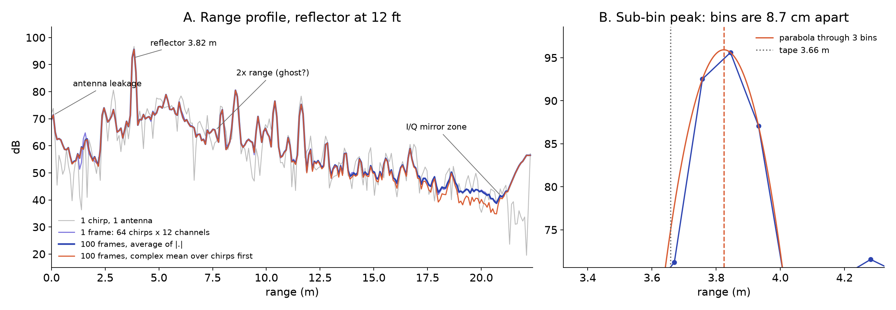
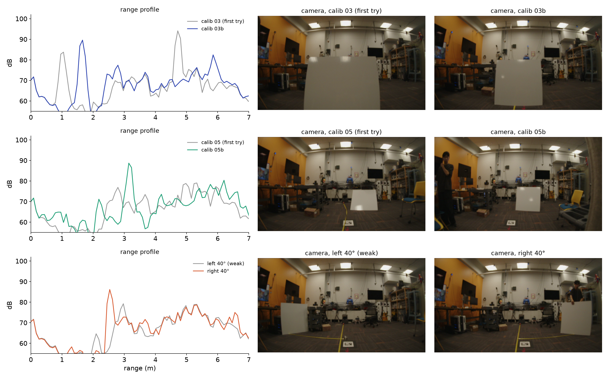

# Experiments

A running account of what has been tried, what came out, and what is still open. Each section is one experiment; the folder it links to holds the full method, every number, the figures with the command that made them, and the open items. This file is written in the voice of the final report so that the report can be assembled from it rather than rewritten.

Status words used below: **done** (numbers final), **preliminary** (runs, numbers will change), **planned** (method fixed, no data yet), **candidate** (an extension that may not be run).

---

## 1. The rig, and whether it records

*[rig-health](experiments/rig-health/README.md) · done (10/21, 10/29)*

Everything here is captured with the WiSE Lab red-rover handheld rig: a TI AWR1843Boost radar with a DCA1000 raw-ADC capture card, an Ouster OS-0 LiDAR, a 1080p camera and an IMU, all recorded by a NUC into the roverd format (plain binary streams plus JSON metadata, one folder per trace). The chirp is the lab's `radarhd-o` configuration: 256 complex samples at 5 Msps over a 1.716 GHz sweep, 64 chirp loops of 3 TX per frame, 20 frames per second, which gives 8.74 cm range bins to 22.4 m and 5.6 cm/s velocity bins to ±1.79 m/s.

*How the rig is driven: the four sensors feed the NUC; the Mac starts and stops recordings over Wi-Fi and pulls the data.*

On rig day 1 (10/19) the LiDAR files came back empty. The cause was not the beam count in the config, as first suspected: packets were arriving (1,280 UDP/s), and the recorder code run on its own captured 41 scans in 5 s. The LiDAR simply needs 20 to 30 s to reconfigure after the recorder web page starts, and START had been pressed too early. With that wait, every trace from 15:04 on 10/21 has all four streams. On 10/29 the OS-0-64 was swapped for an OS-0-128; a dry run confirmed 128 × 2048 range images at 10 Hz (288 scans in 30 s, max interval 107 ms) while the radar delivered 552 frames with none invalid.

*Frame timing on a 30 s trace. Radar 50.0 ms (p99 55.9), LiDAR 100.0 ms, camera 33.3 ms, IMU 10.0 ms. The radar starts 2.3 s after the camera and the LiDAR 1.3 s after it, so sensors must be aligned by timestamp, never by frame number.*

Three capture sessions exist so far. Rig day 1 (10/19): two traces, an indoor desk and a 25-minute campus walk, no LiDAR. Rig day 2 (10/21): 23 indoor traces in a 12 ft room, range, angle, calibration and a room scene, LiDAR from 15:04; 44 GB together with day 1. Session 2 (10/29): five handheld campus traces with the 128-beam LiDAR, 61 GB, covering a parking lot with a full orbit of a parked Jeep, a crosswalk, the Walking to the Sky sculpture, the Scotty statue and a plaza ([session log](notes/sessions/2026-10-29.md)). A Session 3 off campus, with rain or fog if the weather allows, is still to be scheduled. The 10/29 traces live on nunga under `/data/christineh/DATASET/radarhd/`; the 10/21 traces are being copied there.

---

## 2. The radar chain, from raw ADC to a point cloud

*[rd1-pipeline](experiments/rd1-pipeline/README.md) · done (10/19 data, analysed 10/20) — [m2-range-doppler](experiments/m2-range-doppler/README.md) · preliminary (10/31) — [m3-angle-cfar](experiments/m3-angle-cfar/README.md) · preliminary (10/31)*

The first question was whether the textbook chain works at all on our own captures. It was first run as a reference analysis on the rig day 1 traces, each stage checked against the lab's `xwr.rsp` on the same frame, and then on 10/31 rewritten as the project's own package, `src/radar/`, with `xwr.rsp` demoted to a test oracle in `tests/`. The six stage tests pass with a relative error of 6 to 8 × 10⁻⁸ (float32 round-off) once the same window is used: `xwr` applies a Hann window without its zero end points and scaled to unit mean, which keeps dB levels comparable to the un-windowed signal. The walk-through below is one frame of the 10/29 parking-lot trace (`2026-10-29.15-49-40`, radar frame 14356, camera t = 720 s), chosen because a Jeep stands 5.6 m away on the left and a row of parked cars 15 m ahead.

### 2.1 Raw ADC

The `radar/iq` file is a flat stream of int16, 786,432 bytes per frame, reshaped to [64 chirps, 3 TX, 4 RX, 512]. The last axis is not I, Q, I, Q: the DCA1000 interleaves two LVDS lanes as Q0 Q1 I0 I1, so two slicing assignments turn 512 integers into 256 complex samples. Getting this wrong mirrors the range axis, so near echoes appear at 22.4 m minus their distance, which is the check used. Amplitudes stay near ±400 counts, far from the ±32,768 of int16, so nothing saturates. The FFT of a single chirp already shows the Jeep 30 dB above the floor: finding a target is never the problem with this radar, resolution and angle are.

*Stage 1. (a) The first 32 int16 of one chirp with the Q Q I I pattern shaded. (b) The same chirp unpacked: 256 complex samples over 51.2 µs; the beat frequency is 224 kHz per metre of range. (c) The FFT of that single chirp, TX1 RX1, with the Jeep at 5.6 m.*

### 2.2 Range

A Hann window along the 256 samples and an FFT give the range profile; averaging the magnitude over 64 chirps and 12 TX-RX pairs lowers the floor by about 15 dB without moving any peak. Two bands are present in every frame regardless of the scene and are masked before detection: the first 0.35 m, which is the transmit-to-receive coupling through the board and radome, and everything above 20.5 m, which is the I/Q mirror of the strong near echoes, about 25 dB down. The usable range is therefore 0.35 to 20.5 m.

*Stage 2. (a) The camera at the same instant. (b) Range profile, single chirp in grey and the 64 × 12 average in black; the Jeep at 5.6 m, the car row at 13 to 19 m, leakage and mirror zones shaded. (c) The same on the 10/19 indoor desk with the rig static: only near-field returns, the no-target reference.*

On rig day 2 a flat board was placed with a tape measure at 3, 6, 9 and 12 ft straight ahead. The radar range is linear in the tape distance with slope 0.993 and a constant offset of +0.183 m, and after that fit all four residuals are within ±1.2 cm (section 3). The offset is about two range bins and must be subtracted before the project's "±1 bin" acceptance test is meaningful; that test runs as soon as the 10/21 traces reach nunga.

### 2.3 Doppler

The Doppler FFT runs across the 64 chirp loops at each range bin. One loop is three chirps, 537 µs, so the unambiguous velocity is ±1.79 m/s and a brisk walk toward a wall already wraps. On the static desk trace every echo sits in the zero-velocity column, 30 dB above the bins beyond ±0.3 m/s. While walking the whole scene moves relative to the rig at −v·cos θ, fastest straight ahead, so a top view built from the zero-velocity bin alone would lose everything in front; later stages therefore sum power over all Doppler bins. On the parking-lot frame the static world peaks at +0.28 m/s (a slow moment); on the 10/19 campus walk the same pattern gave a walking speed of about 1.4 m/s.

*Stage 3. (a) Static desk: a single line at v = 0. (b) Walking in the parking lot: the static world spread to about +0.3 m/s. (c) Power summed over range: the velocity distribution of both.*

### 2.4 Virtual array and TDM compensation

Three transmitters firing in turn into four receivers give twelve virtual elements. On the AWR1843Boost TX1 and TX3 are two wavelengths apart, exactly the width of the receiver row, so their eight virtual elements form one half-wavelength azimuth row with no gap; TX2 sits half a wavelength higher and one wavelength across, placing its four elements above positions 2 to 5 for elevation. Because the transmitters fire 179 µs apart, a moving target adds a Doppler-dependent phase to every element of a later transmitter. This was the first thing the real data taught that textbooks skip: on the 10/19 walk the phase jumped −1.59 rad between the TX1 and TX3 halves of the row, and +0.04 rad after a per-Doppler-bin rotation, exp(−2πj · k/64 · i/3) for bin k and TX slot i, applied before the elements are concatenated. `xwr.rsp` does not apply it by default.

*Stage 4. (a) The 3 TX × 4 RX layout and the 2 × 8 virtual array it produces. (b) Phase across the azimuth row at the strongest cell (5.6 m, +0.28 m/s) before and after compensation; the slope is the azimuth, the kink at element 3 → 4 is the TDM error. (c) Azimuth spectrum of that cell: after compensation one clean main lobe at about +20°, the Jeep on the left.*

### 2.5 Angle

An FFT across the eight elements (zero-padded to 64 bins) turns the phase slope into sin θ; the main lobe is still 2/N radians, about 14°, so a point target at 5.6 m is smeared into an arc 1.4 m wide. The sign convention is positive azimuth to the left, settled on 10/21 with the angle shots after an earlier wrong guess from a wall; it puts the Jeep on the correct side. The range-azimuth power map, summed over Doppler, is the picture every later stage works from, and placed beside the LiDAR scan of the same instant it shows the whole reason for this project: the LiDAR draws the Jeep as a thin line, the radar as a wide arc.

*Stage 5. (a) Range-azimuth top view with the Jeep's arc at x ≈ −3 m, y ≈ 5 m. (b) The 128-beam LiDAR scan 80 ms later, in its own frame: the rotation to the radar is not calibrated yet, so the two are not overlaid. (c) The camera.*

### 2.6 Detection

Cell-averaging CFAR is a locally adaptive threshold: for each cell the noise is the mean of 8 training cells on either side, separated by 2 guard cells, and the multiplier follows from the designed false-alarm rate under the exponential noise model verified in section 5 (N = 16, Pfa = 10⁻³, α ≈ 9.4 dB). Along range alone this keeps every cell of a target's angular main lobe, so detections trace arcs: 227 per frame on average over 20 frames of the parking lot. Requiring each detection to also be a local maximum in azimuth leaves one per lobe, 12 per frame, which is the rule the rig day 1 analysis had already found necessary.

*Stage 6. (a) One azimuth's range profile with its CA-CFAR threshold and the cells above it. (b) Range-only detections as orange crosses, tracing arcs; after the azimuth-peak rule, blue circles. (c) Points per frame, 227 → 12 (20-frame mean).*

### 2.7 Points

Each detection carries range, azimuth, the radial velocity of its strongest Doppler bin, an elevation from the phase difference between the raised TX2 row and the azimuth row, and an SNR defined as power over the CFAR noise estimate; the spherical-to-Cartesian step puts x right, y forward, z up. One second of the parking lot, 20 frames overlaid without ego-motion correction, gives 259 points: the Jeep at (−4, 5) m and the car row at 14 to 15 m carry the highest SNR, 26 to 31 dB. The side view is the honest part of the result: on a flat lot the z of these points spreads over ±3 m, so the four-element elevation row is not trustworthy and the 3D output should be read as range plus azimuth until the elevation check (section 9) says otherwise. This is the current state of the deliverable for M3; the reference run and the `src/radar` run agree.

*Stage 7. (a) 3D points of one second coloured by frame. (b) Top view coloured by SNR. (c) Side view: elevation from the raised row, not yet usable.*

*The same second produced by `python -m src.radar data/raw/2026-10-29.15-49-40 --time 720 --accumulate 20` on 10/31: range-azimuth map with the last frame's detections circled, top view by SNR, 3D scatter.*

Still open for this part: the ±1 bin and ±7° acceptance numbers from the 10/21 reflector shots; a decision on angular super-resolution by 11/2 once those numbers exist; a radar-to-LiDAR rotation, even a rough one, so the LiDAR-matched columns of the M3 table can be filled; and an ego-velocity estimate per frame so that static points can be required to satisfy v = −v·cos θ, which would reject multipath ghosts, sidelobes and pedestrians in one step.

---

## 3. How accurate are range and azimuth with a fixed target

*[m1-range-angle](experiments/m1-range-angle/README.md) · done (10/21)*

Rig day 2 placed a target with a tape measure in a 12 ft room: four ranges straight ahead and five azimuths at 8 ft. The range result is the clean one: radar = 0.993 × tape + 0.183 m with residuals of +1.1, −1.2, −1.0 and +1.0 cm at 3, 6, 9 and 12 ft, using the strongest bin near the tape distance refined with a three-point parabola.

*One peak per range shot, and the linear fit against the tape.*

*How the peak sharpens: single chirp, frame average, coherent average, sub-bin interpolation.*

Azimuth is right in sign and nearly right at the edge but biased in the middle: with the 0° shot's reading of 4.5° to the right taken as a fixed bias, the 40° right placement reads −41.1° (error −1.1°), but 20° right reads −26.3° (−6.3°) and 20° left reads +29.2° (+9.2°). The 40° left shot is unusable, its echo 17 dB weaker than the others. Per-element phase errors were measured at about 3° RMS and correcting them changes the angles by less than 0.2°, so the array is not the cause. The likely cause is the target itself.

*Angle spectra at the target range for the five placements, and radar azimuth against the placed angle.*

The lesson of the day was that the target was a roughly 60 cm flat board, not a corner reflector. A flat board is a mirror at 4 mm wavelength: it returns energy only when it faces the radar, and a small tilt moves the apparent centre of the return across its width, which at 8 ft is a few degrees. The failed calibration placements (03 and 05, tilted or turned) and the dead 40° left shot all fit this. The ±20° placements should be repeated with a corner reflector and a phone photo behind the rig for every placement.

*A flat board must face the radar; a corner reflector returns the wave along its incoming direction regardless of tilt.*

*Tilted or turned board (calib 03, 05, left 40°) against the retakes.*

---

## 4. Multipath: the radar's late bounce

*[x4-multipath](experiments/x4-multipath/README.md) · side result (10/21); side-wall test pending*

In the range shots of section 3 a second peak sits at exactly twice the target distance: 2.18 m for the 3 ft target at 1.10 m, 3.93 m for 1.99 m, 5.94 m for 2.90 m, 7.86 m for 3.82 m, at −12.5 dB for the nearest and −22 to −24 dB for the rest. This is the radar → target → rig → target → radar path, the counterpart of the late bounce in transient imaging. The planned test puts the rig parallel to a wall 1.5 m away with a corner reflector at (0.5, 5) m, where a mirror-image ghost is predicted at 5.59 m and +26.6°, and then moves the rig to 3 m from the wall, where the ghost should jump to 6.40 m and +38.7°; a geometric filter (a ghost lies behind a reflecting surface at the sum of the path lengths) is the pass criterion: more than 90 % of ghosts removed, more than 95 % of real points kept. A flat concrete wall or metal door with 6 m of clear floor beside it is still to be found. The Scotty statue segment of 10/29 showed such a ghost arc at 8 to 9 m behind a flat wall during recording and is the first outdoor candidate.

*Range profiles rescaled by the target distance: the second-bounce echo lines up at 2×.*

---

## 5. What radar noise looks like

*[x10-noise](experiments/x10-noise/README.md) · preliminary (10/21); sky capture pending*

This is the radar counterpart of the camera noise calibration in the course. A camera measures photon counts, so its dominant noise is Poisson and grows with brightness; a radar measures a complex field, so its dominant noise is additive receiver thermal noise, independent of the signal, and should be complex Gaussian with exponentially distributed power. Range bins 14 to 19 m of the static room scene, which contain no target, were used: the static echo (the mean over 64 chirps) was subtracted and the remaining power compared with an exponential. The 99th percentile of power over mean came out at 4.60 against 4.61 for the exponential, with the static-to-noise ratio in that bin at 6.0 (a Rician K factor). This matters for section 2.6: the CA-CFAR threshold formula assumes exactly this distribution, and it holds only after the static part is removed. Still to do: a 60 s open-sky capture (the radar's dark frame), the noise floor against range, measured against designed false-alarm rate, and a conversion from ADC counts to watts for comparison with kTB·NF.

*Raw samples are pushed off the origin by a static echo; after removing it, a circular noise cloud.*

*Power histogram and Q-Q plot: exponential after removing the static part.*

---

## 6. Where the radar is relative to the camera

*[m4-extrinsics](experiments/m4-extrinsics/README.md) · preview (10/21); calibration pending*

Eight calibration placements of the board, spread over 0.5 to 4 m in range, ±25° in azimuth and −21° to +9° in elevation, were recorded on 10/21. Projecting each radar detection into the fisheye image with the red-rover intrinsics and no extrinsics at all (radar and camera assumed co-located and aligned) already lands all eight on or at the edge of the board, so the true offset is small. The remaining work is to mark the board centre in each image, solve the six-degree-of-freedom transform with PnP and RANSAC, and report the reprojection error, with special attention to placement 06 at 0.48 m where a few centimetres of translation matter most. A corner reflector with a visible apex would make the image side of this much less ambiguous next time. The same placements, with the LiDAR data that exists for them, will give the radar-to-LiDAR transform that sections 2 and 8 are waiting for.

*The eight calibration placements with radar detections projected under the co-located guess.*

---

## 7. Dense depth from sparse radar and a camera

*[m6-dense-depth](experiments/m6-dense-depth/README.md) · planned (due 11/30); preview from rig day 1*

This is the project's main deliverable and cannot start until section 6 is done. Radar points are projected into the fisheye image and filled into a dense depth map by joint bilateral upsampling (as normalized convolution) and by an edge-aware weighted least-squares solver reused from HW3; a monocular depth network with scale aligned to the radar is the baseline, and the 128-beam LiDAR projected into the camera is the ground truth. The evaluation is mean absolute error by distance bin, by day and by night. A preview from rig day 1, with no LiDAR and a co-located guess for the extrinsics, produced a camera-coloured dense cloud whose shape was almost entirely the camera's and the ground prior's, because a single frame gives only 5 to 10 radar points; multi-frame accumulation (section 9) is what will make the radar's contribution visible.

*Radar points (orange) and a camera-coloured dense depth cloud, street scene at 800 s of the 10/19 walk, in the web viewer.*

---

## 8. Walking around objects: size, material and what the radar keeps

*[obj-orbit-360](experiments/obj-orbit-360/README.md) · data partly recorded (10/29); analysis pending*

Session 2 recorded full or partial orbits of three objects: a parked Jeep (metal, about 4.5 m; `15-49-40`, minutes 11 to 17), the Walking to the Sky sculpture (a thin metal pole; `16-12-38`, 5:30 to 9:40, with the rig often tilted up) and the Scotty statue (small metal; `16-22-36`, 2:59 to 3:45, less than a full loop). A tree, a stretch of the GHC wall and a spin in place are still to be recorded. The expectation is that the car is bright from every side, the small object is smeared by the 14° beam, the tree is weak and the wall lights up only when faced squarely. To accumulate the radar points of an orbit into an object frame, two things are needed that do not exist yet: a pose for every radar frame (LiDAR SLAM on the 128-beam scans, with the IMU as a check) and the radar-to-LiDAR transform from section 6. This reconstruction is Yining's part of the project; what the main pipeline owes it is a per-frame export of points with timestamps, SNR and velocity, the dense range-azimuth map as an alternative to sparse points, and a clear note that z is not usable.

---

## 9. Candidate extensions

These are written up with a method and a pass criterion so that one or two can be picked after M3; none is in the plan to achieve.

**Radar through smoke** ([x3-smoke](experiments/x3-smoke/README.md)). At 77 GHz the wavelength is 3.9 mm and smoke particles are about 1 µm, so Rayleigh scattering is negligible and the radar should see through what blinds the camera and the LiDAR. The experiment is the same scene and reflector with and without smoke, three modalities side by side, with the radar's near-field coupling gated rather than "filtered": the story is that the radar never saw the smoke, not that it removed it. It needs a fog machine, a particle logger and a venue that allows smoke, which is the hard part.

**Multi-frame accumulation** ([x5-accumulation](experiments/x5-accumulation/README.md)). Stacking N frames of a static scene should multiply point density by about N without changing the error against LiDAR; with poses it extends to the orbits of section 8. The cheapest extension with the most visible effect.

**Colouring points by Doppler** ([x6-doppler-colour](experiments/x6-doppler-colour/README.md)). The pipeline already has velocity per point; pedestrians in the 10/29 traces walk toward and away from the rig at well over the 0.3 m/s needed to separate them from the background.

**A confidence map for dense depth** ([x7-confidence](experiments/x7-confidence/README.md)). Per-pixel confidence from distance to the nearest radar point, image gradient and CFAR SNR, used as the data weight in the least-squares fill; pass if the top 20 % most confident pixels have at least 30 % lower error than the whole image.

**Radome contamination** ([x8-radome](experiments/x8-radome/README.md)). Water or mud on the radome, and how many dB the same reflector loses; an hour on a rig day.

**Is the elevation trustworthy** ([x9-elevation](experiments/x9-elevation/README.md)). A target at 5 m at three heights against LiDAR. Section 2.7 already suggests the answer is no for single frames; this experiment decides whether z is kept, averaged, or dropped.

---

## B-roll for the final video

- [ ] Rig close-up: radar, LiDAR, camera, how it is carried
- [ ] Start-up: recorder web page, LiDAR spinning
- [ ] Target placement with a tape measure (rig day 2 style)
- [ ] Walking orbits filmed by a second person
- [ ] Screen recordings: range peak moving, 3D viewer orbit, dense depth vs LiDAR side by side
- [ ] Night or bad-weather shot where the camera fails and the radar does not

New experiment: copy [`experiments/_TEMPLATE.md`](experiments/_TEMPLATE.md) into `experiments/<id>/README.md` and add a section above.
