# Experiments

What was tried, what came out, what is open. One section per experiment; the linked folder has the full method, every number and the command behind each figure. Written in report voice so the report is assembled from here, not rewritten.

Status: **done** (numbers final) · **preliminary** (runs, numbers will move) · **planned** (method fixed, no data) · **candidate** (may not run).

---

## 1. The rig, and whether it records

*[rig-health](experiments/rig-health/README.md) · done (10/21, 10/29)*

All data comes from the WiSE Lab red-rover handheld rig: TI AWR1843Boost radar with a DCA1000 raw-ADC board, Ouster OS-0 LiDAR, 1080p camera, IMU, recorded by a NUC in the roverd format. The chirp (`radarhd-o`) is 256 complex samples at 5 Msps over 1.716 GHz, 64 loops × 3 TX per frame, 20 fps: 8.74 cm range bins to 22.4 m, 5.6 cm/s velocity bins to ±1.79 m/s.

*Sensors feed the NUC; the Mac starts and stops recordings over Wi-Fi and pulls the data.*

On rig day 1 the LiDAR files were empty. Not the beam count: packets arrived (1,280 UDP/s) and the recorder alone captured 41 scans in 5 s. The LiDAR needs 20 to 30 s to reconfigure after the recorder page starts, and START had been pressed too early. Every trace from 15:04 on 10/21 has all four streams. On 10/29 the OS-0-64 was swapped for an OS-0-128: 128 × 2048 range images at 10 Hz, radar 552 frames with none invalid in the dry run.

*Radar 50.0 ms (p99 55.9), LiDAR 100.0 ms, camera 33.3 ms, IMU 10.0 ms. Radar starts 2.3 s after the camera, LiDAR 1.3 s: align by timestamp, never by frame number.*

Sessions so far: rig day 1 (10/19, two traces, no LiDAR); rig day 2 (10/21, 23 indoor traces in a 12 ft room: range, angle, calibration, room scene; 44 GB with day 1); Session 2 (10/29, five handheld campus traces with the 128-beam LiDAR, 61 GB: a parking lot with a full orbit of a Jeep, a crosswalk, two sculptures, a plaza; [log](notes/sessions/2026-10-29.md)). Session 3, off campus, is unscheduled. Data lives on nunga under `/data/christineh/DATASET/radarhd/`.

---

## 2. The radar chain, from raw ADC to a point cloud

*[rd1-pipeline](experiments/rd1-pipeline/README.md) · done — [m2-range-doppler](experiments/m2-range-doppler/README.md) · preliminary (10/31) — [m3-angle-cfar](experiments/m3-angle-cfar/README.md) · preliminary (10/31)*

The chain was first run as a reference analysis on rig day 1 data, then on 10/31 written as the project's own package `src/radar/`, with the lab's `xwr.rsp` kept only as a test oracle. The six stage tests agree to 6–8 × 10⁻⁸ once the same window is used (Hann without its zero end points, scaled to unit mean). The walk-through below is one frame of the 10/29 parking lot (`2026-10-29.15-49-40`, frame 14356, camera t = 720 s): a Jeep 5.6 m away on the left, a row of cars 15 m ahead.

### 2.1 Raw ADC

`radar/iq` is a flat int16 stream, 786,432 bytes per frame, reshaped to [64 chirps, 3 TX, 4 RX, 512]. The last axis is interleaved Q0 Q1 I0 I1 by the DCA1000; two slicing assignments give 256 complex samples. The wrong order mirrors the range axis, which is the check. Amplitudes stay near ±400 counts, so nothing saturates. A single chirp's FFT already shows the Jeep 30 dB above the floor: finding targets is never the problem, resolution and angle are.

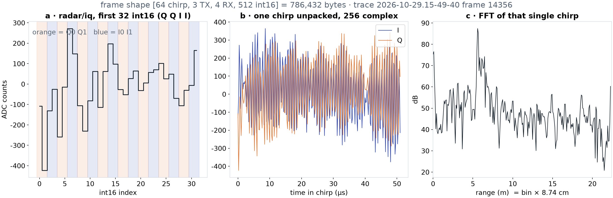

*Stage 1. (a) First 32 int16 of a chirp, Q Q I I shaded. (b) The chirp unpacked, 256 samples over 51.2 µs; the beat frequency is 224 kHz per metre. (c) FFT of that one chirp.*

### 2.2 Range

Hann window, FFT along the 256 samples. Averaging magnitude over 64 chirps and 12 channels lowers the floor about 15 dB without moving peaks. Two bands exist in every frame and are masked before detection: below 0.35 m (TX-to-RX leakage) and above 20.5 m (the I/Q mirror of near echoes, about 25 dB down).

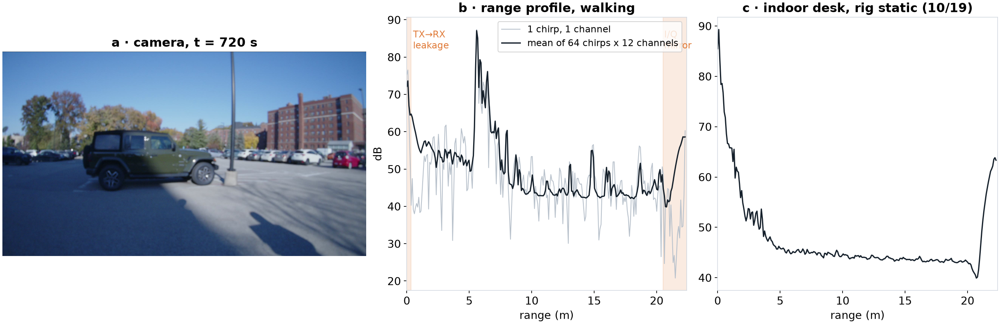

*Stage 2. (a) Camera. (b) Range profile, one chirp in grey, the 64 × 12 mean in black: Jeep at 5.6 m, car row at 13–19 m, masked zones shaded. (c) The static indoor desk of 10/19: near-field only.*

With a tape-measured board at 3, 6, 9 and 12 ft (section 3), radar range = 0.993 × tape + 0.183 m, residuals within ±1.2 cm. The offset is about two bins and must be subtracted before the "±1 bin" acceptance test; that test runs as soon as the 10/21 traces are on nunga.

### 2.3 Doppler

FFT across the 64 loops at each range bin. One loop is 537 µs, so the unambiguous velocity is ±1.79 m/s; a brisk walk toward a wall wraps. Static desk: everything in the zero-velocity column, 30 dB above bins beyond ±0.3 m/s. Walking: the scene moves at −v·cos θ, so later stages sum power over all Doppler bins rather than take v = 0. The parking-lot frame peaks at +0.28 m/s; the 10/19 walk gave about 1.4 m/s.

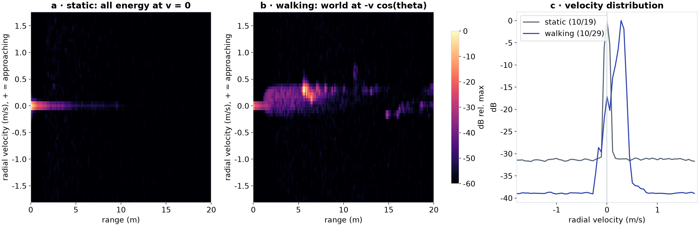

*Stage 3. (a) Static: one line at v = 0. (b) Walking: the world spread to about +0.3 m/s. (c) Velocity distribution of both.*

### 2.4 Virtual array and TDM compensation

Three TX into four RX give twelve virtual elements. TX1 and TX3 are two wavelengths apart, the width of the RX row, so their eight elements form one half-wavelength azimuth row; TX2 sits λ/2 higher over positions 2–5 for elevation. The transmitters fire 179 µs apart, so a moving target adds a Doppler-dependent phase to every element of a later TX. On the 10/19 walk the phase jumped −1.59 rad between the TX1 and TX3 halves; a per-Doppler-bin rotation exp(−2πj · k/64 · i/3) brings it to +0.04 rad. `xwr.rsp` does not apply it by default.

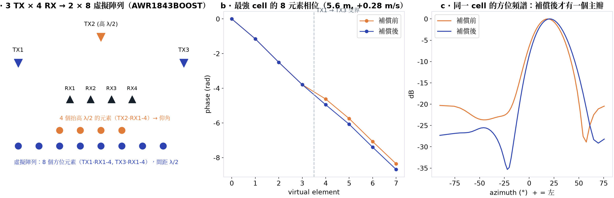

*Stage 4. (a) 3 TX × 4 RX → 2 × 8. (b) Phase across the azimuth row at the strongest cell: the slope is azimuth, the kink at element 3 → 4 is the TDM error. (c) Azimuth spectrum of that cell: one clean lobe at +20° after compensation, the Jeep on the left.*

### 2.5 Angle

An FFT across the eight elements (zero-padded to 64 bins) gives sin θ; the main lobe is 2/N rad, about 14°, so a point at 5.6 m smears into a 1.4 m arc. Positive azimuth is left, settled with the 10/21 angle shots. Beside the LiDAR scan of the same instant, this is the whole reason for the project: the LiDAR draws the Jeep as a line, the radar as an arc.

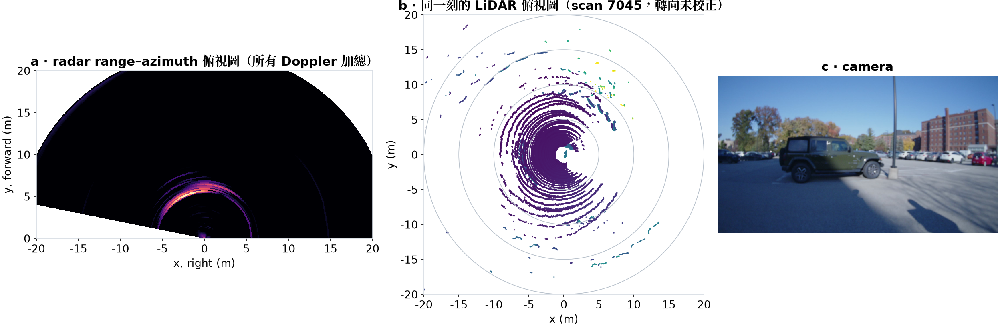

*Stage 5. (a) Range-azimuth top view, Jeep arc at x ≈ −3 m, y ≈ 5 m. (b) LiDAR scan 80 ms later in its own frame; the rotation to the radar is uncalibrated, so not overlaid. (c) Camera.*

### 2.6 Detection

Cell-averaging CFAR: noise is the mean of 8 training cells either side with 2 guard cells, and the multiplier follows from the false-alarm rate under the exponential noise model of section 5 (N = 16, Pfa = 10⁻³, α ≈ 9.4 dB). Along range alone it keeps every cell of a target's lobe, 227 detections per frame. Requiring a local maximum in azimuth leaves 12.

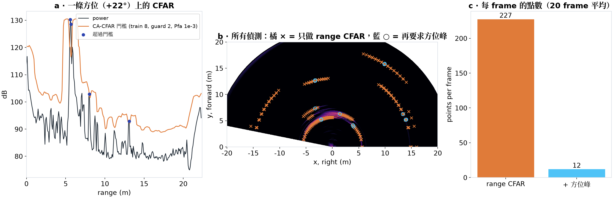

*Stage 6. (a) One azimuth's profile with its threshold. (b) Range-only detections (orange, arcs) and after the azimuth-peak rule (blue). (c) 227 → 12 per frame.*

### 2.7 Points

Each detection carries range, azimuth, the velocity of its strongest Doppler bin, elevation from the phase between the TX2 row and the azimuth row, and SNR over the CFAR noise; x right, y forward, z up. One second of the parking lot (20 frames, no ego-motion correction) gives 259 points, the Jeep at (−4, 5) m and the car row at 14–15 m with the highest SNR, 26–31 dB. The side view is the honest part: z spreads over ±3 m on a flat lot, so the four-element elevation is not usable yet and the output should be read as range plus azimuth.

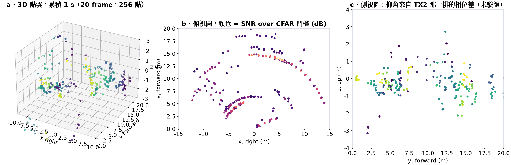

*Stage 7. (a) 3D points of one second by frame. (b) Top view by SNR. (c) Side view: elevation not yet usable.*

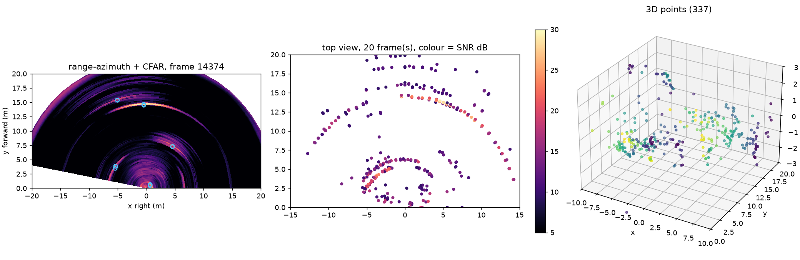

*The same second from `python -m src.radar data/raw/2026-10-29.15-49-40 --time 720 --accumulate 20`.*

Open: the ±1 bin and ±7° numbers from the 10/21 shots; the super-resolution decision by 11/2; a radar-to-LiDAR rotation so LiDAR-matched columns can be filled; a per-frame ego-velocity so static points must satisfy v = −v·cos θ, which rejects ghosts, sidelobes and pedestrians at once.

---

## 3. Range and azimuth accuracy with a fixed target

*[m1-range-angle](experiments/m1-range-angle/README.md) · done (10/21)*

Range is the clean result: radar = 0.993 × tape + 0.183 m, residuals +1.1, −1.2, −1.0, +1.0 cm at 3, 6, 9, 12 ft, using the strongest bin near the tape distance refined with a three-point parabola.

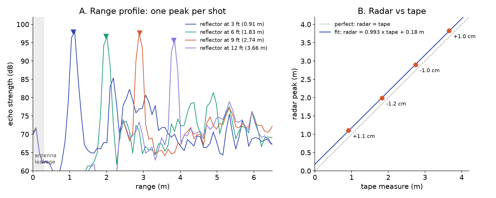

*One peak per range shot, and the fit against the tape.*

Azimuth is right in sign and nearly right at the edge but biased in the middle: with the 0° shot's 4.5° right taken as bias, 40° right reads −41.1° (−1.1°), 20° right −26.3° (−6.3°), 20° left +29.2° (+9.2°). The 40° left shot is unusable, 17 dB weaker. Per-element phase errors are about 3° RMS and correcting them moves angles by under 0.2°, so the array is not the cause.

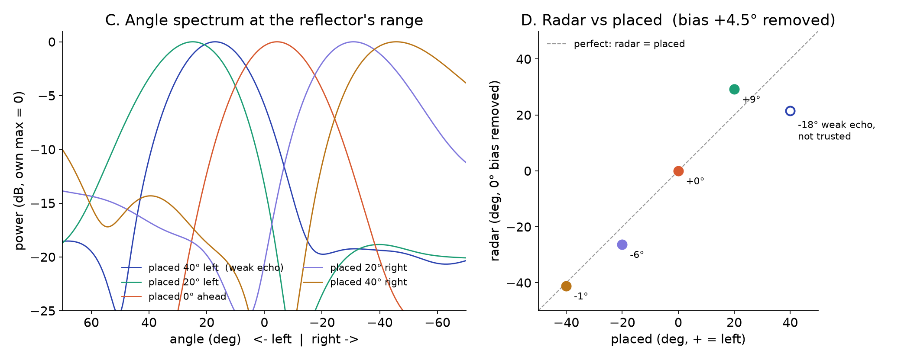

*Angle spectra at the target range for the five placements, and radar vs placed angle.*

The target was a ~60 cm flat board, not a corner reflector. At 4 mm wavelength a board is a mirror: it returns energy only when facing the radar, and a small tilt shifts the apparent centre by a few degrees at 8 ft. The failed calibration placements (03, 05) and the dead 40° left shot all fit. Repeat ±20° with a corner reflector and a photo behind the rig per placement.

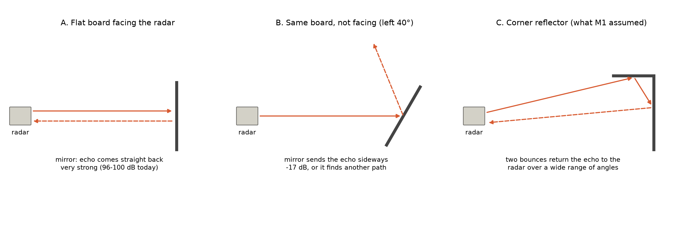

*A flat board must face the radar; a corner reflector returns the wave regardless of tilt.*

---

## 4. Multipath

*[x4-multipath](experiments/x4-multipath/README.md) · side result (10/21); wall test pending*

The range shots show a second peak at exactly twice the target distance (2.18, 3.93, 5.94, 7.86 m for targets at 1.10, 1.99, 2.90, 3.82 m), at −12.5 dB for the nearest and −22 to −24 dB for the rest: radar → target → rig → target → radar, the counterpart of a late bounce in transient imaging. The planned test puts the rig 1.5 m from a wall with a corner reflector at (0.5, 5) m, predicting a mirror ghost at 5.59 m, +26.6°, jumping to 6.40 m, +38.7° at 3 m from the wall; pass is > 90 % of ghosts removed and > 95 % of real points kept by a geometric filter. The Scotty segment of 10/29 showed such a ghost arc at 8–9 m behind a wall and is the first outdoor candidate.

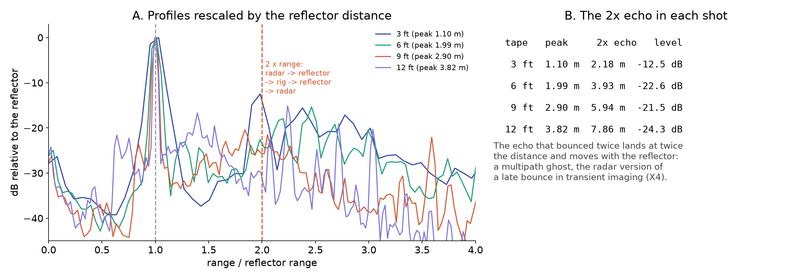

*Range profiles rescaled by target distance: the second-bounce echo lines up at 2×.*

---

## 5. Radar noise

*[x10-noise](experiments/x10-noise/README.md) · preliminary (10/21); sky capture pending*

The radar counterpart of the camera noise calibration. A camera counts photons, so its noise is Poisson and grows with brightness; a radar measures a complex field, so its noise is additive thermal, complex Gaussian, with exponential power. In target-free bins (14–19 m of the static room) with the static echo (the 64-chirp mean) removed, the 99th percentile of power over mean is 4.60 against 4.61 for an exponential. This is what the CFAR threshold formula in 2.6 assumes, and it holds only after the static part is removed. Still to do: a 60 s open-sky capture (the radar's dark frame), noise floor vs range, measured vs designed Pfa, counts to watts against kTB·NF.

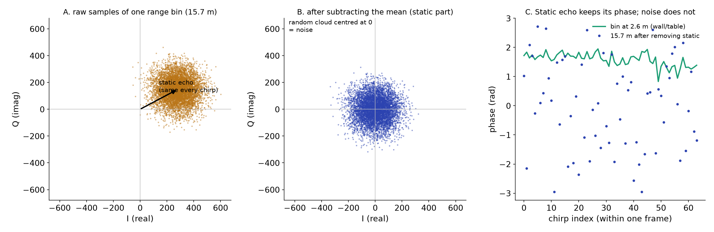

*Samples pushed off the origin by a static echo; after removing it, a circular noise cloud.*

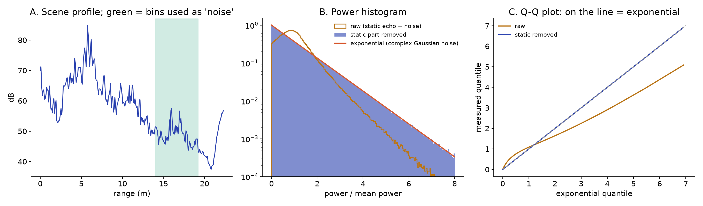

*Exponential after removing the static part.*

---

## 6. Extrinsics: radar to LiDAR, radar to camera

*[m4-extrinsics](experiments/m4-extrinsics/README.md) · radar→LiDAR solved in 2D, radar→camera by PnP (11/1, both preliminary)*

Eight board placements over 0.5–4 m, ±25° azimuth. The radar sees the board as its strongest CFAR return (range minus the 0.183 m offset); in the LiDAR scan the board is the largest upright cluster near where a prior (LiDAR −x forward) predicts it, re-picked within 0.5 m after a first solve, because a global search in a 12 ft room kept picking furniture at the same range. A 2D rigid fit by Kabsch over seven placements (calib_06 at 0.25 m sits inside the radar leakage zone) gives yaw +101.9° and t = (−0.11, +0.16) m with a mean residual of 8.5 cm, max 16 cm; the residual is the radar's azimuth error on a flat board, not range. Pitch, roll and tz are not estimated, since radar elevation is unusable. On data not used in the fit the transform holds: 11 cm median distance to the nearest LiDAR return in the 10/21 room scene, 22 cm on the Scotty segment of 10/29 after the LiDAR swap, so the OS-0-128 sits where the OS-0-64 did to within a few centimetres.

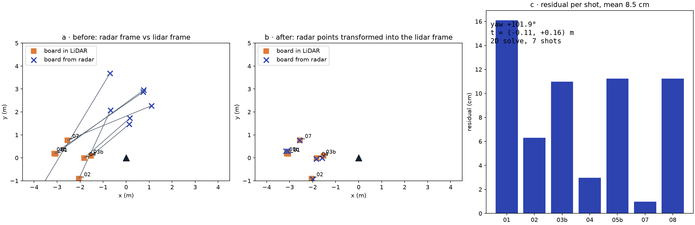

*Board positions from radar and LiDAR before and after the transform, and the residual per shot.*

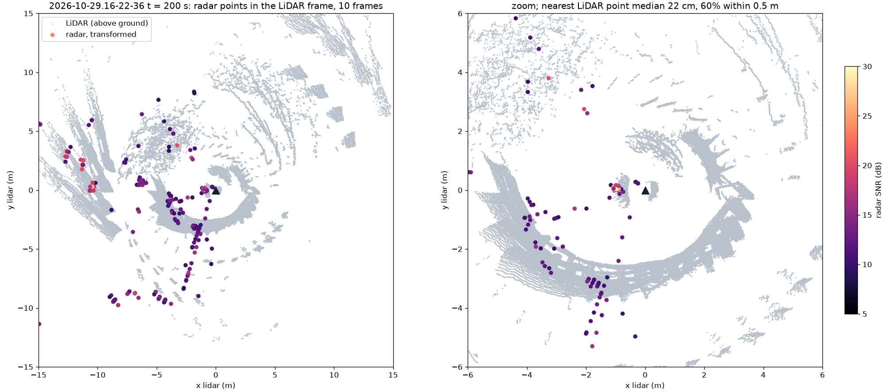

*Radar points transformed into the LiDAR frame on the Scotty segment: they follow the curved wall.*

Radar to camera uses the same seven placements: the board centre in each camera frame (a grey, smooth, square blob; five of them grown from a hand seed), the radar's x, y with the LiDAR board height as the 3D point, the red-rover OPENCV_FISHEYE intrinsics, and `cv2.solvePnP` from the co-located guess. The reprojection error falls from 143 px to 35 px, which at 3 m is 2°, the radar's own bearing error on a flat board; the rotation (−7°, −3°, +8° Rodrigues in camera axes) is usable, the translation (+0.06, −0.48, +0.64 m) is weakly constrained by seven noisy bearings and should not be read as the physical offset. A LiDAR-to-camera PnP on the same pixels reaches 29 px, so the blob centroids of a flat board are the next limit, and composing radar→LiDAR→camera agrees with the direct solve to 2.2° in rotation. A corner reflector, one physical apex for all three sensors, would fix both.

The principled version was then run: one least-squares problem in the LiDAR frame, ten unknowns (radar yaw and translation, camera pose), 28 residuals weighted by each sensor's noise (range 2 cm, azimuth 2°, pixel 20 px), started from the pairwise answers. The range residual halves to 3.7 cm because the radar's height below the LiDAR becomes observable through range once it is a free parameter (−0.50 ± 0.21 m); azimuth and pixel residuals do not move, since they are what the flat board allows; and radar→camera is composed from the two LiDAR-referenced poses, so the loop closes by construction. The Jacobian gives the honest summary of seven flat-board shots: yaw to ±2°, in-plane offsets to a few centimetres, heights to ±20 cm. The IMU is absent because it sees no target; it enters by hand-eye on the orbit segments.

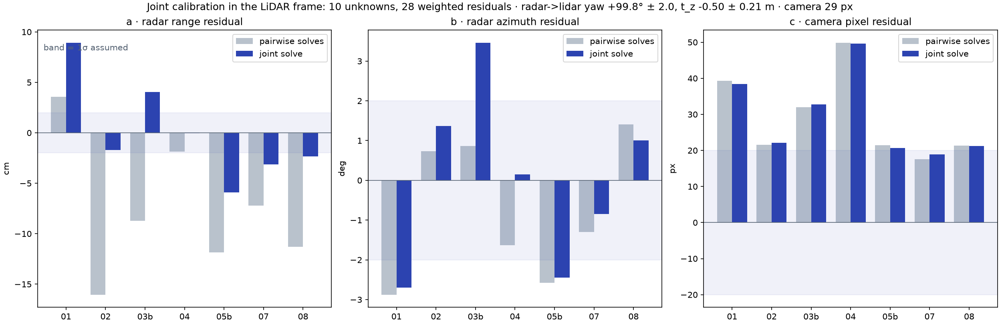

*Residuals per shot, pairwise start (grey) vs joint solve (blue), with the assumed 1σ band.*

The four calibrations on the same second of the parking-lot frame make the comparison visible: no calibration puts every point on one line; the three real ones agree horizontally to within a degree and differ vertically where the translation is weakly constrained. The method-by-method table with the held-out checks is in the M4 report under "Summary for the report".

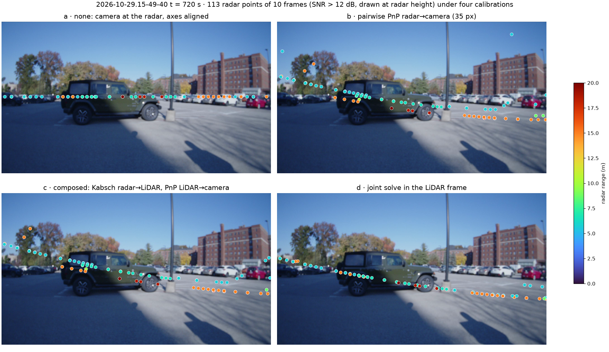

*The same radar points under (a) no calibration, (b) pairwise PnP, (c) composed Kabsch + PnP, (d) the joint solve.*

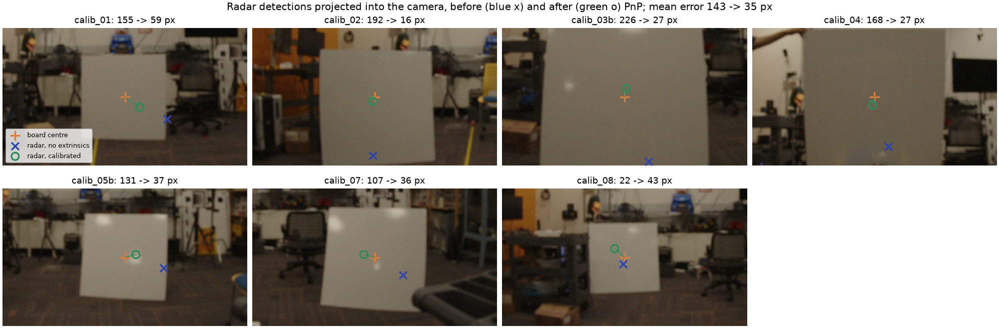

*Radar detections projected into the camera before (blue x) and after (green o) PnP, crops around the board.*

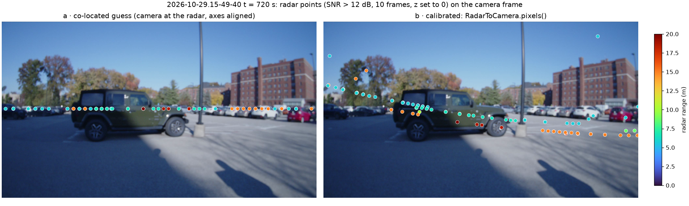

*What the transform is for: radar points of one second on the parking-lot frame, co-located guess (left) and calibrated (right); points are drawn at radar height because elevation is unusable.*

---

## 7. Dense depth

*[m6-dense-depth](experiments/m6-dense-depth/README.md) · planned (due 11/30)*

The main deliverable; needs section 6 first. Radar points projected into the image are filled by joint bilateral upsampling (normalized convolution) and an edge-aware weighted least-squares solver from HW3; a scale-aligned monocular depth network is the baseline; the 128-beam LiDAR projected into the camera is ground truth; the metric is MAE by distance bin, day and night. The rig day 1 preview, with no LiDAR and a co-located guess, produced a dense cloud whose shape was mostly the camera's and the ground prior's, because a frame gives only 5–10 radar points; accumulation (section 9) is what will make the radar's share visible.

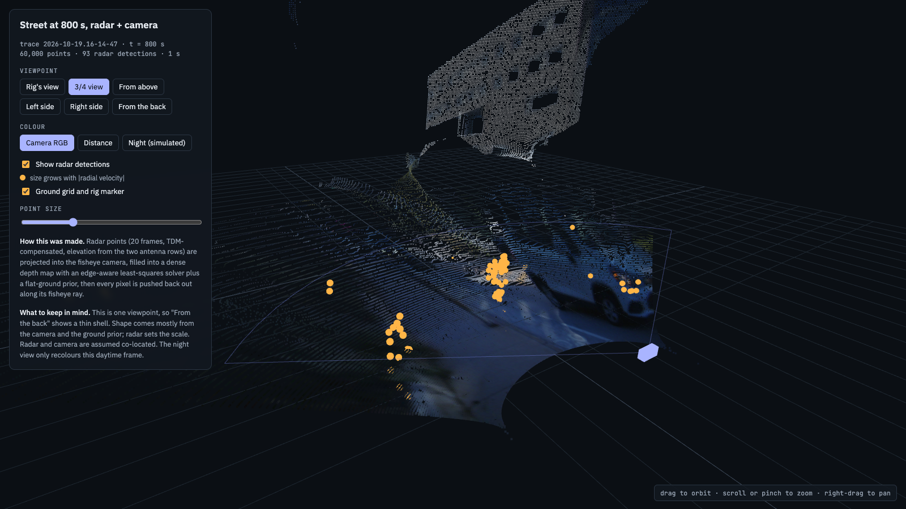

*Radar points (orange) and a camera-coloured dense cloud, 10/19 walk at 800 s.*

---

## 8. Orbits around objects

*[obj-orbit-360](experiments/obj-orbit-360/README.md) · data partly recorded (10/29); analysis pending*

Session 2 orbited a Jeep (`15-49-40`, min 11–17), the Walking to the Sky sculpture (`16-12-38`, 5:30–9:40, rig often tilted up) and the Scotty statue (`16-22-36`, 2:59–3:45, partial). A tree, a GHC wall and a spin in place are still to record. Expected: the car bright from every side, the small object smeared by the 14° beam, the tree weak, the wall lit only when faced squarely. Accumulating an orbit needs a pose per radar frame (LiDAR SLAM on the 128-beam scans) and the radar-to-LiDAR transform of section 6. The reconstruction is Yining's part; the main pipeline owes it a per-frame export with timestamps, SNR and velocity, the dense range-azimuth map as an alternative to sparse points, and the note that z is not usable.

---

## 9. Candidate extensions

Each has a method and a pass criterion; one or two are picked after M3.

- **Smoke** ([x3](experiments/x3-smoke/README.md)): at 3.9 mm wavelength 1 µm particles do not scatter; same scene with and without smoke, three modalities side by side. Needs a fog machine and a venue.
- **Multi-frame accumulation** ([x5](experiments/x5-accumulation/README.md)): N frames should give about N× density at unchanged error. Cheapest, most visible.
- **Doppler colour** ([x6](experiments/x6-doppler-colour/README.md)): velocity per point already exists; pedestrians in the 10/29 traces separate from background above 0.3 m/s.
- **Confidence map** ([x7](experiments/x7-confidence/README.md)): per-pixel confidence as the data weight in the least-squares fill; pass if the top 20 % has 30 % lower error.
- **Radome contamination** ([x8](experiments/x8-radome/README.md)): water or mud on the radome, dB lost on the same reflector.
- **Elevation** ([x9](experiments/x9-elevation/README.md)): a target at three heights against LiDAR; 2.7 already suggests single-frame z is not usable.

---

## B-roll for the video

- [ ] Rig close-up and how it is carried
- [ ] Start-up: recorder page, LiDAR spinning
- [ ] Tape-measure target placement
- [ ] Orbits filmed by a second person
- [ ] Screen recordings: range peak moving, 3D viewer, dense depth vs LiDAR
- [ ] Night or bad-weather shot where the camera fails and the radar does not

New experiment: copy [`experiments/_TEMPLATE.md`](experiments/_TEMPLATE.md) to `experiments/<id>/README.md`, add a section here.
