# Time-of-Flight at 4 mm: A 3D Camera from a Single-Chip Radar and a Fisheye Camera

Po-Lin Chen · 15-663 Computational Photography, final project · Carnegie Mellon University, Fall 2026

*Every number and figure comes from code in this repo. Each folder under [experiments/](experiments/) has the commands to reproduce it. The longer draft is [report/draft.md](report/draft.md).*

## Abstract

A single-chip 77 GHz radar measures range in any light. Its angle is poor: a 14° beam and no usable elevation. I put a fisheye camera next to it and ask how much of a 3D camera the pair can be. I build the radar chain from raw samples, calibrate it to the camera and a LiDAR, stack its points over a handheld walk, and fill its sparse depth into a dense depth map with the camera image. Against the LiDAR, range is right to ±1.2 cm, azimuth to 0.58°, and 90-92 % of the stacked radar points lie within 0.5 m of a LiDAR surface, by day and by night. Dense depth shows the limit. The radar puts the right depth on a statue, but the image cannot give the statue its outline unless the outline shows in colour. Seven radar heights do not help, because the radar's beam covers the whole statue from each one. A learned radar model (GRT) is the opposite of the classical chain: complete where it is sparse, smeared where it is sharp.

## 1. Introduction

A camera sees shape but not depth. A radar sees depth but not shape. The radar's aperture is a few wavelengths wide, so a point spreads over a 14° beam, and its array is almost flat, so it has no elevation. Figure 3 shows the result on a parked car: the radar sees an arc 1.4 m wide where the LiDAR sees a line.

The idea is to let the radar give depth at a few points and let the image decide where that depth spreads, as in joint bilateral upsampling (Kopf et al., 2007). The question is whether this still works when the depth samples are a handful of points on one image row, each smeared over 14°.

I built the system on a handheld rig from the CMU WiSE Lab, with a LiDAR as ground truth. The main findings:

- The radar has the depth; the camera does not have the shape. The radar point on a statue 3.3 m away is 0.26 m from the LiDAR, but every image-guided fill moves part of the statue onto the wall behind it.
- A sharp depth map is not a correct one. Joint bilateral upsampling looks most like the scene and has the largest error on the statue (3.72 m).
- Edges help only where they exist. An edge-aware fill keeps 77-78 % of the statue's outline where it differs in colour from the background, and no more than a constant depth where it does not. At night that is the whole outline.
- More heights are not more elevation. From seven heights the radar sees the statue's bronze at the same range.

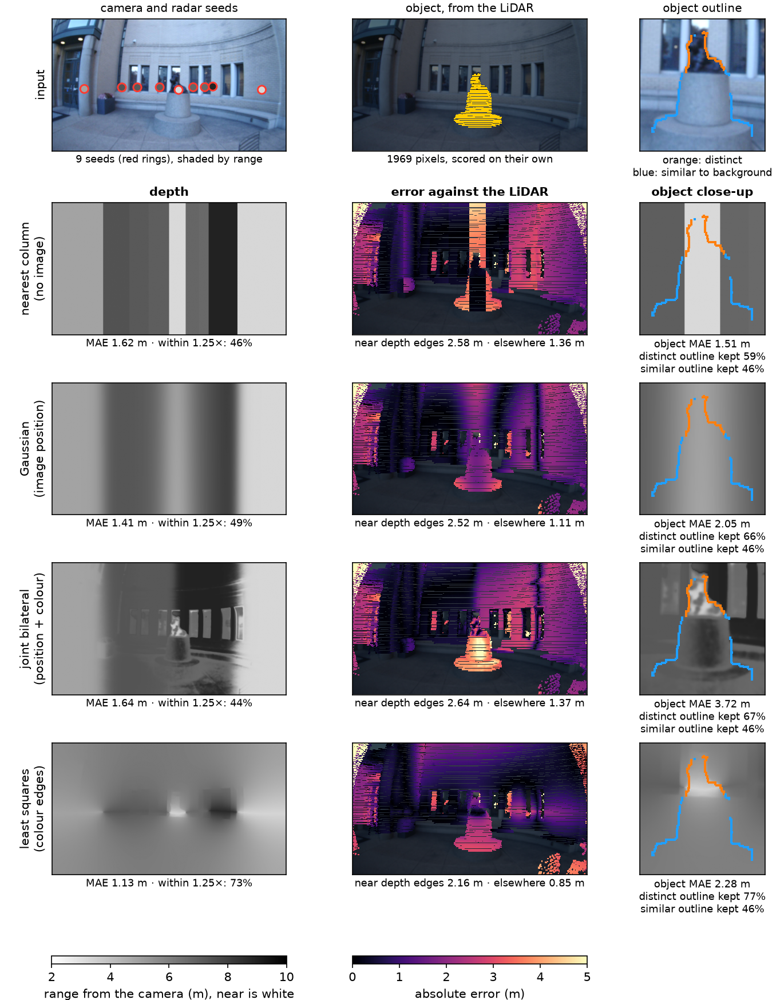

*Figure 1. Nine radar points and one photograph, and four ways to fill them. Rows: 3D view, depth (near is white), statue close-up. The outline is orange where it stands out in colour and blue where it does not. Error against the LiDAR under each panel.*

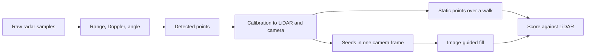

*Figure 2. The pipeline. Radar points go through the calibration. Over a walk, the static ones are stacked into a 3D cloud. In one camera frame, they become seeds for a dense depth map. Both are scored against the LiDAR.*

## 2. Background

An FMCW radar sends a chirp that sweeps a bandwidth *B*. The echo comes back late, and mixing it with the chirp gives a tone whose frequency is set by range. So range is a frequency, read out with an FFT, much like continuous-wave time-of-flight in optics. Two targets split when they are one bin apart:

> Δ*r* = *c* / 2*B* = 8.74 cm for *B* = 1.716 GHz.

Angle comes from phase across the antennas. Three transmitters and four receivers give a virtual row of eight (Rao, 2018). An array of *N* elements has a beam about

> Δθ ≈ 2 / *N* rad, so 14° for *N* = 8.

At 3.6 m that beam is 0.9 m wide. The vertical baseline is one half-wavelength step, so there is no usable elevation. And at a 4 mm wavelength most flat surfaces are mirrors: they return only from the point where they face the radar.

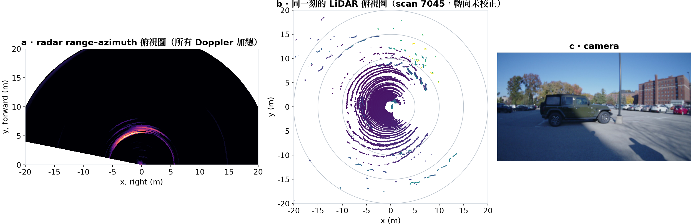

*Figure 3. The radar sees a car as an arc. (a) Radar top view: the car 5.6 m away is an arc 1.4 m wide. (b) LiDAR: the same car is a line. (c) Camera.*

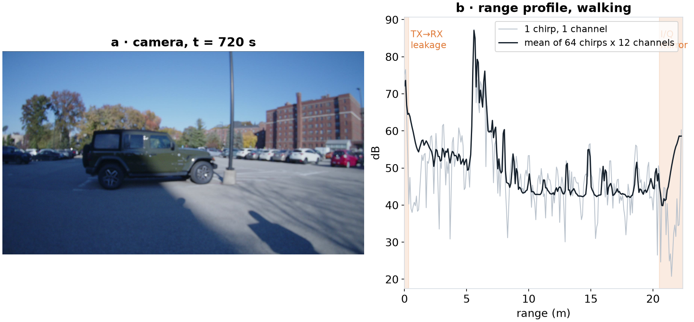

*Figure 4. One radar range profile while walking. (a) Camera. (b) One chirp in grey, the mean over 64 chirps and 12 channels in black. The car is the peak at 5.6 m, a row of cars is at 13-19 m. Shaded zones are masked.*

## 3. Calibration

The radar, LiDAR and camera are fixed on one rig. I place a flat board at eight spots and solve radar to LiDAR, then LiDAR to camera.

The board is a mirror to the radar. Figure 5 shows why that matters. The LiDAR sees the whole board and its centre. The radar sees only the specular point, where the board faces it. When the board is turned, the two are far apart. Fitting the radar to the specular point instead of the centre cuts the azimuth error from 2.89° to 0.58°. It also fixes older angle shots that read 6-9° too wide: on those, the error drops from 4.05° to 0.75°.

Figure 6 checks LiDAR to camera. The LiDAR's board points land on the board in the image. The corners are off by 6.4 px, against 52 px for the old solve.

Figure 7 checks range. A board at four taped distances reads radar = 0.993 × tape + 0.183 m, within ±1.2 cm.

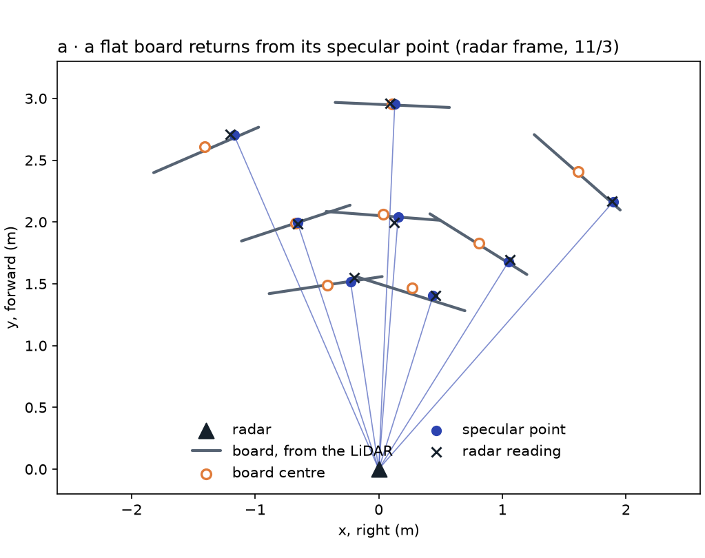

*Figure 5. A flat board returns from its specular point, not its centre. Top view in the radar frame: board planes from the LiDAR, their centres (orange), their specular points (blue) and the radar readings (×).*

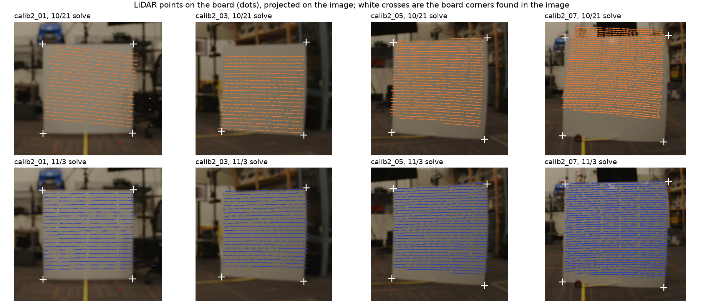

*Figure 6. LiDAR points on the board, projected into the camera, with the old solve (top) and this one (bottom). White crosses are the board's corners in the image.*

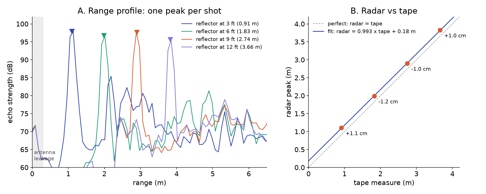

*Figure 7. Range is linear to ±1.2 cm. A board at four taped distances.*

## 4. 3D reconstruction over a walk

One radar frame has about a dozen points. To build a 3D model I stack frames over a handheld walk. The poses come from LiDAR odometry (KISS-ICP; Vizzo et al., 2023). A static point must have the Doppler that the rig's own motion predicts, so I keep only points that match. The rest are moving people, ghosts and sidelobes. Every kept point sits at the radar's height, since it has no elevation.

Figure 8 shows this on a parked car. The test removes the cloud inside the orbit: two-bounce ghosts of the car, sidelobes, and the person walking alongside. Figure 9 shows the statue by day and at night. The radar's top view is the same while the camera frame is nearly black.

*Table 1. Radar points stacked over three orbits, against the LiDAR with the same poses.*

| Orbit | Points kept | Within 0.5 m of LiDAR | LiDAR covered |
|---|---|---|---|
| Parked car, day | 44 % of 23,999 | 91 % | 69 % |
| Statue, day | 68 % of 67,106 | 92 % | 71 % |
| Statue, night | 75 % of 78,868 | 90 % | 72 % |

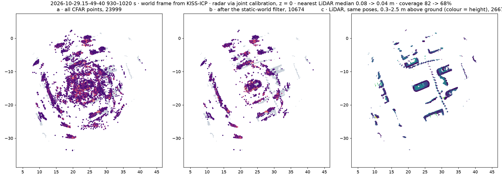

*Figure 8. The Doppler test removes the ghosts inside the orbit. A 90 s orbit of a parked car, top view. (a) All radar points. (b) Points kept. (c) LiDAR with the same poses.*

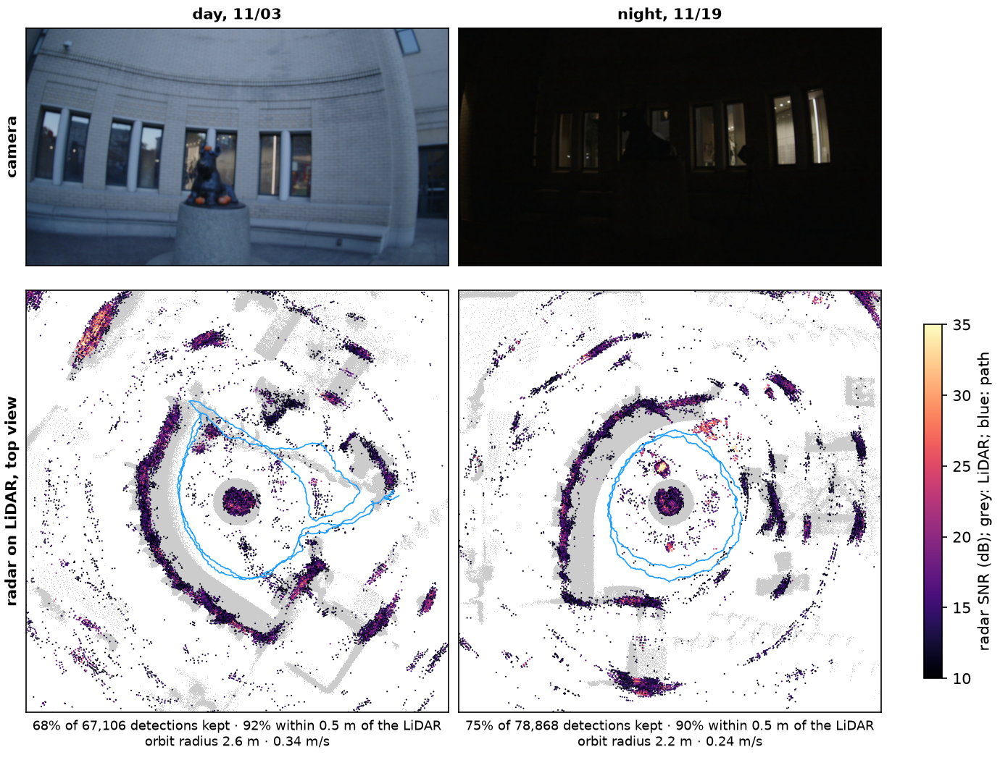

*Figure 9. The radar sees the statue the same way at night. Top: a camera frame by day and at night. Bottom: kept radar points on the LiDAR (grey), with the walked path (blue).*

## 5. Dense depth

The rig stands still 3.3 m from a statue, with a stone wall about 7 m behind it. Radar cells that keep firing over 50 s become seeds: nine pixels with a known depth, all on one image row. I compare five fills, from no image to full use of it: a constant depth, nearest column, a Gaussian blur, joint bilateral (blur weighted by colour), and edge-aware least squares (depth spreads until it hits a colour edge; Levin et al., 2004). The reference is the LiDAR projected into the camera.

*Table 2. Mean error (m) against the LiDAR. Best in bold.*

| Fill | Above ground | Statue | Around statue | Pedestal | Bronze |
|---|---|---|---|---|---|
| Constant | 1.29 | 3.44 | **0.55** | 3.47 | 3.36 |
| Nearest column | 1.62 | **1.51** | 1.18 | **1.80** | **0.59** |
| Gaussian | 1.41 | 2.05 | 0.99 | 2.17 | 1.69 |
| Joint bilateral | 1.64 | 3.72 | 1.44 | 4.10 | 2.52 |
| Least squares | **1.13** | 2.28 | 0.79 | 2.62 | 1.24 |

Figure 1 shows how each fill behaves. Nearest column paints vertical bands. The statue's band lands on the statue by luck, so it scores best there, and it pulls the wall above the statue 3.9 m forward. Gaussian blurs everything into one smooth surface. Joint bilateral looks most like the scene, but the look is texture copied from the photo. The dark bronze matches the dark windows on the wall, so the statue takes the wall's depth. Least squares gives the flattest wall and the best overall error. It cuts the bronze at its outline where it stands out against pale window frames. The pedestal is the same stone as the wall, so it takes the wall's depth.

The statue's outline splits in two. The bronze against pale frames is distinct in colour. The stone against stone is not. I score the share of each outline that a fill puts on the right side.

*Table 3. Share of the statue's outline kept. Two takes of the same scene. A constant depth gets 46-47 %.*

| Fill | Distinct outline | Similar outline |
|---|---|---|
| Nearest column | 58-59 % | 46-47 % |
| Gaussian | 66-68 % | 46 % |
| Joint bilateral | 57-67 % | 44-46 % |
| Least squares | **77-78 %** | 46 % |

Where the outline shows in colour, least squares keeps the most. Where it does not, every fill does as badly as a constant. At night the image is dark except the windows, so the whole outline is the similar kind. Every fill then keeps 48-52 % and the colour-based fills act like the plain blur (Figure 10, top rows).

## 6. Several heights, and bronze against stone

A radar seed sits at the radar's height. So I took seven takes from one spot at night, with the radar crossing the statue between 0.83 and 1.49 m above the ground, and put all the seeds into one image (Figure 10). The stone pedestal ends at 1.05 m, the bronze at 1.75 m.

Stacking does not help. With all 66 seeds the error above the ground is 1.76-2.35 m, against 1.22-1.30 m for one take. Figure 11 explains why. From every height the radar's peak sits at the bronze's range, even when the radar is level with the stone. At 2.5 m the beam covers the whole statue, so a seed's height is the radar's height, not the height of what reflected.

Figure 11 also shows the two materials. The radar sees the bronze. The stone shows only from the two lowest heights, 18 dB below the bronze. The LiDAR is the other way round: it sees the light stone (reflectivity 23) better than the dark bronze (4).

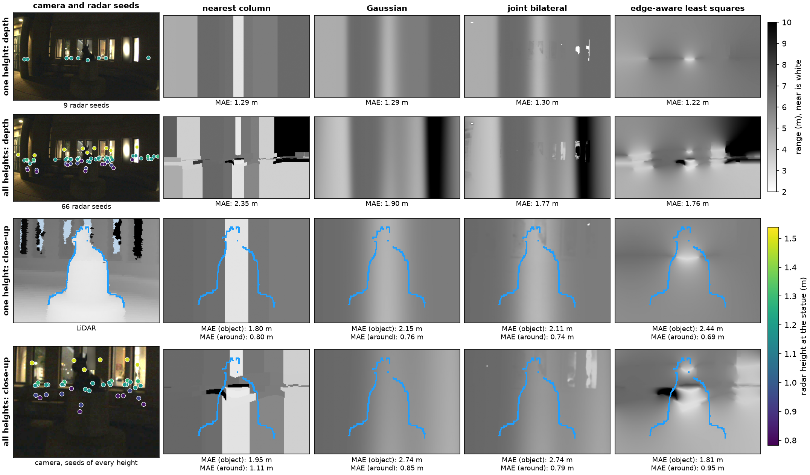

*Figure 10. Seeds from seven heights do not give the statue its height. Night. Rows: one take and all seven, as depth and as a statue close-up. Seeds are coloured by the radar's height at the statue. Two lit windows with people behind them are blurred.*

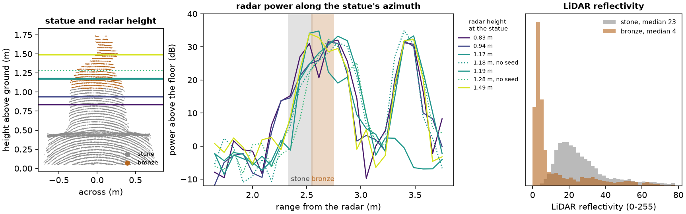

*Figure 11. The radar sees the bronze from every height; the LiDAR sees the stone. Left: the statue's LiDAR points by part, with each take's radar height (dotted: no seed on the statue). Middle: radar power along the statue's direction, one line per take, with the ranges of the stone and the bronze. Right: LiDAR reflectivity by part.*

## 7. Classical against learned

GRT (Huang et al., 2025) is a model trained on 29 hours of radar from the same kind of rig. It outputs a 3D occupancy grid. I ran the released model unchanged on my traces (Figure 12). The classical chain gives 10-20 sharp points per frame. GRT fills the whole view but smears along range and height.

To score both the same way I look from above, on the same frames, against the same LiDAR.

*Table 4. CFAR and GRT from above. Per frame: median distance from the method to the LiDAR / from the LiDAR to the method. Stacked: as in Table 1.*

| Method | Per frame, day | Stacked, day | Per frame, night | Stacked, night |
|---|---|---|---|---|
| CFAR | 0.12 / 1.54 m | 92 % / 71 % | 0.13 / 1.49 m | 90 % / 72 % |
| GRT, p > 0.9 | 0.09 / 0.14 m | 81 % / 82 % | 0.11 / 0.12 m | 71 % / 84 % |

CFAR is more precise; GRT is more complete. Night does not change GRT, since it reads only the radar.

Figure 13 uses the height stack on GRT. Unlike a CFAR seed, GRT does not put the statue at the radar's height: in the six takes with little tilt, its mean height on the statue stays at 0.84-1.14 m whatever the radar's height. But it smears the statue up to about 2.3 m, 0.5 m above its top.

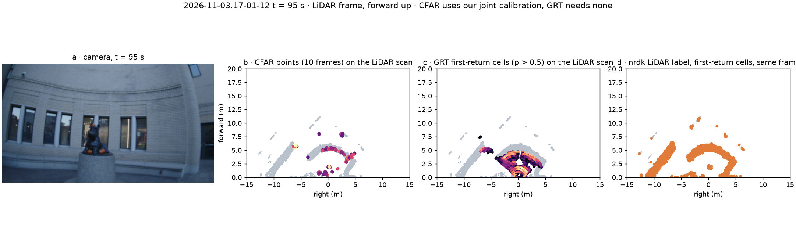

*Figure 12. Classical points are sparse and sharp; the learned model is dense and smeared. One moment of the statue orbit: camera, CFAR points on the LiDAR, GRT's first occupied cells on the LiDAR, and the LiDAR label.*

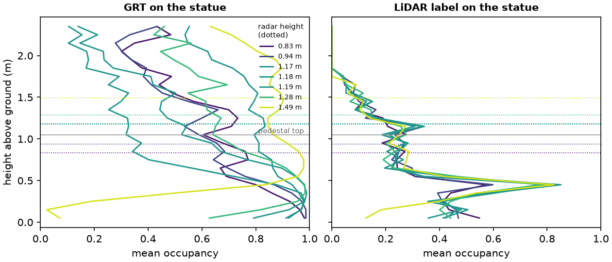

*Figure 13. GRT does not follow the radar's height, but smears the statue upwards. Occupancy on the statue against height, one line per take, coloured by the radar's height (dotted). Left: GRT. Right: LiDAR label.*

## 8. Limits

Elevation is the main limit. Every radar point sits at the radar's height. That flattens the 3D cloud and puts every seed on one image row, so the statue's height has to come from the image alone. Moving the radar up and down does not fix it.

Walls make a second copy of every target at twice its range (Figure 14). One early seed was such a ghost. Open scenes give the radar little to see: it covers 23 % of the LiDAR on a lawn (Figure 15).

The detector can drop real targets. In two of the seven height takes, a strong object 0.6 m behind the statue raised the CFAR threshold and removed the statue's seed.

Dense depth was tested on one object, with filter settings chosen by eye. The day and night takes are from two spots, 3.3 m and 2.5 m from the statue.

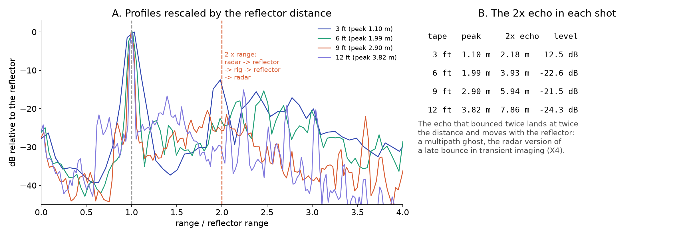

*Figure 14. Walls make a second copy of every target. Range profiles scaled by the target's distance; the second echo lines up at twice the range.*

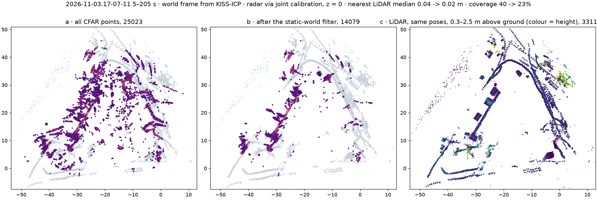

*Figure 15. An open lawn gives the radar little to see. It covers 23 % of the LiDAR.*

## 9. Conclusion

On its own the radar is a depth sensor that works in any light: centimetres in range, under a degree in azimuth once the board is treated as a mirror, but a 14° beam and no height. The camera can lend it shape only where colour edges and depth edges line up. Where they do not, the image moves correct radar depth onto the wrong surface. At night the radar works the same and the camera loses its edges. Extra radar heights do not replace them, and a learned model fills gaps at the cost of precision. What would help is elevation: the phase between the array's two rows, tested on this height stack.

## 10. Relation to the proposal

| Item | Section | Outcome |
|---|---|---|
| Calibration | 3 | Done. The radar's height is the rig's nominal value |
| Dense depth, one height, day and night | 5 | Done. Day and night from two spots; no reshoot |
| Several heights | 6 | Done, night only |
| 3D reconstruction, day and night | 4 | Done |
| CFAR against GRT | 7 | Done, day, night and height stack |
| Bronze against stone | 6 | Done inside the height stack |
| Hopes: elevation from the array rows, backprojection, metal panel | 9 | Not done |

## Acknowledgements

The rig was lent by the CMU WiSE Lab. GRT's authors released the model used in Section 7. The distinct and similar outline test follows a suggestion by the course staff.

## References

- Huang, T., Prabhakara, A., Chen, C., Karhade, J., Ramanan, D., O'Toole, M., Rowe, A. Towards foundational models for single-chip radar. *ICCV*, 2025.
- Kopf, J., Cohen, M. F., Lischinski, D., Uyttendaele, M. Joint bilateral upsampling. *ACM Transactions on Graphics* 26(3), 2007.
- Levin, A., Lischinski, D., Weiss, Y. Colorization using optimization. *ACM Transactions on Graphics* 23(3), 2004, pp. 689-694.
- Rao, S. MIMO radar. Texas Instruments application report SWRA554A, 2018.
- Vizzo, I., Guadagnino, T., Mersch, B., Wiesmann, L., Behley, J., Stachniss, C. KISS-ICP: in defense of point-to-point ICP. *IEEE Robotics and Automation Letters* 8(2), 2023, pp. 1029-1036.
