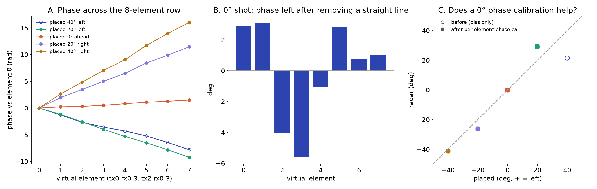
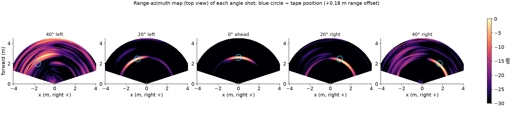

# M1: range and angle accuracy with a fixed target (2026-10-21)

**Status:** Done

## Question
How accurate are the radar's range and azimuth, before any calibration?

## Method
Indoor room (12 ft). Target placed with a tape measure: 4 ranges straight ahead, 5 azimuths at 8 ft. Range = strongest bin near the tape distance, refined with a 3-point parabola. Azimuth = 8-element row (tx0 + tx2), zero-Doppler part, Hann window, 512-point FFT. The target turned out to be a ~60 cm flat board, not a corner reflector (see the lesson below).

## Data
Traces in `notes/shots.csv`: `range_3ft` to `range_12ft`, `angle_0_8ft`, `angle_L20_8ft`, `angle_L40_8ft`, `angle_R20_8ft`, `angle_R40_8ft` (the R40 shot is the last 30 s of `2026-10-21.15-36-20`).

## Results
### Range
| Tape | Radar | Residual after fit |
|---|---|---|
| 3 ft (0.914 m) | 1.102 m | +1.1 cm |
| 6 ft (1.829 m) | 1.987 m | −1.2 cm |
| 9 ft (2.743 m) | 2.898 m | −1.0 cm |
| 12 ft (3.658 m) | 3.824 m | +1.0 cm |

Fit: radar = 0.993 × tape + 0.183 m.

*Range profiles (one peak per shot) and radar vs tape*

*One range profile step by step: single chirp, frame average, coherent average, sub-bin peak*
### Azimuth (+ = left)
| Placed | Radar, 0° bias removed | Error | Echo |
|---|---|---|---|
| 40° left | 21.5° | not used | 79 dB, board not facing the rig |
| 20° left | 29.2° | +9.2° | 95 dB |
| 0° | 0° (raw reads 4.5° right) | bias | 98 dB |
| 20° right | −26.3° | −6.3° | 94 dB |
| 40° right | −41.1° | −1.1° | 86 dB |

*Angle spectra at the target range, and radar vs placed angle*

*Phase across the 8 virtual elements; per-element residual of the 0° shot (RMS ≈ 3°); phase calibration changes the angles by < 0.2°*

*Range-azimuth top view of each angle shot; circle = tape position*
### Lesson: the target was a flat board

*A flat board is a mirror and must face the radar; a corner reflector is not*

*Failure cases: tilted or turned board (calib 03, 05, left 40°) vs retakes*

## Conclusion
Range is linear to within ±1.2 cm after a constant +0.18 m offset. Azimuth has the right sign and is within ~1° at 40° right, but reads 6 to 9° too wide at ±20°. Channel phase errors are too small to explain it, so placement or the board's size is the likely cause.

## Open items
- Repeat ±20° with a corner reflector and a phone photo per placement
- Outdoor ranges beyond 3.7 m (10 to 15 m)

## B-roll to capture (for the 5-minute video)
- [ ] Phone photo from behind the rig for every target placement
- [ ] Close-up of the board (and of a corner reflector, if borrowed)
- [ ] Screen recording: the range peak moving as the target moves

## Reproduce
Reference figures in `notes/fig/`; the author's own implementation goes in `src/` (M2, M3).

[Back to all experiments](../../EXPERIMENTS.md)
