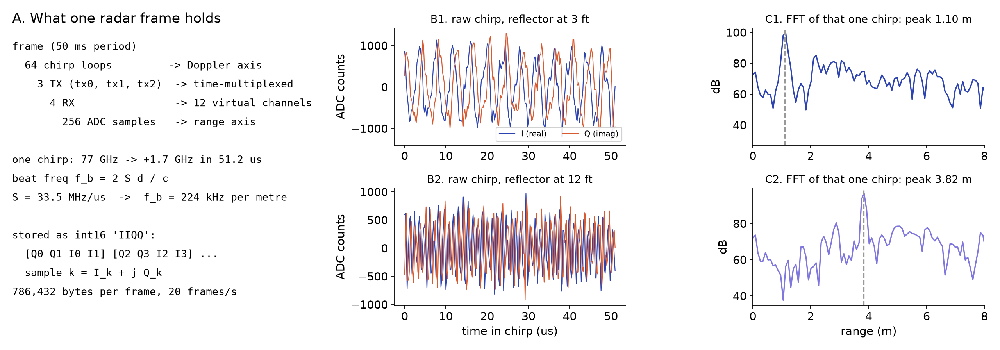
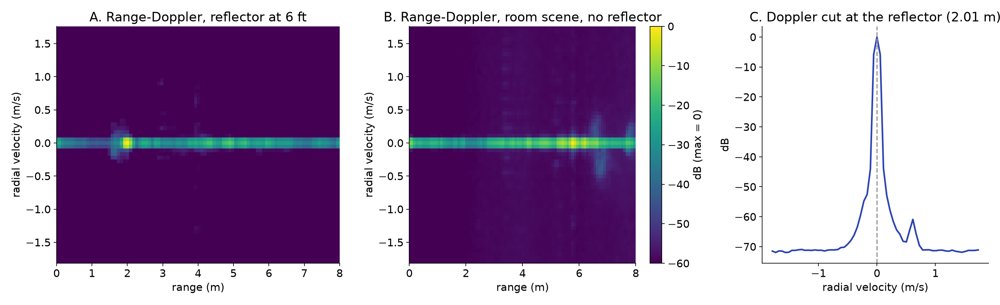

# M2: own range and Doppler processing

**Status:** Preliminary (2026-10-31): code written and matched to `xwr.rsp`; the tape-measure checks wait for the 10/21 shots to reach nunga.

## Question
Does my own implementation reproduce the reference numbers?

## Method
IIQQ unpacking, range FFT, Doppler FFT written from scratch in `src/radar/adc.py` and `src/radar/range_doppler.py`; compared frame by frame with `xwr.rsp` (`tests/test_vs_xwr.py`) and with the M1 numbers. Window: Hann without the zero end points, scaled to unit mean (same as xwr, so levels compare directly).

## Data
M1 range shots and `scene_room` (2026-10-21, pending); `2026-10-29.15-18-16` frame 300, `2026-10-29.15-49-40` frame 14356, `2026-10-19.15-45-38` frame 400 (on nunga).

## Results
| Check | Reference | Mine | Pass |
|---|---|---|---|
| Range fit slope | 0.993 | TBD (10/21 data) | ±0.005 |
| Range offset | 0.183 m | TBD (10/21 data) | ±1 cm |
| Peak within ±1 bin of tape (after offset) | 4/4 | TBD (10/21 data) | 4/4 |
| IIQQ unpacking vs `xwr.rsp.iq_from_iiqq` | — | bit-equal on 3 frames | yes |
| Range-Doppler map vs `xwr.rsp` (relative error) | — | 6–8 × 10⁻⁸ on 3 frames | < 1e-6 ✅ |
| Static energy in the zero-Doppler bin | > 70 dB above the rest | zero-velocity column 30 dB above bins beyond ±0.3 m/s (10/19 desk); walking frame peaks at +0.28 m/s | yes (the 70 dB figure was for the strongest bin alone) |
| Derived chirp constants vs `radar.json` | 0.08738 m, 0.0559 m/s | 0.08738 m, 0.0559 m/s (`ChirpParams.check`) | yes |


*Pending: my range profile overlaid on the reference for the 12 ft shot. Source: TBD.*


*Pending: my range-Doppler map vs reference, and their difference. Source: TBD.*


*Reference: raw ADC of one chirp and its FFT*


*Reference: range-Doppler maps*


## Conclusion
Own range and Doppler code reproduces `xwr.rsp` to float32 round-off. The course-facing acceptance (±1 bin against the tape) still needs the 10/21 range shots.

## Open items
- Run the range fit on the 10/21 shots once they are on nunga (`rsync` from the Mac in progress)
- Make the two pending figures from `src/radar` output (replace the rd2 reference figures)

## B-roll to capture (for the 5-minute video)
- [ ] Screen recording: notebook running the range FFT on one frame

## Reproduce
```bash
source .venv/bin/activate
python -m pytest tests/ -q                      # 6 stage tests against xwr.rsp
RADAR_TRACE=data/raw/2026-10-19.15-45-38 RADAR_FRAME=400 python -m pytest tests/ -q
```

[Back to all experiments](../../EXPERIMENTS.md)
