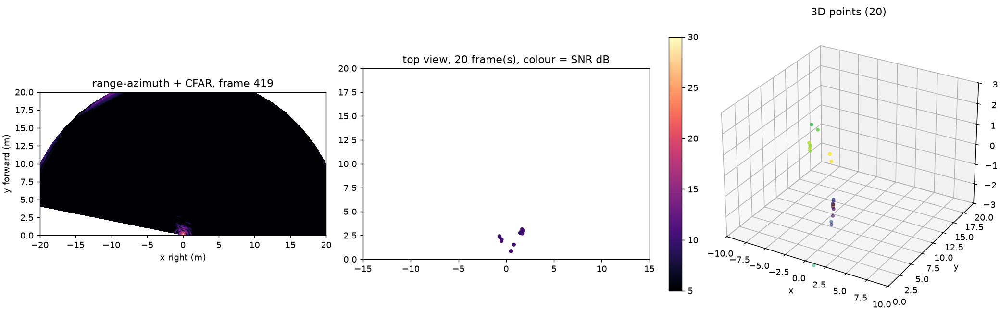

# M3: angle estimation, CFAR and 3D points

**Status:** Preliminary (2026-10-31): the chain runs end to end on Session 2 data and gives a 3D point cloud; the ±7° check waits for the 10/21 angle shots.

## Question
Are azimuth errors within ±7° (half a beam), and how many reliable points does one frame give?

## Method
8-element azimuth FFT (64-point, zero-padded) with TDM compensation, elevation from the second row, CA-CFAR along range with the exponential threshold (train 8, guard 2, Pfa 1e-3), azimuth-peak rule. Power is summed over Doppler before CFAR because the rig moves. Leakage (< 0.35 m) and the I/Q mirror (> 20.5 m) are masked. Code: `src/radar/angle.py`, `cfar.py`, `pointcloud.py`; TDM compensation, virtual array and the azimuth spectrum match `xwr.rsp` to < 1e-7 (`tests/`).

## Data
M1 angle shots, calibration shots, `scene_room` (2026-10-21, pending); Session 2 `2026-10-29.15-49-40` t = 720 s (parking lot, Jeep on the left at 5.6 m), `2026-10-29.16-22-36` t = 200 s, `2026-10-19.15-45-38` (static desk).

## Results
| Placement | Reference error | Mine | Pass (±7°) |
|---|---|---|---|
| 20° left | +9.2° | TBD | TBD |
| 0° | 0° (bias) | TBD | TBD |
| 20° right | −6.3° | TBD | TBD |
| 40° right | −1.1° | TBD | TBD |

| CFAR setting | Points / frame | Matched to LiDAR within 0.5 m | False alarms |
|---|---|---|---|
| range only | 227 (20-frame mean, 15-49-40 around frame 14356) | TBD (needs radar↔LiDAR rotation, M4) | TBD |
| + azimuth peak | 12 | TBD | TBD |
| + 20-frame accumulation | 259 points per second | TBD | TBD |

Sanity checks on the parking-lot frame: the Jeep seen on the left of the camera image appears as an arc at x ≈ −4 m, y ≈ 5 m (so + azimuth = left is right); the row of parked cars appears at 14–15 m with the highest SNR (26–31 dB over the CFAR noise). Elevation from the 4-element raised row is noisy: z on a flat lot spreads over ±3 m, so the 3D output should not trust z until X9 says otherwise.


*Own chain on the parking-lot frame: range-azimuth map with CFAR detections, 20-frame top view coloured by SNR, 3D points. `python -m src.radar data/raw/2026-10-29.15-49-40 --time 720 --accumulate 20`, 2026-10-31.*



*Same on the static desk trace: one near target, 20 points in 20 frames. `python -m src.radar data/raw/2026-10-19.15-45-38 --frame 400 --accumulate 20`.*


*Pending: 3D radar point cloud of `scene_room` over the 128-beam LiDAR cloud. Source: TBD.*


*Pending: points per frame vs CFAR threshold (ROC-style curve against LiDAR). Source: TBD.*


## Conclusion
The chain produces a point cloud that matches the scene in range and azimuth; elevation is not usable yet. Angle accuracy numbers wait for the 10/21 shots.

## Open items
- Azimuth error table from the 10/21 angle shots (±7° check)
- Decide on super-resolution by 11/02 based on these errors
- Radar↔LiDAR rotation (even a rough one) so the LiDAR-matched columns can be filled
- Elevation: check against LiDAR (X9) or drop z from the M3 output

## B-roll to capture (for the 5-minute video)
- [ ] Screen recording: radar points appearing frame by frame over the LiDAR cloud

## Reproduce
```bash
source .venv/bin/activate
python -m src.radar data/raw/2026-10-29.15-49-40 --time 720 --accumulate 20 --out figures/pc_2026-10-29.15-49-40_t720.png
python -m src.radar data/raw/2026-10-19.15-45-38 --frame 400 --accumulate 20 --out figures/pc_2026-10-19.15-45-38_400.png
```

[Back to all experiments](../../EXPERIMENTS.md)
