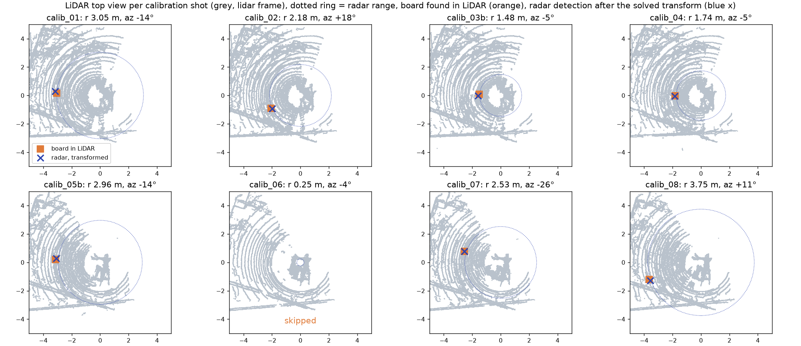

# M4: radar to LiDAR and radar to camera extrinsics

**Status:** Radar→LiDAR solved in 2D (2026-11-01, preliminary); radar→camera pending

## Question
Where is the radar relative to the LiDAR and the camera, and how far do transformed radar points land from the target?

## Method
8 calibration placements of the board, 10 s each, rig static. Radar→LiDAR (`src/calib/radar_lidar.py`): radar board = median of the strongest CFAR point over 40 frames, range minus the 0.183 m offset; LiDAR board = largest upright cluster (floor removed, ≥ 25 cm tall) within 1 m of where a prior (LiDAR −x forward) predicts it, re-picked within 0.5 m after a first solve; 2D rigid fit (yaw, tx, ty) by Kabsch. Pitch, roll and tz are not estimated because radar elevation is unusable. Radar→camera (pending): mark the board centre in each image, PnP + RANSAC with the red-rover fisheye intrinsics, reprojection error.

## Data
`calib_01`, `calib_02`, `calib_03b`, `calib_04`, `calib_05b`, `calib_06`, `calib_07`, `calib_08` (2026-10-21). Checks: `scene_room` (10/21), `2026-10-29.16-22-36` t = 200 s, `2026-10-29.15-49-40` t = 720 s.

## Results

### Radar → LiDAR
| Quantity | Value |
|---|---|
| yaw (radar → lidar) | +101.9° |
| t (x, y) in the lidar frame | (−0.114, +0.157) m |
| shots used | 7 (calib_06 skipped: board at 0.25 m, inside the radar leakage zone) |
| residual per shot | 01 16.1 cm · 02 6.3 · 03b 11.0 · 04 3.0 · 05b 11.2 · 07 1.0 · 08 11.2; mean 8.5 cm |

Check on traces not used in the fit (nearest above-ground LiDAR point to each transformed radar point, xy): room scene 10/21 median 11 cm, 68 % within 0.5 m; Scotty segment 10/29 (after the swap to the OS-0-128) median 22 cm, 60 %; parking lot 10/29 median 145 cm, 29 % (the radar sees cars at 15 m where this scan has almost no returns, and the rig is walking; the Jeep itself lines up).



*Board found in LiDAR (orange) and the radar detection after the transform (blue x), per shot. `python -m src.calib.radar_lidar`, 2026-11-01.*


*Before and after the transform, residual per shot.*


*Check on the Scotty segment of 10/29: radar points on the LiDAR walls. `python -m src.calib.overlay data/raw/2026-10-29.16-22-36 --time 200 --accumulate 10`.*

### Radar → camera (pending)
| Placement | Range | Azimuth (+ left) | Elevation | Image error after calibration |
|---|---|---|---|---|
| 01 | 3.20 m | −8° | −5° | TBD px |
| 02 | 2.40 m | +25° | −12° | TBD px |
| 03b | 1.64 m | +1° | −14° | TBD px |
| 04 | 1.93 m | 0° | +9° | TBD px |
| 05b | 3.17 m | −9° | −17° | TBD px |
| 06 | 0.48 m | +2° | −14° | TBD px |
| 07 | 2.71 m | −21° | −21° | TBD px |
| 08 | 3.95 m | +18° | −13° | TBD px |

| Extrinsics | Before (co-located guess) | After |
|---|---|---|
| Translation (m) | 0, 0, 0 | TBD |
| Rotation (deg) | 0, 0, 0 | TBD |
| Mean reprojection error (px) | TBD | TBD |


*Preview: radar detections projected with no extrinsics; all 8 land on or at the edge of the board*


*Pending: same 8 images after calibration, with the target centre marked and the residual drawn as a line. Source: TBD.*


*Pending: reprojection error vs range and vs azimuth. Source: TBD.*


## Conclusion
Radar→LiDAR: a 2D rigid transform explains the seven board placements to 8.5 cm on average and still holds on Session 2 data after the LiDAR swap. The residual is dominated by the radar's azimuth error on a flat board, not by range. Radar→camera: the uncalibrated preview already lands every detection on the target, so that offset is small too.

## Open items
- Radar→camera: mark the board centre in each image (or use a corner reflector apex next time), PnP + RANSAC, reprojection error
- Pitch, roll, tz: from the board height in LiDAR plus a tape measure, or after X9
- Repeat with a corner reflector to bring the residual down

## B-roll to capture (for the 5-minute video)
- [ ] Phone photo of the rig showing where radar and camera sit
- [ ] Overlay video: radar points on the camera feed, before vs after calibration

## Reproduce
```bash
python -m src.calib.radar_lidar          # calib/extrinsics_radar_lidar.json + the two figures
python -m src.calib.overlay data/raw/2026-10-29.16-22-36 --time 200 --accumulate 10 --out figures/calib_overlay_scotty.png
```
Use it: `from src.calib.transform import RadarToLidar; T = RadarToLidar.load(); xyz_lidar = T(xyz_radar)`.

[Back to all experiments](../../EXPERIMENTS.md)
