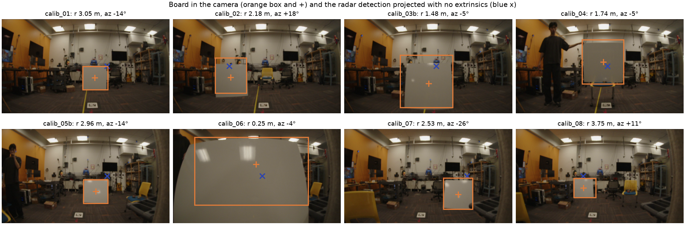
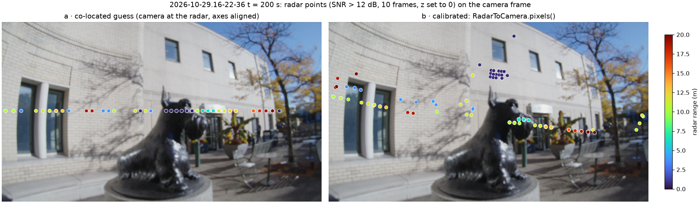
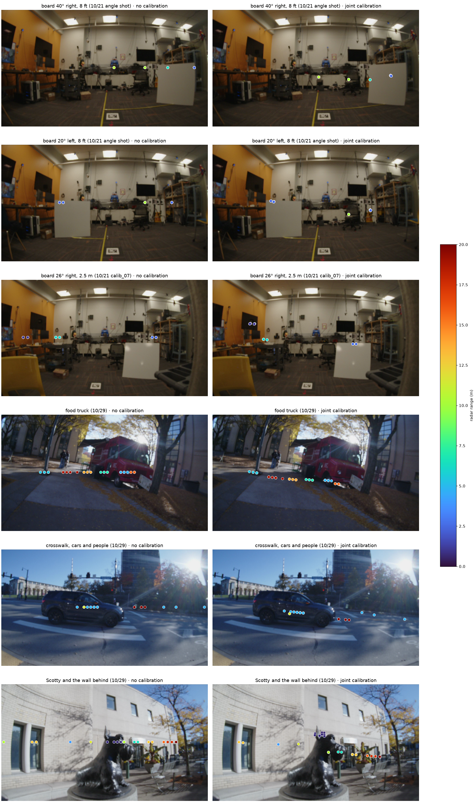

# M4: radar to LiDAR and radar to camera extrinsics

**Status:** Radar→LiDAR solved in 2D, radar→camera by PnP, and one joint solve (2026-11-01, preliminary). Numbers below are from the corrected LiDAR geometry (11/1 evening: the beam-azimuth offset sign in `src/calib/lidar.py` was flipped, 0.7 m median error per LiDAR point; everything was rerun).

## Question
Where is the radar relative to the LiDAR and the camera, and how far do transformed radar points land from the target?

## Method
8 calibration placements of the board, 10 s each, rig static. Radar→LiDAR (`src/calib/radar_lidar.py`): radar board = median of the strongest CFAR point over 40 frames, range minus the 0.183 m offset; LiDAR board = largest upright cluster (floor removed, ≥ 25 cm tall) within 1 m of where a prior (LiDAR −x forward) predicts it, re-picked within 0.5 m after a first solve; 2D rigid fit (yaw, tx, ty) by Kabsch. Pitch, roll and tz are not estimated because radar elevation is unusable. Radar→camera (`src/calib/board_image.py`, `radar_camera.py`): board centre in each camera frame found as a grey, smooth, square blob (three shots automatically, five grown from a hand seed inside a range-sized window); 3D board point = radar x, y plus the LiDAR board height (a constant z offset is absorbed by the translation); pixels undistorted with the red-rover OPENCV_FISHEYE intrinsics (`calib/camera_fisheye_iq1m.json`), `cv2.solvePnP` from the co-located guess; reprojection error with the fisheye model.

## Data
`calib_01`, `calib_02`, `calib_03b`, `calib_04`, `calib_05b`, `calib_06`, `calib_07`, `calib_08` (2026-10-21). Checks: `scene_room` (10/21), `2026-10-29.16-22-36` t = 200 s, `2026-10-29.15-49-40` t = 720 s.

## Results

### Radar → LiDAR
| Quantity | Value |
|---|---|
| yaw (radar → lidar) | +94.0° (exact alignment of the two frames would be +90°) |
| t (x, y) in the lidar frame | (−0.142, −0.002) m |
| shots used | 7 (calib_06 skipped: board at 0.25 m, inside the radar leakage zone) |
| residual per shot | 01 13.7 cm · 02 7.1 · 03b 7.2 · 04 4.2 · 05b 10.8 · 07 1.3 · 08 12.7; mean 8.1 cm |

Check on traces not used in the fit (nearest above-ground LiDAR point to each transformed radar point, xy, 10–20 radar frames overlaid without poses against one scan): room scene 10/21 median 11 cm, 67 % within 0.5 m; Scotty segment 10/29 (after the swap to the OS-0-128, rig walking) median 58 cm, 49 %; parking lot 10/29 median 241 cm, 13 % (the radar sees cars at 15 m where this scan has almost no returns, and the rig is walking; the Jeep itself lines up). The walking checks improve once per-frame poses are used (section obj-orbit-360).


*Board found in LiDAR (orange) and the radar detection after the transform (blue x), per shot. `python -m src.calib.radar_lidar`, 2026-11-01.*


*Before and after the transform, residual per shot.*


*Check on the Scotty segment of 10/29: radar points on the LiDAR walls. `python -m src.calib.overlay data/raw/2026-10-29.16-22-36 --time 200 --accumulate 10`.*

### Radar → camera
| Placement | Range (offset removed) | Azimuth (+ left) | Reprojection error, co-located guess | After PnP |
|---|---|---|---|---|
| 01 | 3.05 m | −14.5° | 147 px | 55 px |
| 02 | 2.18 m | +18.2° | 138 px | 9 px |
| 03b | 1.48 m | −5.4° | 189 px | 20 px |
| 04 | 1.74 m | −5.4° | 142 px | 35 px |
| 05b | 2.96 m | −14.5° | 131 px | 36 px |
| 06 | 0.25 m | — | not used (radar leakage zone; board fills the frame) | — |
| 07 | 2.53 m | −25.9° | 100 px | 34 px |
| 08 | 3.75 m | +10.8° | 32 px | 39 px |

Worked example, the point pairs PnP was given (all in `calib/extrinsics_radar_camera.json`):

| Shot | 3D point, radar frame (x, y, z) m | Board centre (u, v) px | Projected, co-located guess | Projected, after PnP |
|---|---|---|---|---|
| calib_01 | (+0.76, +2.95, −0.57) | (1064, 671) | (1203, 719), 147 px | (1116, 691), 55 px |
| calib_02 | (−0.68, +2.07, −0.60) | (660, 667) | (650, 805), 138 px | (652, 664), 9 px |
| calib_03b | (+0.14, +1.47, −0.59) | (964, 737) | (1044, 909), 189 px | (971, 718), 20 px |
| calib_04 | (+0.16, +1.73, −0.16) | (1004, 491) | (1049, 625), 142 px | (994, 525), 35 px |
| calib_05b | (+0.74, +2.87, −0.65) | (1076, 715) | (1202, 749), 131 px | (1112, 713), 36 px |
| calib_07 | (+1.10, +2.27, −0.63) | (1302, 747) | (1395, 783), 100 px | (1271, 733), 34 px |
| calib_08 | (−0.70, +3.68, −0.65) | (776, 672) | (772, 704), 32 px | (740, 658), 39 px |

| Extrinsics (radar → camera) | Before (co-located guess) | After |
|---|---|---|
| Rotation (Rodrigues, deg, camera axes) | 0, 0, 0 | −5.2, −2.7, +6.5 |
| Translation (m, camera axes) | 0, 0, 0 | (+0.04, −0.35, +0.57) |
| Mean reprojection error (px) | 125 | 33 (max 55) |

33 px at 3 m with a 987 px focal length is 2°, the same size as the radar's azimuth error on a flat board (section M1), so the fit is azimuth-limited. A LiDAR→camera PnP on the same pixel centres with the LiDAR board centroids as 3D points reaches 23 px (`calib/extrinsics_lidar_camera.json`), so the image-side centres (blob centroids of a flat board) are the next limit; composing radar→LiDAR→camera and comparing with the direct solve gives a rotation difference of 0.9°, the loop closing well inside the radar's bearing error. The translation is weakly constrained by seven points with degree-level bearing noise and should not be read as the physical offset; the rotation is the usable part. The other intrinsics file in red-rover (`camera_fisheye_notebooks.json`) gives the same answer to within 1° and 4 cm.



*Board found in each camera frame (orange) and the radar detection projected with no extrinsics (blue x). `python -m src.calib.board_image`.*


*Radar detections projected into the camera before (blue x) and after (green o) PnP, crops around the board. `python -m src.calib.radar_camera`.*

On real scenes (points at radar height, z = 0, since elevation is unusable): the co-located guess puts every radar point on one horizontal line; the calibrated projection moves them by the solved yaw and roll, so the Jeep's returns sit on the Jeep and the 15 m returns on the car row behind it. Vertical placement is not calibrated and should not be read.


*Radar points (10 frames, SNR > 12 dB) on the parking-lot frame, co-located guess vs calibrated. `python -m src.calib.project_image data/raw/2026-10-29.15-49-40 --time 720 --accumulate 10`.*



*Same on the Scotty segment: returns from the wall behind the statue and from the planters to the right.*


*Preview: radar detections projected with no extrinsics; all 8 land on or at the edge of the board*


*Pending: same 8 images after calibration, with the target centre marked and the residual drawn as a line. Source: TBD.*


*Pending: reprojection error vs range and vs azimuth. Source: TBD.*


### Joint solve, LiDAR frame as world (`src/calib/joint.py`)
One least-squares problem instead of pairwise chains: unknowns are the radar pose (yaw, tx, ty, tz; pitch and roll fixed at 0) and the camera pose (6) relative to the LiDAR, 10 in all; the 28 residuals are the seven shots' radar range (σ 2 cm), radar azimuth (σ 2°) and camera pixel (σ 20 px) against the LiDAR board point, radar elevation left out. Started from the pairwise answers, cost 45 → 17 (σ units).

| Quantity | Pairwise | Joint | 1σ (Jacobian) |
|---|---|---|---|
| radar→lidar yaw | +94.0° | +94.4° | ± 1.5° |
| radar→lidar t (x, y) | (−0.14, −0.00) m | (−0.15, +0.02) m | ± (0.05, 0.02) m |
| radar→lidar t_z | not estimated | −0.27 m | ± 0.15 m |
| lidar→camera t | (+0.02, −0.41, +0.33) m (PnP) | (+0.03, −0.43, +0.19) m | ± (0.09, 0.09, 0.14) m |
| radar range residual | 5.5 cm | 2.9 cm | — |
| radar azimuth residual | 1.45° | 1.45° | — |
| camera pixel residual | 23 px | 23 px | — |

What changed and what did not: the range residual halves because t_z is now a free parameter and the board heights (−0.2 to −0.7 m in the LiDAR frame) make it observable through range; the radar comes out 0.27 ± 0.15 m below the LiDAR, which agrees within 1σ with the rig's nominal 0.15–0.17 m (red-rover URDF comment and nrdk docstring); azimuth and pixel residuals stay where the sensors put them, since no amount of joint fitting beats a flat board's bearing noise; and the radar→camera transform is composed from the two LiDAR-referenced poses, so the loop closes by construction. The 1σ column is the real product: with seven flat-board shots, yaw is known to 1.5°, in-plane offsets to a few cm, heights to 15 cm. `RadarToLidar.load_joint()` and `RadarToCamera.load_joint()` apply it. The IMU is not in the solve because it observes no target; it enters through hand-eye on the orbit segments (rotation between LiDAR scans against integrated gyro), which is the next piece.


*Residuals per shot, pairwise start (grey) vs joint solve (blue); the band is the assumed 1σ. `python -m src.calib.joint`.*

## Summary for the report

Quantitative, every method on the same seven 10/21 board placements; checks on scenes not used in any fit (nearest above-ground LiDAR return to each transformed radar point, xy median; room = 10/21 `scene_room`, Scotty = 10/29 `16-22-36` t = 200 s after the LiDAR swap). "—" means the method does not produce that quantity.

| Method | Unknowns | Radar range res. | Radar azimuth res. | Camera px res. | Loop closure | t_z radar→LiDAR | Check: room | Check: Scotty |
|---|---|---|---|---|---|---|---|---|
| None (co-located guess) | 0 | — | — | 143 px | — | — | — | — |
| Kabsch radar→LiDAR, 2D | 3 | 8.1 cm (2D) | — | — | — | not estimated | 11 cm, 67 % | 58 cm, 49 % |
| PnP radar→camera | 6 | — | — | 33 px | — | — | — | — |
| PnP LiDAR→camera, composed | 6 (+3) | 8.1 cm | — | 23 px | 0.9° vs direct | — | — | — |
| Joint, LiDAR frame, weighted | 10 | 2.9 cm | 1.45° | 23 px | by construction | −0.27 ± 0.15 m | 11 cm, 67 % | 58 cm, 49 % |

1σ from the joint solve: yaw ±1.5°, t_x ±5 cm, t_y ±2 cm, t_z ±15 cm; camera rotation ±3°, translation ±9–14 cm. The residuals that do not move between rows (azimuth, pixels) are the flat board's limit, not the solver's. The held-out checks accumulate 10–20 radar frames without poses while the rig walks (up to 25 cm of motion), against a single LiDAR scan, so they are a sanity check rather than an accuracy figure; the earlier 11 / 22 cm values were inflated by the smeared LiDAR geometry (every beam rotated by up to 22°), which put a LiDAR point near everything.

Qualitative, the same second of the parking-lot frame under each calibration:


*Radar points of one second (SNR > 12 dB, drawn at radar height) on `2026-10-29.15-49-40` t = 720 s: (a) no calibration, (b) pairwise PnP, (c) composed Kabsch + PnP, (d) joint solve. `python -m src.calib.compare data/raw/2026-10-29.15-49-40 --time 720 --accumulate 10`.*

More examples, no calibration vs the joint solve, chosen because the effect is easy to see: a single board off-axis (the radar point moves from the empty desk onto the board), a food truck, a car at a crosswalk, and the wall behind Scotty.



*Radar points (SNR > 15 dB, drawn at radar height) on six scenes: 10/21 board at 40° right, 20° left and 26° right; 10/29 food truck, crosswalk, Scotty. `python -m src.calib.examples`.*

## Conclusion
Radar→LiDAR: a 2D rigid transform explains the seven board placements to 8.1 cm on average and still holds on Session 2 data after the LiDAR swap; the joint solve brings the range residual to 2.9 cm and puts the radar 0.27 ± 0.15 m below the LiDAR, consistent with the rig's nominal geometry. The residual is dominated by the radar's azimuth error on a flat board, not by range. Radar→camera: PnP on seven board centres brings the reprojection error from 125 to 33 px, which is the radar's own bearing error; the rotation (5–7° about two axes) is usable, the translation is not yet trustworthy.

## Open items
- Repeat with a corner reflector (apex visible in the image, strong point return) to bring both residuals down and pin the translation
- Pitch, roll for radar→LiDAR: from the board height in LiDAR plus a tape measure, or after X9. t_z from the joint solve is −0.27 ± 0.15 m against the rig's nominal 0.15–0.17 m (red-rover URDF comment, nrdk docstring); a tape measure would pin it
- Close the loop: compose radar→LiDAR with a LiDAR→camera estimate and compare with radar→camera

## B-roll to capture (for the 5-minute video)
- [ ] Phone photo of the rig showing where radar and camera sit
- [ ] Overlay video: radar points on the camera feed, before vs after calibration

## Reproduce
```bash
python -m src.calib.radar_lidar          # calib/extrinsics_radar_lidar.json + the two figures
python -m src.calib.overlay data/raw/2026-10-29.16-22-36 --time 200 --accumulate 10 --out figures/calib_overlay_scotty.png
```
```bash
python -m src.calib.board_image          # board centres in the 8 camera frames -> calib/board_pixels.json
python -m src.calib.radar_camera         # PnP -> calib/extrinsics_radar_camera.json + figure
```
Use them: `from src.calib.transform import RadarToLidar, RadarToCamera; T = RadarToLidar.load(); xyz_lidar = T(xyz_radar); C = RadarToCamera.load(); uv = C.pixels(xyz_radar)`.

[Back to all experiments](../../EXPERIMENTS.md)
