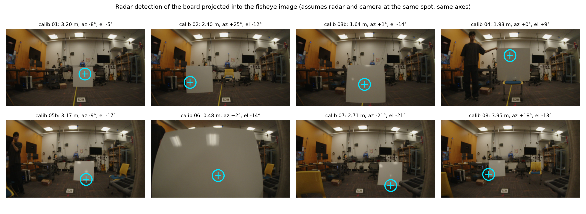

# M4: radar to camera extrinsics

**Status:** Preview done (2026-10-21); calibration pending

## Question
Where is the radar relative to the camera, and how far do projected radar points land from the target in the image?

## Method
8 calibration placements. For each: range, azimuth (bias removed) and elevation (phase difference between the two rows, sign −1) give a 3D point; Kannala-Brandt projection with the red-rover fisheye intrinsics. Next: mark the target centre in each image, solve the 6-DoF extrinsics (PnP + RANSAC), report reprojection error.

## Data
`calib_01`, `calib_02`, `calib_03b`, `calib_04`, `calib_05b`, `calib_06`, `calib_07`, `calib_08` (2026-10-21).

## Results
| Placement | Range | Azimuth (+ left) | Elevation | Image error after calibration |
|---|---|---|---|---|
| 01 | 3.20 m | −8° | −5° | TBD px |
| 02 | 2.40 m | +25° | −12° | TBD px |
| 03b | 1.64 m | +1° | −14° | TBD px |
| 04 | 1.93 m | 0° | +9° | TBD px |
| 05b | 3.17 m | −9° | −17° | TBD px |
| 06 | 0.48 m | +2° | −14° | TBD px |
| 07 | 2.71 m | −21° | −21° | TBD px |
| 08 | 3.95 m | +18° | −13° | TBD px |

| Extrinsics | Before (co-located guess) | After |
|---|---|---|
| Translation (m) | 0, 0, 0 | TBD |
| Rotation (deg) | 0, 0, 0 | TBD |
| Mean reprojection error (px) | TBD | TBD |

*Preview: radar detections projected with no extrinsics; all 8 land on or at the edge of the board*

*Pending: same 8 images after calibration, with the target centre marked and the residual drawn as a line. Source: TBD.*

*Pending: reprojection error vs range and vs azimuth. Source: TBD.*

## Conclusion
Pending. The preview already lands every detection on the target, so the uncalibrated offset is small.

## Open items
- Mark the board centre in each image (or use a corner reflector apex next time)
- Solve and report extrinsics; check calib 06 (0.48 m), where a few cm of offset matter most

## B-roll to capture (for the 5-minute video)
- [ ] Phone photo of the rig showing where radar and camera sit
- [ ] Overlay video: radar points on the camera feed, before vs after calibration

## Reproduce
TBD in `src/`.

[Back to all experiments](../../EXPERIMENTS.md)
