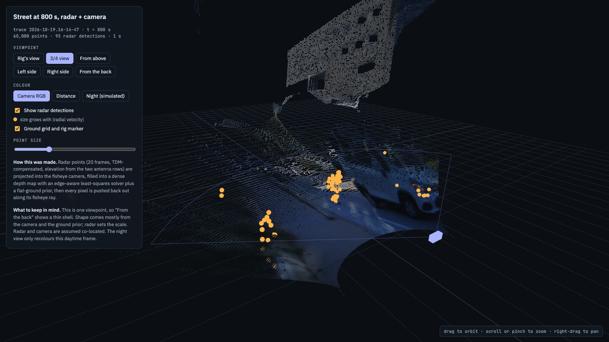
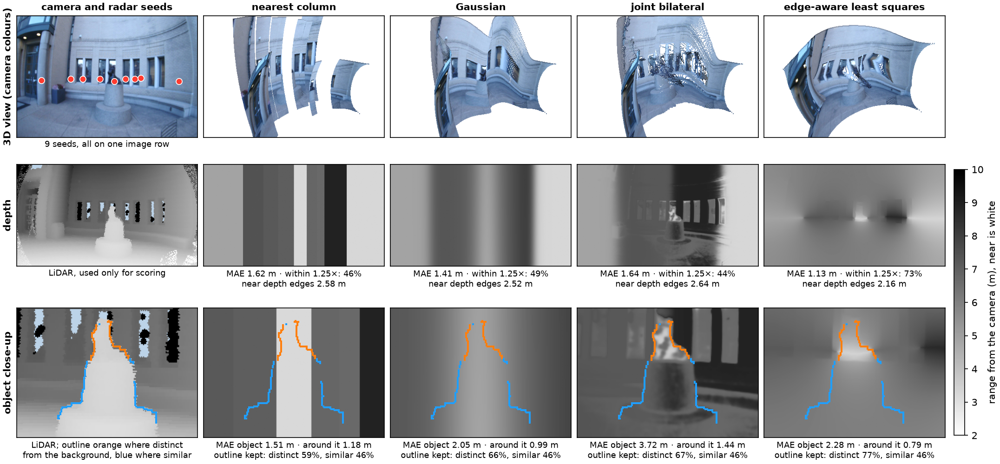

# M6: camera-guided dense depth, evaluated against LiDAR

**Status:** Preliminary (2026-11-11): the static outdoor scene B and the Scotty static scene, day; night pair not recorded yet

## Question
How much of the camera's structure can be lent to sparse radar depth, and where does it break?

## Method
Project radar points into the fisheye image; fill with joint bilateral upsampling (normalized convolution) and an edge-aware weighted least-squares solver; compare with a monocular-depth baseline. Ground truth: 128-beam LiDAR projected into the camera.

## Data
`scene_room` (indoor, 64-beam LiDAR), Session 2 static scenes (128-beam), night repeats if recorded.

## Results
| Method | MAE 0-5 m | MAE 5-10 m | MAE 10-20 m | Day | Night |
|---|---|---|---|---|---|
| Radar points only (nearest) | TBD | TBD | TBD | TBD | TBD |
| Joint bilateral upsampling | TBD | TBD | TBD | TBD | TBD |
| Weighted least squares | TBD | TBD | TBD | TBD | TBD |
| Monocular depth (baseline) | TBD | TBD | TBD | TBD | TBD |


*Pending: four columns: camera, radar points, dense depth, LiDAR ground truth; one row per scene. Source: TBD.*


*Pending: error map: dense depth minus LiDAR, coloured. Source: TBD.*


*Pending: MAE vs distance bin, one line per method. Source: TBD.*


*Preview from rig day 1 (no LiDAR): radar points and camera-coloured dense depth in the 3D viewer*


## First run (2026-11-11): one static scene, day
Scene: `2026-11-05.16-10-35`, rig static outdoors: a small car at 7 m, a building wall running away to the right at 5 to 10 m, two tripods at 3.5 m (one with a reflector), far buildings at 15 to 20 m. Radar frames 5 to 55 s (500 frames), camera frame and LiDAR scans at 12 s, everything at a quarter of the image resolution.

**Seeds.** With the rig still, a cell that is a surface keeps detecting: cells hit in at least 30 % of the frames (SNR over 10 dB) are kept, 38 of them. A cell is dropped as an azimuth sidelobe when another one in the same range bin is more than 12 dB stronger (2 dropped), and per azimuth only the nearest is kept, because the radar sees past an object the camera cannot (12 left in the image). A seed has no height, so it is drawn at the radar's own height: one row in the image.

Against the LiDAR at their own pixel, **6 of the 12 seeds are within 0.2 m** (−0.12 to +0.19 m). The other six, each a different failure:

| Azimuth | Seed | Seed − LiDAR | What it is |
|---|---|---|---|
| −22° | 19.6 m | +10.0 m | echo at twice the wall's range (the wall is at 9.6 m) |
| +51° | 3.6 m | −6.6 m | azimuth sidelobe of the reflector at 3.5 m, 11 dB down, so it passes the 12 dB test |
| +39° | 7.3 m | −7.4 m | a thin object in front of a far background (probably the lamp post; not confirmed) |
| +5° | 4.7 m | −2.6 m | a low return in front of the car (probably the kerb; not confirmed): right range, wrong height |
| −26° | 3.7 m | −1.5 m | the second tripod: real, but a few pixels wide |
| −41° | 7.3 m | −1.2 m | a weak cell (52 % of frames) in front of the wall seed at 8.7 m |

**Fills.** Mean absolute error against the LiDAR, pixels more than 0.3 m above the ground, 9,155 pixels:

| Fill | 0–5 m | 5–10 m | 10–20 m | 0–20 m |
|---|---|---|---|---|
| Nearest seed per column (no image) | 0.68 | 2.50 | 10.04 | 3.57 |
| Gaussian (image position only) | 1.55 | 1.69 | 8.91 | 2.77 |
| Joint bilateral (position and colour) | 1.95 | 1.92 | 9.42 | 3.05 |
| Joint bilateral, confident pixels only (80 % of them) | 2.22 | 2.02 | 9.88 | 3.39 |

Upper bound, not a method: the same fills from only the six seeds the LiDAR agrees with.

| Fill | 0–5 m | 5–10 m | 10–20 m | 0–20 m |
|---|---|---|---|---|
| Nearest seed per column | 0.82 | 1.01 | 9.59 | 2.29 |
| Gaussian | 0.87 | 1.01 | 9.62 | 2.30 |
| Joint bilateral | 1.02 | 1.08 | 9.63 | 2.36 |
| Joint bilateral, confident pixels only (69 %) | 0.75 | 1.12 | 4.54 (66 px) | 1.15 |

What this says, on this one scene:

- **The seeds limit the result, not the fill.** Half of them are wrong or sit on something a few pixels wide, and no fill can repair a wrong seed. Removing them (which only the LiDAR can do here) takes the 5–10 m error from about 2 m to about 1 m.
- **Colour guidance did not help here.** The joint bilateral fill is no better than the Gaussian one, with all seeds or with the verified ones. With a dozen seeds on one row most pixels have one seed in reach, so there is little for the colour term to choose between; and this scene has no depth edge between wide objects (car 7 m, wall 5 to 10 m behind and beside it).
- **What the colour term does give is a confidence.** It leaves the sky and the far buildings empty instead of painting them with the car's depth: with verified seeds the confident pixels are at 1.15 m overall.
- **The far buildings (10–20 m) are wrong in every fill.** Their seeds exist (15.5 m) but lie behind the car at the radar's height, so the first-return rule drops them; they are visible only higher in the image, where no seed is drawn.

Parameters were set by hand on this scene (sigma 100 px across, 320 px up, 0.08 in Lab/100) and not tuned against the LiDAR. The figures carry a camera frame and are kept local (`data/sessions/dense/`).

## Scotty, rig on a stand (2026-11-11)
Scene: `2026-11-05.16-34-29` (second take `16-36-41`), the statue 3.2 m ahead with its curved wall about 7 m behind. Same seeds as above (21 persistent cells, 9 seeds in the image; 7 of 9 within 0.35 m of the LiDAR, the statue's seed −0.26 m). Two more fills next to the first three: a **constant** depth (the median seed), and an **edge-aware least squares** fill (the seed row filled by nearest seed, then a smoothness term weak across colour edges: σ 0.05 in Lab/100, λ 1; point seeds alone are degenerate for a 2D smoothness term). Two more regions: pixels **near a depth edge** of the LiDAR (a 7 × 7 window spanning more than 1 m, grown by 3 px), and the **statue**, cut out of the LiDAR (points within 0.9 m of its axis at (−3.21, 0.24) m in the LiDAR frame), split at 1.05 m above the ground into the stone pedestal and the bronze figure.

Mean absolute error, 0–20 m, above the ground (m):

| Fill | All | Near depth edges | Statue | Around the statue | Stone pedestal | Bronze figure |
|---|---|---|---|---|---|---|
| Constant (median seed) | 1.29 | 2.38 | 3.44 | **0.55** | 3.47 | 3.36 |
| Nearest seed per column | 1.62 | 2.58 | **1.51** | 1.18 | **1.80** | **0.59** |
| Gaussian | 1.41 | 2.52 | 2.05 | 0.99 | 2.17 | 1.69 |
| Joint bilateral | 1.64 | 2.64 | 3.72 | 1.44 | 4.10 | 2.52 |
| Edge-aware least squares | **1.13** | **2.16** | 2.28 | 0.79 | 2.62 | 1.24 |

"Around the statue": the rest of the statue's close-up box, more than 2 px from its outline (mostly wall). Nearest column wins on the statue only because the statue seed's 34 px column band lands on its middle (0.14 m inside the band, 3.5 m outside); the wall in that band is pulled 3.9 m forward. Read statue and around-the-statue together.

Second take, same order: all 1.31, 1.74, 1.66, 1.78, 1.35; statue 3.40, 1.50, 1.91, 2.78, 2.05. With only the seeds the LiDAR agrees with (an upper bound): statue 3.40, 1.51, 1.96, 3.24, 2.35.

- **The radar has the statue's depth; colour guidance moves it.** Without the image the bronze figure is at 0.59 m. The joint bilateral fill is the worst on the statue: the figure (median lightness 0.21 in the guide) is as dark as the windows of the wall 7 m behind (0.17 to 0.23 at the wall's seeds beside it) and lighter than the patch at its own seed (0.10); the stone pedestal (0.44) matches the stone wall (0.43 to 0.60). The colour test picks the wall's seeds for both parts.
- **The overall average hides this**: the wall covers most pixels, and a constant depth already scores 1.29 m.
- **Connectivity instead of colour** (least squares) is best overall and near depth edges, but not on the statue.
- Parameters set by eye on this scene, not tuned against the LiDAR. The least-squares fill has no useful confidence yet (its cut keeps every pixel).

**Distinct and similar outlines** (TA question: objects that stand out vs objects that look like their background). The statue's outline (closed LiDAR mask, only where the range steps by more than 1 m) is split by colour contrast across it: ≥ 15 Lab units is distinct (89 px, bronze against the window frames), < 7 is similar (134 px, stone pedestal against stone wall). Score: share of pixels within 4 px of the outline that the fill puts on the right side (`src/eval/silhouette.py`).

| Fill | Distinct (take 1 / 2) | Similar (take 1 / 2) |
|---|---|---|
| Constant | 47 / 47 % | 46 / 46 % |
| Nearest column | 59 / 58 % | 46 / 47 % |
| Gaussian | 66 / 68 % | 46 / 46 % |
| Joint bilateral | 67 / 57 % | 46 / 44 % |
| Edge-aware least squares | **77 / 78 %** | 46 / 46 % |

No fill keeps a similar outline (all score like a constant). On a distinct one, least squares keeps the most; joint bilateral is no better than Gaussian. LiDAR spread to every pixel: 88 / 91 %.



*`2026-11-05.16-34-29` at 30 s. First column: camera with the 9 seeds, LiDAR depth, LiDAR statue close-up with its outline (orange distinct, blue similar). One column per fill: 3D view in camera colours (`src/fusion/view3d.py`), depth (grey, near is white, 2–10 m), statue close-up; numbers under each panel. The constant fill is in the JSON only. Numbers: `dense_scotty_1105.json`, `dense_scotty_1105_take2.json`, `dense_scotty_1105_upper_bound.json` in this folder.*

## Conclusion
Pending: one scene only. Next are a scene with a depth edge between wide objects (Scotty in front of its wall, the Jeep in front of the car row) and the night pair.

## Open items
- The seed failures above: the echo at twice the range, sidelobes within 12 dB, thin objects, returns from another height
- A scene where colour should matter: a wide object in front of a far background
- Ground pixels: no seeds there; they are excluded from the numbers above, not solved
- Night pair of the Scotty static scene (not recorded yet)

## B-roll to capture (for the 5-minute video)
- [ ] Orbit video of the coloured 3D point cloud in the web viewer
- [ ] Side-by-side: camera frame vs dense depth vs LiDAR

## Reproduce
```bash
python -m src.fusion.dense_depth data/raw/2026-11-05.16-10-35 --time 12 --start 5 --seconds 50 --out out/dense_static_b.png
python -m src.fusion.dense_depth data/raw/2026-11-05.16-10-35 --time 12 --start 5 --seconds 50 --verified 0.5 --out out/dense_static_b_verified.png   # upper bound
python -m src.fusion.dense_depth data/raw/2026-11-05.16-34-29 --start 5 --seconds 50 --time 30 --object -3.21 0.24 0.9 --object-split 1.05 --vmin 2 --vmax 10 --out figures/dense_scotty_1105.png
python -m pytest tests/test_jbu.py tests/test_silhouette.py -q
```
`src/fusion/seeds.py` (persistent cells, sidelobe and first-return rules, projection), `src/fusion/jbu.py` (nearest, Gaussian and joint bilateral fills), `src/fusion/wls.py` (edge-aware least squares), `src/eval/lidar_depth.py` (LiDAR depth in the image, error by distance), `src/eval/silhouette.py` (object outline, distinct/similar split, outline kept), `src/fusion/dense_depth.py` (the figure and a JSON with every number).

[Back to all experiments](../../EXPERIMENTS.md)
