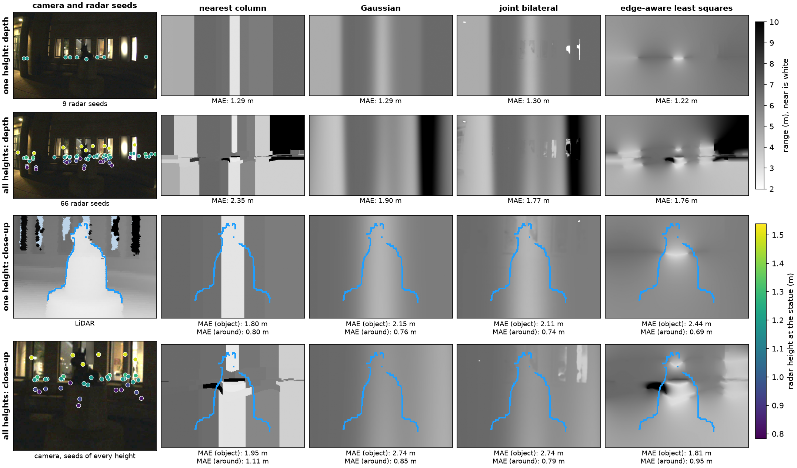
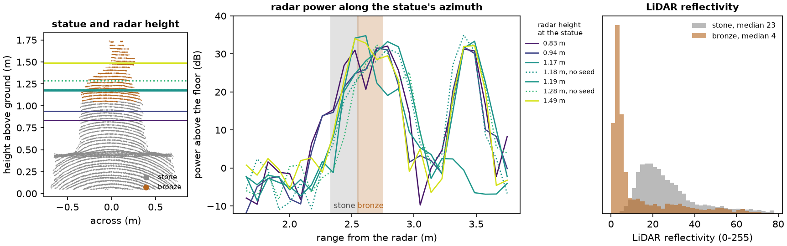

# M7: Several heights at one mark, by night; bronze against stone

**Status:** Done (2026-11-20). Proposal items 2 (night half), 3 and 6.

## Question
Does stacking takes from several radar heights give the dense-depth fills seeds on several image rows, and so better depth? Which part of the statue, the bronze figure or the stone pedestal, does the radar see from each height?

## Data
- Night height stack, 11/19 ([SESSIONS.md](../../SESSIONS.md), session 5): `2026-11-19.17-40-44`, `17-43-28`, `17-45-02`, `17-46-37`, `17-48-40`, `17-51-19`, `17-53-30`. Rig static at one mark, 2.5 m from the Scotty statue, raised or lowered between takes. 3–39 s of each take (360 frames); the camera frame and LiDAR scans at 20 s.
- Reference: the first take, `17-40-44`. Its camera frame is the guide for every fill; its LiDAR is the score.
- The statue: LiDAR points within 0.9 m of (−2.65, 0.08) in the reference LiDAR frame. Stone pedestal below 1.05 m above the ground, bronze figure above; the figure ends at 1.75 m.

## Method
1. **Registration.** Each take's LiDAR (five scans merged) is levelled on its RANSAC ground plane, then aligned to the reference with point-to-plane ICP within 15 m. The LiDAR is used for this and for the score only, never for the depth.
2. **Seeds.** The same static first-return seeds as `dense_depth`, per take. A seed goes from radar k to LiDAR k (joint extrinsics), then to the reference LiDAR (ICP), then into the reference camera. A seed still sits on its radar's horizontal plane, so each take's seeds form their own row.
3. **Fills.** The four fills of section 7 and a constant. Nearest column and least squares are anchored on every take's row. With one take they reduce exactly to `dense_depth` (same numbers to the cent).
4. **Score.** As in m6: MAE above the ground, on the statue, around it, per part, and the outline kept. The stack is compared with the first take alone and with each of the seven takes alone, all in the reference image.
5. **Materials.** Per take: the range-azimuth power (summed over Doppler, averaged over 60 frames) along the statue's azimuth, the CFAR threshold there, and the LiDAR range from that take's radar to the stone and the bronze inside ±7° of the statue. Also the LiDAR's reflectivity channel on each part.

## Results

**Registration.** ICP residual 1.8–2.6 cm with 86–95 % inliers, and each take's own ground plane agrees with its registered height to 1 cm.

| Take | LiDAR height (m) | Tilt (°) | Yaw vs take 1 (°) | Radar's plane at the statue (m) | Statue seed | Statue peak (dB, range) | CFAR threshold (dB) | Stone front (dB) |
|---|---|---|---|---|---|---|---|---|
| `17-53-30` | 1.20 | 4.9 | +2.1 | 0.83 | yes | 32 at 2.79 m | 34 | 14 |
| `17-51-19` | 1.30 | 5.3 | −0.1 | 0.94 | yes | 32 at 2.70 m | 32 | 14 |
| `17-46-37` | 1.48 | 3.9 | −6.9 | 1.17 | yes | 35 at 2.61 m | 33 | −1 |
| `17-43-28` | 1.53 | 2.5 | +0.6 | 1.18 | **no** | 31 at 2.79 m | 34 | 6 |
| `17-40-44` | 1.53 | 2.5 | 0 | 1.19 | yes | 33 at 2.79 m | 24 | 8 |
| `17-45-02` | 1.62 | 3.3 | −2.2 | 1.28 | **no** | 32 at 2.70 m | 33 | 8 |
| `17-48-40` | 1.42 | 8.0 | +1.4 | 1.49 | yes | 34 at 2.53 m | 32 | 9 |

Powers are relative to the median of the map from 1 to 6 m. Tilt is between the LiDAR's axis and the reference ground's normal. The LiDAR's range from the radar is 2.24–2.40 m to the front of the stone and 2.53–2.91 m to the bronze.

**Dense depth, MAE (m) against the LiDAR.**

| Fill | Take 1 alone: above ground / statue / around / stone / bronze | Seven heights | Seven takes alone: median (range), above ground / statue |
|---|---|---|---|
| Constant | 1.23 / 3.45 / 0.70 / 3.47 / 3.39 | 1.22 / 3.41 / 0.68 / 3.43 / 3.35 | — |
| Nearest column | 1.29 / 1.80 / 0.80 / 2.11 / 0.77 | 2.35 / 1.95 / 1.11 / 1.75 / 2.61 | 2.52 (1.29–3.56) / 2.56 (1.18–5.44) |
| Gaussian | 1.29 / 2.15 / 0.76 / 2.27 / 1.77 | 1.90 / 2.74 / 0.85 / 2.78 / 2.63 | 2.15 (1.29–3.00) / 2.22 (1.74–4.10) |
| Joint bilateral | 1.30 / 2.11 / 0.74 / 2.23 / 1.71 | 1.77 / 2.74 / 0.79 / 2.78 / 2.60 | 1.46 (1.27–3.00) / 2.25 (1.74–4.12) |
| Edge-aware least squares | 1.22 / 2.44 / 0.69 / 2.66 / 1.75 | 1.76 / 1.81 / 0.95 / 1.58 / 2.53 | 1.64 (1.22–2.53) / 3.01 (1.56–4.06) |

**Outline.** At night none of the statue's outline is distinct in colour (0 px with contrast ≥ 15, 277 px below 7). Every fill keeps 48–52 % of it from one height and 46–50 % from all heights; a constant keeps 46 %.

**LiDAR reflectivity** (0–255, median): stone 23, bronze 4.



*Rows: the first take alone and all seven, as depth and as the statue close-up. Seeds are coloured by the height of the radar's plane at the statue.*



*Left: the statue's LiDAR points by part, with the height of each take's radar plane (dotted: no statue seed). Middle: radar power along the statue's azimuth against range from the radar, one line per take, with the LiDAR's range spans of the stone and the bronze. Right: LiDAR reflectivity by part.*

## Conclusion
Stacking heights does not help the scene. With seven heights, the error above the ground is 1.76–2.35 m, against 1.22–1.30 m from the first take alone and a median of 1.46–2.52 m over the takes alone. Least squares improves on the statue (1.81 m, better than 6 of the 7 takes alone), mostly on the pedestal. The power profile explains why: it is the same from every height, with the peak at the bronze's range even when the radar's plane crosses the stone. At 2.5 m the elevation beam covers the whole statue from every height, so a seed's height is the radar's, not the reflector's. Extra heights add seeds at the wrong height, not new vertical information.

The radar sees the bronze. The stone shows only from the two lowest heights, as a 14 dB shoulder at the pedestal's front, 18 dB below the bronze; from 1.17 m up it stays within 9 dB of the floor. The LiDAR is the other way round: reflectivity 23 on the stone and 4 on the bronze.

The two takes without a statue seed are a detector effect, not a height or material one. The statue's power there is as high as in the others (31–32 dB). An object 1.3 m tall, 3.4 m from the radar and about 20° to its right, is in every take but the first. Along the statue's azimuth it falls in the range CFAR's training cells, 0.6 m beyond the statue, and raises the threshold from 24 dB (first take) to 32–34 dB.

## Open items
- What the 1.3 m object beside the statue was (not in the first take; equipment set down, most likely).
- The elevation from the phase between the array's two rows (hope 1, `x9-elevation`): this stack is the test set, the same statue from six known heights.
- The LiDAR heights logged on 11/19 (1.41–1.91 m) were wrong; corrected in `SESSIONS.md` and `notes/shots.csv`.

## Reproduce
```
python -m src.fusion.stack --ref data/raw/2026-11-19.17-40-44 \
    --takes data/raw/2026-11-19.17-{40-44,43-28,45-02,46-37,48-40,51-19,53-30} \
    --object -2.65 0.08 0.9 --hide 1440 300 1530 620 --hide 995 335 1040 480 --out out/stack_1119.png
```
`--hide` blurs two lit windows with people behind them in the shown frame only; the fills use the frame as recorded. Writes `stack_1119.png`, `stack_1119_3d.png`, `stack_1119_materials.png` and `stack_1119.json`, copied to `figures/stack_scotty_1119.png`, `figures/stack3d_scotty_1119.png`, `figures/materials_scotty_1119.png` and here as `stack_scotty_1119.json`.
