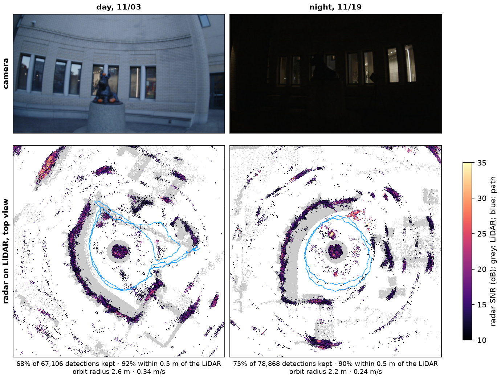
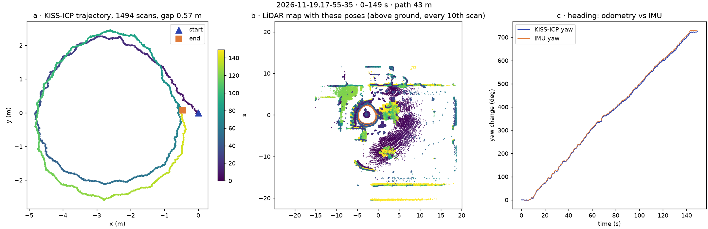
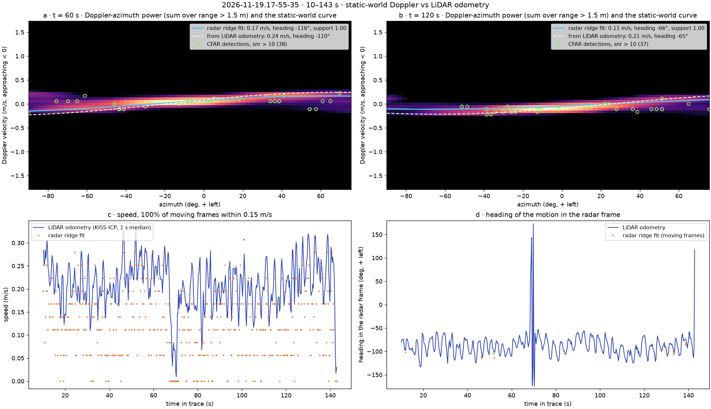
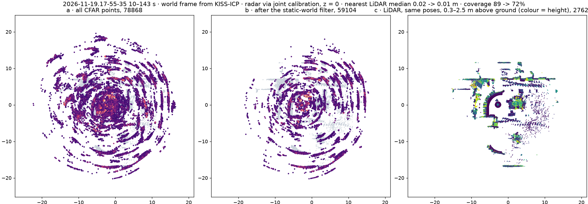

# Night orbit: the day chain, after dark

**Status:** done (2026-11-20). Proposal item 4, the night half.

## Question
Does the radar reconstruction of an orbited object change at night? Nothing in the chain uses the camera (poses from the LiDAR, static test from the radar's Doppler), so it should not.

## Data
- Night: `2026-11-19.17-55-35`, 10–143 s: two laps around the Scotty statue after dark, radius 2.2 m, 0.24 m/s.
- Day, for comparison: `2026-11-03.17-01-12`, 30–165 s: two passes around the same statue before dark, radius 2.6 m, 0.34 m/s.

## Method
The same commands and settings as the day orbit (`notes/sessions/2026-11-03.md`): KISS-ICP poses with gyro deskew, the radar's Doppler checked against the odometry, CFAR points accumulated in the world frame, the static-world test, the LiDAR layer 0.3–2.5 m above the ground with the same poses as the reference.

## Results

| | Day, 11/03 | Night, 11/19 |
|---|---|---|
| Odometry | 79 m path (whole trace), yaw −66° vs IMU −52° (whole trace) | 43 m path, two laps close to 0.57 m, yaw +723° vs IMU +731° |
| Doppler vs odometry, moving frames (> 0.3 m/s) | 90 % within 0.15 m/s, heading 8° | 15 frames only: 100 % within 0.15 m/s, heading 7° |
| CFAR detections | 67,106 | 78,868 |
| Kept by the static test | 68 % | 75 % |
| Kept points within 0.5 m of the LiDAR | 92 % | 90 % |
| LiDAR cells covered (all → kept) | 83 → 71 % | 89 → 72 % |



*Top: a camera frame from each orbit. Bottom: radar points kept by the static test (colour = SNR) on the LiDAR (grey), with the path (blue), 14 m across, centred on the statue.*







## Conclusion
The night orbit scores as the day one: 90 % against 92 % within 0.5 m, 72 % against 71 % coverage, the same pedestal ring and curved wall in the top view while the photograph is nearly black. The higher pass rate at night (75 % against 68 %) follows the slower walk: at 0.24 m/s most of the scene lies within one Doppler bin (5.6 cm/s) of zero, so the static test removes less, and the Doppler check has only 15 moving frames to test. The radar's ridge fit reads lower than the odometry at this speed (0.11–0.17 against 0.21–0.24 m/s in the two frames shown).

## Open items
- The two orbits differ in radius and speed; a strict day/night pair would need the same path.
- CFAR against GRT on this orbit (proposal item 5).

## Reproduce
```bash
python -m src.recon.poses data/raw/2026-11-19.17-55-35 --out figures/poses_scotty_1119.png
python -m src.recon.ego_check data/raw/2026-11-19.17-55-35 --start 10 --seconds 133 --frames 60 120 --out figures/ego_check_scotty_1119.png
python -m src.recon.accumulate data/raw/2026-11-19.17-55-35 --start 10 --seconds 133 --out figures/accum_scotty_1119.png
python -m src.recon.day_night --day data/raw/2026-11-03.17-01-12 30 165 95 --night data/raw/2026-11-19.17-55-35 10 143 70 \
    --centre-day -13.17 -9.88 --centre-night -2.76 0.08 --out figures/day_night_scotty.png
```
The day orbit's `data/recon/2026-11-03.17-01-12/` comes from its own `accumulate` run (same settings, 30–165 s).

[Back to all experiments](../../EXPERIMENTS.md)
