# 360° orbits: how object size and material change what the radar sees

**Status:** Data partly recorded (2026-10-29, 2026-11-03); poses, static-world filter and accumulation working (2026-11-01); Scotty reconstructed from all three sensors in one object frame and a viewer to compare them (2026-11-07); the per-object table across car / tree / wall still pending

## Question
For a car, a small metal object, a tree or sculpture and a building wall: how much of each object does the radar capture, compared with the 128-beam LiDAR?

## Method
Orbit each object once (radius 2 to 5 m, 0.5 to 1 m/s, start and stop at a marked spot), camera pointed at the object. Poses from LiDAR SLAM; radar points accumulated in the object frame.

## Data
Recorded 2026-10-29 (see [session log](../../notes/sessions/2026-10-29.md)): car = `2026-10-29.15-49-40` 11-17 min; sculpture (thin metal pole) = `2026-10-29.16-12-38` 5:30-9:40; small metal (Scotty) = `2026-10-29.16-22-36` 2:59-3:45. Small metal again, better: `2026-11-03.17-01-12` 30-165 s, two passes at 2.6 m ([session log](../../notes/sessions/2026-11-03.md)). Spin in place: `2026-11-03.17-18-46`. Still to record: tree, GHC wall, a small object with nothing behind it.

## Poses (2026-11-01)
KISS-ICP (LiDAR-only odometry, no loop closure, `src/recon/poses.py`) on the OS-0-128 scans, 25 scans/s on CPU. Three things had to be right before the trajectory held together. The LiDAR geometry: with the beam-azimuth sign flipped (the bug fixed on 11/1) the odometry diverged within a minute. The deskew: KISS-ICP's own constant-velocity deskew feeds its per-scan jitter back into the next scan on this handheld rig and doubled the apparent path (685–705 s: 28 m with it, 14 m without); each scan is now un-skewed with the IMU's z gyro instead (column j was measured at ts + j/2048 × 0.1 s, rotated back to mid-scan), which on the 98°/s swing at 720 s leaves 4° against the gyro where the built-in deskew leaves +98° and no deskew −208°. The map: with KISS-ICP's defaults (50 m, 0.5 m voxels) the sparse far returns of the open parking lot steer the registration during that same swing (−267° even with gyro deskew); 30 m / 0.3 m brings it to 15°.

| Window | Scans | Path | Heading, odometry vs IMU | Note |
|---|---|---|---|---|
| `15-49-40` 660–1020 s (loop at the start, walk 35 m, two orbit laps) | 3,552 | 237 m | −1288° vs −1133° | the two laps overlap; the 155° difference accumulates in two slips while standing still and spinning (785–890 s), not on the orbit |
| `16-22-36` 160–230 s (Scotty) | 700 | 32 m | +598° vs +608° | not a closed loop (gap 14 m) |

Poses are written to `data/poses/<trace>/lidar.npz` (per scan) and `radar.npz` (interpolated to radar frames: linear position, slerp rotation), world frame = first scan of the window. Per-scan position jitter is still ~0.1 m (95th percentile 0.12 m), so anything differentiated from the poses needs smoothing. Drift on the orbit itself is to be measured by closing a lap next time (start and end at a marked spot).

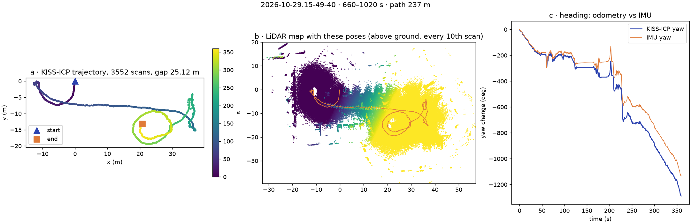

*KISS-ICP on `15-49-40` 660–1020 s: trajectory, LiDAR map built with these poses, heading against the IMU. The ring around the path in the map is the operator. `python -m src.recon.poses data/raw/2026-10-29.15-49-40 --start 660 --seconds 360`.*

## Static-world filter: does the radar's Doppler agree with the odometry? (2026-11-01)
A static target at azimuth az seen from a sensor moving with velocity v shows Doppler v_r = −v · u(az), u = (−sin az, cos az), negative = approaching on our Doppler axis (the sign was settled on the straight walk to the Jeep, 735–780 s: the static-world ridge sits at −1.1 m/s straight ahead). `src/radar/ego.py` fits that cosine to the strongest return of every azimuth bin (one vote each, power-weighted) and `src/recon/ego_check.py` compares the fit with the velocity from the LiDAR poses (1 s median, rotated into the radar frame with the joint calibration). The two never see each other, so their agreement checks the Doppler axis, the pose velocity, the calibration yaw and the time alignment at once.

They agree. On Scotty the ridge speed is within 0.15 m/s of the odometry on 89 % of moving frames (median difference 0.08 m/s) and the heading within 6°, through the approach at 1 m/s and the sideways orbit at 0.3 m/s. On the Jeep window every moving segment lines up (the 0.5 m/s loop at the start, the 1.1 m/s walk, the 0.5–0.6 m/s orbit with the motion 85° to the left of the radar axis); the overall 42 % within 0.15 m/s is pulled down by the slow orbit, where the whole scene sits inside ±0.5 m/s and the ridge amplitude is uncertain by about that much. The heading agrees to 13° there.

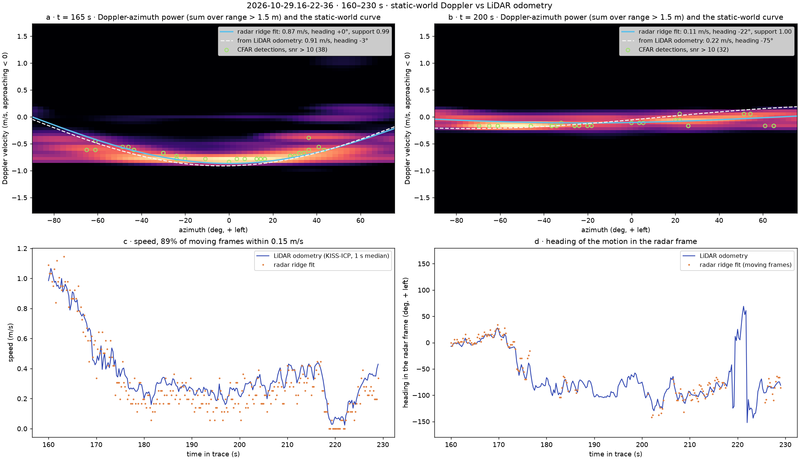

*`16-22-36` 160–230 s: Doppler-azimuth power of two frames with the static-world curve from the radar alone (blue) and from the LiDAR poses (dashed), and the CFAR detections of those frames; speed and heading over the window from both. `python -m src.recon.ego_check data/raw/2026-10-29.16-22-36 --start 160 --seconds 70 --frames 165 200`.*

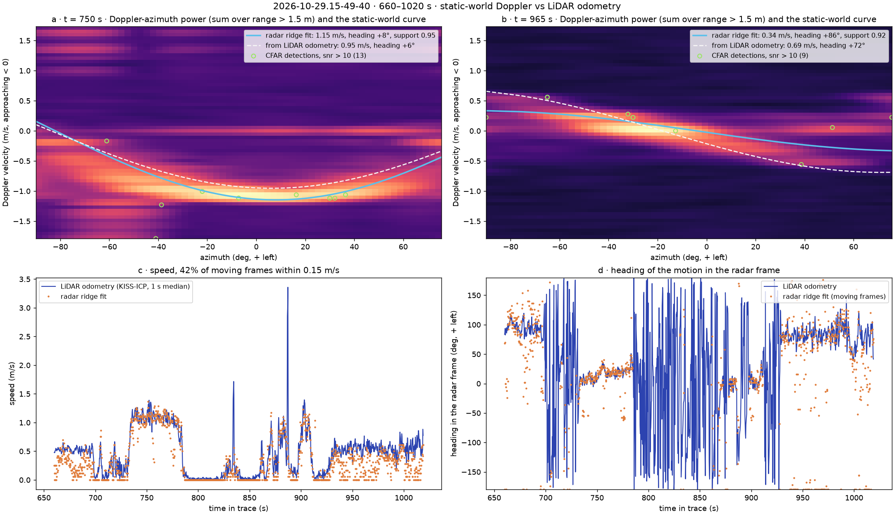

*Same for `15-49-40` 660–1020 s (`--frames 750 965`). The 720 s spike in the odometry speed is the look-around swing that the deskew and map settings above were tuned on.*

## Accumulation in the world frame (2026-11-01)
`src/recon/accumulate.py`: CFAR points of every radar frame (snr > 10), the static-world test with the odometry velocity (|v − (−v_sensor · u(az))| < 1.5 Doppler bins), the slant range placed in the plane (z = 0; the elevation estimate is unusable, see the close-up below), joint calibration into the LiDAR frame, the interpolated pose into the world. Next to it the LiDAR built with the same poses, the operator and rig dropped (within 1.5 m), and only the layer 0.3–2.5 m above the ground kept, within 15 m of the sensor; that layer is roughly what the radar sees. The ground is estimated per scan in the sensor frame, in two steps: a plane fitted to the low points within 10 m (the handheld rig is tilted, so in the sensor frame the ground is a slope of up to ±1 m at 5 m), then per 2 m cell the 5th percentile of the residual to that plane, so a terrace or the raised lawn next to Scotty's plaza counts as ground too. Per scan because the odometry's z and pitch jitter smears the ground into a 0.5 m slab in the world frame, where a height cut no longer separates it (the first try, a world-frame cut, left a lattice of ground wedges); the plane alone kept Scotty's lawn as a 0.3–0.5 m "layer", the cells alone let the tilted asphalt through. Two numbers, both within 15 m of the path: the xy distance from each radar point to the nearest LiDAR point of the layer, and coverage, the share of 0.5 m LiDAR cells that have a radar point within 0.5 m.

On the Jeep orbit (930–1020 s, two laps, 1,777 frames, 23,999 CFAR points) the static filter keeps 44 %. What it removes is the cloud inside the orbit (panel a): points with the wrong Doppler for their azimuth, the ghosts of the Jeep's two-bounce returns, sidelobes of the strong near echo, and the companion walking alongside. What stays (panel b) is the Jeep as a ring of returns around its LiDAR outline, the row of parked cars at 10–15 m, and the wall segments at the left, each where the LiDAR has them: the median distance to the LiDAR layer drops from 0.06 to 0.02 m and the share within 0.5 m rises from 77 to 88 %. Coverage drops from 81 to 69 %, so the filter also costs real points, mostly where the odometry velocity is least certain (the 1 s median lags turns) and at the edge of the field of view, where the static curve is steepest. On Scotty (160–230 s, 1,384 frames, 34,526 points) 72 % pass, the median distance goes from 0.02 to 0.01 m (90 to 92 % within 0.5 m) and coverage from 81 to 70 %. The pass rate tracks the odometry speed: at Scotty's 0.3 m/s the whole scene sits within a few Doppler bins of zero and little can fail the test; at 0.55 m/s around the Jeep more does. Both runs also write the dense range–azimuth power of every frame (`--dense`, `data/recon/<trace>/dense_power.npz`, float16 dB, with the frame index that keys the poses) for a reconstruction that does not start from CFAR points. These numbers use the 10/21 solve; with the 11/3 solve (`m4-extrinsics`) the Jeep orbit reaches 91 % within 0.5 m at the same 69 % coverage, and the Scotty orbit of 11/3 (`2026-11-03.17-01-12`, 30–165 s) 92 % at 71 %.

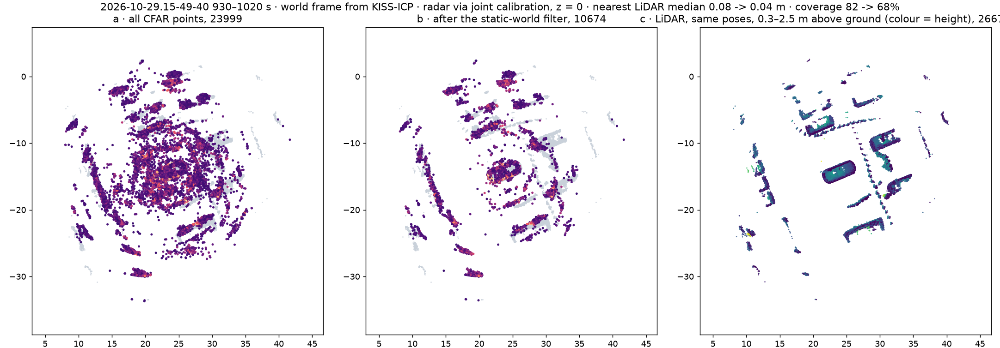

*`15-49-40` 930–1020 s, top view, world frame from KISS-ICP: all CFAR points (a), after the static-world filter (b), the LiDAR layer built with the same poses, coloured by height above ground (c); grey in a, b is the LiDAR. `python -m src.recon.accumulate data/raw/2026-10-29.15-49-40 --start 930 --seconds 90 --dense`.*

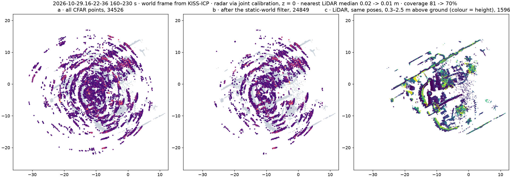

*Same for `16-22-36` 160–230 s. Scotty is the small cluster near the orbit centre; the arcs are the wall and planters behind it.*

What this is good for and what it is not: the accumulated static points sit on the LiDAR surfaces to a few centimetres in the plane, which is the calibration and odometry working; the object itself is still a ring the width of the 14° beam, with no height. Per-object numbers (points on the object per frame, extent against the LiDAR, echo strength versus viewing angle) are the next step, on these files.

## Up close: Scotty (2026-11-01)
`src/recon/closeup.py`: one object at the resolution each sensor has for it. Two camera frames of the approach, at 4.0 m and 2.2 m, carry the LiDAR scan of that instant and the radar detections of ten frames, both projected through the joint calibration; the LiDAR points are cut out within 1.2 m of the statue and coloured by height above the local ground, the radar points are drawn at the radar's height, red when they fall within half a metre of the pedestal. The statue's position starts as a guess (the orbit's centre) and is refined on every scan: a circle of fixed radius (0.39 m, fitted once on the 4 m scan, where most of the arc is visible) is fitted to the LiDAR points 0.45–1.0 m above ground, two parameters, Gauss–Newton with a shrinking inlier band. The guess was 0.45 m off; the per-scan centres then scatter 0.10 m about their mean, which is the odometry's jitter, and the cut-out from all 270 scans of the orbit (175–229 s) is drawn with that correction.

What each sensor has of a 1.9 m statue. The camera has all of it, fisheye, 1920 × 1080. The LiDAR at 2.2 m has 8,864 points on it, 7 mm apart across and 28 mm up, enough that the head, back and tail of the dog read from one scan (panel c); from the whole orbit, re-centred, the plinth, the cylinder and the dog are all there, the dog smeared by the odometry's yaw error, which the re-centring does not touch (d). The radar at 4 m sees the statue as two CFAR detections at 3.4–3.5 m (SNR 12–17 dB); its peak in the range–azimuth map is 36 dB above the noise floor and 9 dB below the wall behind it at 7.2 m (f). At 2.2 m it is 30 points of ten frames at 1.7–2.0 m, SNR up to 27 dB. Over the orbit the static points pile onto the pedestal: 3,041 of the 4,582 within 2.5 m lie within 0.35 m of its surface (e), a blob the size of the pedestal rather than a ring, because at 1–1.3 m from the axis the 14° beam and the 9 cm range bin each cover the whole object. The 2,299 rejected points form a ring around the path: the operator, who moves with the sensor and so carries the wrong Doppler for a static target. Below about 1.5 m the LiDAR–camera projection drifts off the photo (the solved translation is good to 0.1 m and parallax grows as 1/range), so the close frame is taken at 2.2 m.

One fix came out of this. The radar's elevation estimate was being used: `to_xyz` scales the range by cos(el) before z was zeroed, and with 13 % of detections at |el| > 20° and 8 % beyond 45°, those points landed short. `to_xy` now puts the slant range in the plane, and the accumulation numbers above are with it (Jeep, filtered: median 0.04 → 0.02 m, 86 → 88 % within 0.5 m).

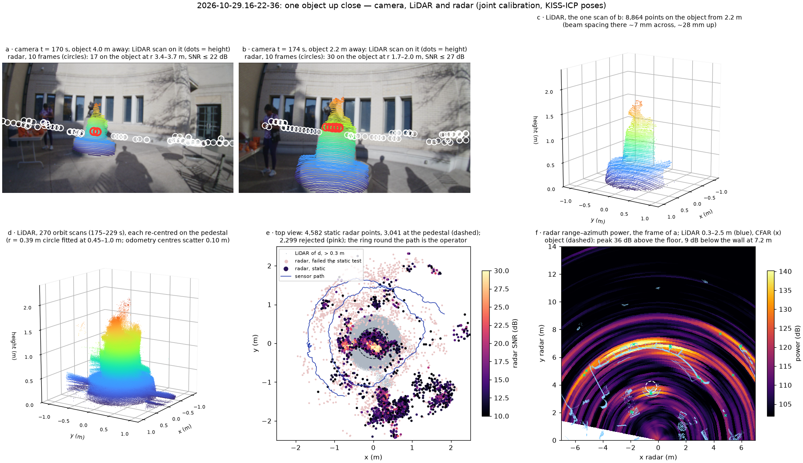

*`16-22-36`: a, b camera at 4.0 and 2.2 m with the LiDAR scan (colour = height) and the radar detections (circles, red on the object); c the one scan at 2.2 m; d the orbit's 270 scans re-centred on the pedestal; e top view with the orbit's radar points; f range–azimuth power of the 4 m frame with the LiDAR of that instant. `python -m src.recon.closeup data/raw/2026-10-29.16-22-36 --centre -12.45 -2.60 --far 170 --near 174 --orbit 175 229 --split --out figures/closeup_scotty.png`.*

## The Scotty orbit of 2026-11-03
Two passes in opposite directions at 2.6 m, on the 11/3 calibration (`17-01-12`, 30-165 s). Static-filtered radar points sit 1 cm (median) from the LiDAR, 92 % within 0.5 m, coverage 71 %; the Doppler ridge agrees with the odometry on 90 % of moving frames, 8° in heading. Up close the LiDAR has 7,129 points on the statue from one scan at 2.15 m and the radar 33 of 199 points on it; 674 scans re-centred on the 0.39 m pedestal scatter 0.11 m. The radar over the whole orbit is still one blob at the pedestal: 6,670 of 7,421 static points within 0.35 m of it, and at 2.6 m the 14° beam is 63 cm across a 78 cm pedestal. In range it does read the near side. The other long traces of that session went through the same chain ([session log](../../notes/sessions/2026-11-03.md)).

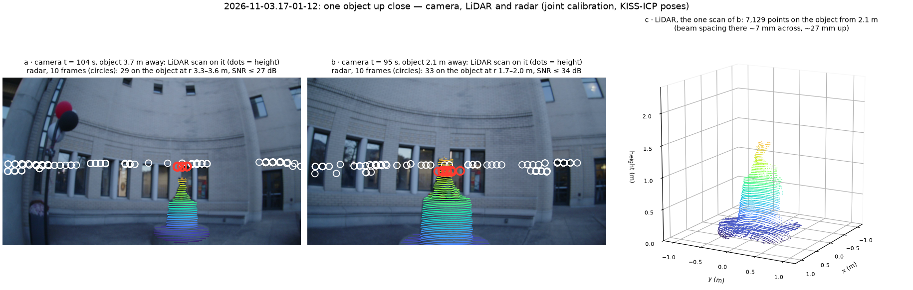

*`python -m src.recon.closeup data/raw/2026-11-03.17-01-12 --centre -13.20 -9.87 --far 104 --near 95 --orbit 30 165 --pedestal-radius 0.39 --split --out figures/closeup_scotty_1103.png`.*

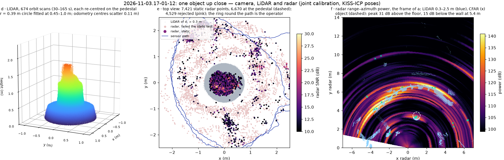

*The same command, second figure: 674 scans, the radar points of the orbit, the range-azimuth power of the far frame.*

## One object, three sensors, one frame (2026-11-07)

Everything above compares the radar with the LiDAR in the world frame. This section puts each sensor's
reconstruction of the *object* into a single frame so they can be laid on top of each other without
fitting anything: x and y in the world's orientation about the refined pedestal centre, z the height
above that scan's local ground. `src.recon.closeup` already computes exactly this for its panel (d);
`src/ext/obj_lidar/export_ply.py` turns it into a file, and `src/ext/obj_radar/export_ply.py` and
`src/ext/obj_rgb/` put the radar and the camera into the same frame. Because the frame is defined by
the object's own pedestal rather than by the odometry, three clouds built from three sensors land on
each other with no registration step, and any gap between them is a real disagreement.

All of it is the 11/3 Scotty orbit, `2026-11-03.17-01-12`, 30–165 s, on the 11/3 solve. The LiDAR is
the reference: 674 of 674 scans fitted, inlier share median 0.90, refined centre (−13.07, −9.86)
exactly as the close-up above, 4,052,776 points thinned to 2,187,651 on a 5 mm grid, 0.05–1.79 m tall.

The radar side has two clouds, and the gap between them is the point. **GRT** predicts a 64 × 128 × 64
(elevation, azimuth, range) occupancy grid per radar frame, already in the LiDAR sensor frame, so no
extrinsic enters; keeping the first occupied cell of each column (behind a surface the grid keeps
firing, and accumulating that over an orbit fills the object solid) and accumulating 674 frames gives
283,387 points. **CFAR** is the hand-written chain's own detections, `data/recon/<trace>/radar_points.npz`
after the static-world filter, 5,164 of them on the object; they carry no elevation, so they are drawn
at the radar's height and form a band, not a shape.

The threshold matters more than it does for scoring. At the 0.5 the alignment work uses, GRT fills the
whole 1.2 m cut-out evenly; at 0.9 the density finally concentrates on the object (37k points per m²
inside 0.15 m of the axis against 15k at 1.05–1.2 m). Even then it reaches the 2.6 m ceiling of the cut
against the statue's 1.79 m.

| Cloud | Points | Top | → LiDAR, median | LiDAR →, median | Within 5 cm | Symmetric trimmed Chamfer |
|---|---|---|---|---|---|---|
| radar, GRT p > 0.9 | 283,387 | 2.20 m | 17.1 cm | 1.3 cm | 22 % / 99 % | 7.35 cm |
| radar, CFAR static | 5,164 | 1.58 m | 1.1 cm | 40.2 cm | 94 % / 27 % | 13.70 cm |
| RGB, DA3 pose-free + Sim3 | 46,454 | 1.47 m | 1.4 cm | 2.2 cm | 72 % / 76 % | 1.94 cm |
| RGB, DA3 with poses, 32 frames | 50,637 | 1.70 m | 1.1 cm | 1.7 cm | 82 % / 81 % | 1.40 cm |
| RGB, DA3 with poses, 96 frames | 79,734 | 1.73 m | 1.0 cm | 0.9 cm | 82 % / 88 % | 1.01 cm |
| LiDAR (reference) | 75,714 | 1.79 m | — | — | — | — |

*Both directions of the nearest-point distance, on 2 cm voxels, in the band 0.25–2.2 m and within
1.2 m of the axis, so the ground is out of both clouds. The Chamfer averages the nearest 80 % of each
direction.*

The two radar rows fail in opposite ways, and neither is captured by a one-directional number. GRT
covers the LiDAR completely — 99 % of LiDAR points have a GRT point within 5 cm — but only 22 % of its
own points are that close to the LiDAR: it is a fog that contains the object. CFAR is the mirror image:
94 % of its points sit within 5 cm of a LiDAR surface, and it explains 27 % of the object. A model that
is scored only on how well it covers the reference would rate the fog highest.

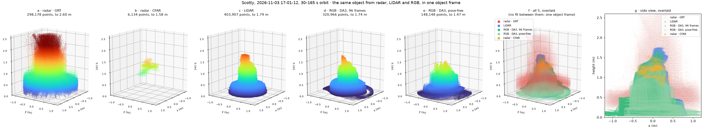

*`2026-11-03.17-01-12` 30–165 s, every cloud in the object frame with no fit between them: GRT (a), CFAR
(b), LiDAR (c), DA3 with the calibrated poses (d), DA3 pose-free (e), all of them overlaid (f) and in
side view (g). GRT is drawn faint in f and g because at any usable opacity it hides everything behind
it, which is itself the result. `.venv/bin/python -m src.ext.viewer.still --out out/scotty_models.png`,
commit of this change.*

## The object from the camera alone (2026-11-07)

Depth Anything 3 (`DA3-GIANT-1.1`, in the `da3` conda env on nunga) reconstructs from the orbit's camera
frames. Run pose-free, as its default, it estimates its own cameras and the result is only defined up
to a similarity, which has to be resolved against something before it can be measured. Run with the
poses we already have, it is metric by construction and the LiDAR is free to be an independent
reference instead of also being the ruler. Both were done, and the difference is large.

**Pose-free, and the three ways of scaling it that do not work.** Scaling on a fitted pedestal radius
fails: the accumulated cloud is a filled disc rather than the single-scan arc `closeup.circle_free`
fits, and the algebraic fit degenerates (0.61 units against the 0.10 it should be). Scaling on "the
orbit radius" assumes an orbit, which this is not (below). And resolving the similarity with scaled
ICP driven by open3d's one-directional fitness **collapses**: it shrinks the cloud to ×0.48 until it
sits inside the LiDAR, reports a 1.2 cm median and leaves an object 0.65 m tall against the true 1.79 m.
`src/ext/obj_rgb/align_to_lidar.py` therefore scores a symmetric trimmed Chamfer and solves only for
scale, yaw and translation, since both clouds are levelled on their own data. That fit is sharp, not
ambiguous as a near-symmetric object might suggest: it repeats at 214.6° and the residual rises from
2.2 cm to 70 cm half a turn away.

**The poses exist without any photogrammetry.** The KISS-ICP odometry composed with `lidar_to_camera`
from the joint solve (σ 0.29°, 1.2 cm) puts the camera centre, which sits at (0.028, −0.024, −0.136) m
in the LiDAR frame, in the world frame at any instant. Comparing that with DA3's own estimate is a
check on both. The capture is **not an orbit**: it is two laps walked in opposite directions with the
distance to the statue wandering 1.93–4.82 m (mean 2.88), so a circle fitted to the camera centres
means little, and the 2.6 m taken from the session log put the scale 10 % out. DA3's cameras, fitted
onto the real ones, are 36 cm from them at the median on a track 2.9 m from the object, and its height
spread is 0.29 m against the real 0.81 m — it flattens the vertical motion, which is where the top of
the statue was lost.

Two independent routes to the same number agree: the point cloud fitted to the LiDAR says ×1.149 and
yaw 214.6°, the camera track alone says ×1.063 and **213.0°**. The yaw matches to 1.6°; the 8 % left in
the scale is DA3's depth and its own cameras disagreeing with each other.

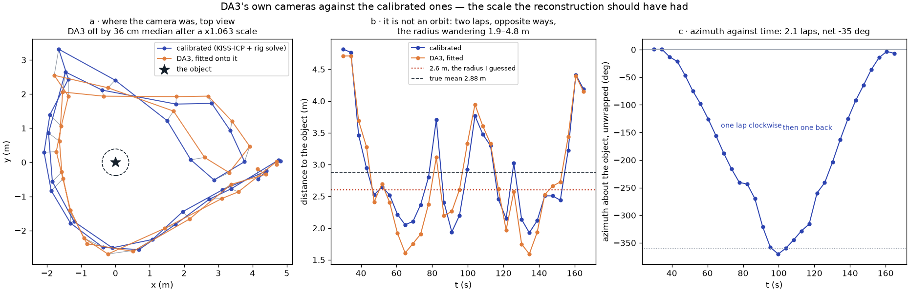

*Where the camera really was, against DA3's estimate fitted onto it (a); the distance to the object
over time, with the 2.6 m the session log records (b); the azimuth, unwrapped, showing the two laps (c).
`.venv/bin/python -m src.ext.obj_rgb.camera_track data/raw/2026-11-03.17-01-12 --pred out/da3_scotty/da3_pred.npz --centre -13.07 -9.86 --out out/da3_scotty/camera_track.png`, commit of this change.*

**With the poses given.** `inference(..., extrinsics, intrinsics, align_to_input_ext_scale=True)` returns
depth in our world frame, in metres; the returned camera centres equal the ones passed. Scored against
the LiDAR **with no fit at all**, the symmetric Chamfer goes from 1.94 cm (pose-free, after its Sim3) to
1.40 cm, and the object's top from 1.47 m to 1.70 m against the true 1.79 m.

What is left is not accuracy but coverage, and the three ablations say so clearly. **DA3 → LiDAR stays
at 1.0–1.2 cm in every configuration**; what moves is LiDAR → DA3, the share of the object DA3 has
anything for at all.

| Change | Chamfer | Top | → LiDAR | LiDAR → |
|---|---|---|---|---|
| 32 frames, undistorted (the configuration above) | 1.40 cm | 1.70 m | 1.1 cm | 1.7 cm |
| 32 frames, raw fisheye frames and the fisheye K | 1.26 cm | 1.71 m | 1.1 cm | 1.5 cm |
| 16 frames at 504 | 1.82 cm | 1.65 m | 1.1 cm | 2.5 cm |
| 16 frames at 1008 | 1.94 cm | 1.70 m | 1.2 cm | 2.8 cm |
| 96 frames at 504 | **1.01 cm** | 1.73 m | 1.0 cm | **0.9 cm** |

Undistortion is not the win, even though the lens needs it on paper: k1..k4 are small but the model is
equidistant, so a corner lands 273 px (16 px at DA3's 504-wide working size) from where a pinhole with
the same focal length would put it — and yet feeding the raw fisheye frames scored slightly *better*,
because `cv2`'s balance-0 undistortion stretches the field 88° → 94° and the resample costs more than
the model mismatch while the object is near frame centre. Doubling the resolution does not help either
(and 32 frames at 1008 does not fit in a 4090's 24 GB). Frames do: 16 → 32 → 96 takes the Chamfer
1.82 → 1.40 → 1.01 cm and LiDAR → DA3 2.5 → 1.7 → 0.9 cm, and at 96 frames the cloud has more points on
the object than the LiDAR does. The video holds 4,050 frames over this window; 96 is 2.4 % of them.

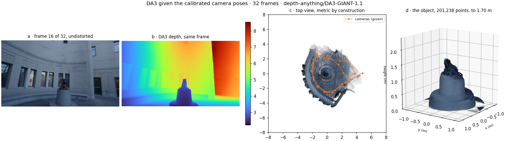

*One undistorted frame, DA3's depth for it, the top view with the given cameras, and the cut-out.
`CUDA_VISIBLE_DEVICES=1 ~/miniconda3/envs/da3/bin/python src/ext/obj_rgb/run_da3_posed.py out/da3_scotty/poses.npz --out-dir out/da3_scotty_posed`, commit of this change.*

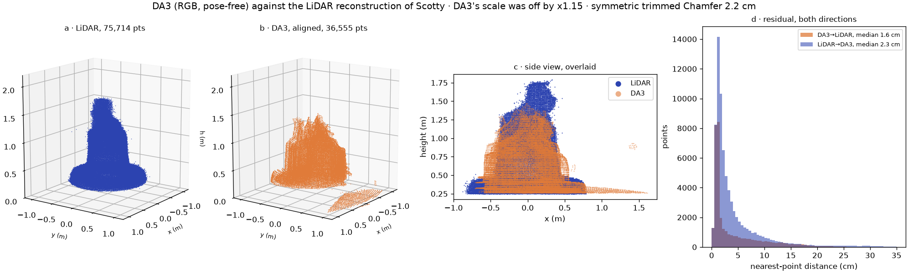

*The pose-free run after the similarity fit: LiDAR (a), DA3 (b), the two in side view (c) and the
residual in both directions (d). The flat top at 1.47 m is what the poses later recovered.
`.venv/bin/python -m src.ext.obj_rgb.align_to_lidar --da3 out/da3_scotty/object.ply --lidar out/scotty_lidar.ply --out-dir out/da3_scotty --z 0.25 2.2`, commit of this change.*

### A splat on the same poses

With the poses in hand, a 3D Gaussian splat needs no structure-from-motion either:
`src/ext/obj_rgb/export_nerfstudio.py` writes `transforms.json` straight from them and
`ns-train splatfacto` runs with the poses fixed, in metres, in the same world frame
(`--orientation-method none --center-method none --auto-scale-poses False`). COLMAP never enters.
Two conversions matter and are easy to get wrong: nerfstudio's `transform_matrix` is camera-to-world
in the OpenGL convention, so the rotation is post-multiplied by diag(1, −1, −1); and gsplat rasterises
a pinhole only, so here the frames *must* be undistorted, whatever the DA3 ablation says about the
model's own preference. The splat is seeded with the DA3 cloud downsampled to 284k points, which is the
role COLMAP's sparse cloud usually plays, so the chain stays camera-only.

30,000 iterations on 87 training views (nerfstudio holds the rest out) take 8 minutes on one 4090 and
2.4 GB. Scored the same way as everything else:

| Cloud | Points | Top | → LiDAR | LiDAR → | Within 5 cm | Chamfer |
|---|---|---|---|---|---|---|
| 3DGS, Gaussian centres | 5,403 | 1.63 m | 1.5 cm | 4.8 cm | 73 % / 52 % | 3.20 cm |
| 3DGS, depth rendered at the training views | 366,700 | 2.20 m | 22.2 cm | 0.8 cm | 21 % / 83 % | 9.24 cm |
| DA3 with the same poses, 96 frames | 79,734 | 1.73 m | 1.0 cm | 0.9 cm | 82 % / 88 % | 1.01 cm |

Neither splat row is the splat losing at reconstruction; they are two different things being measured,
and the pair is more informative than either.

The **Gaussian centres** are anisotropic ellipsoids placed wherever they reduce the image loss, not
samples of a surface: 5,403 of them on an object the LiDAR gives 76k points for. The forward distance
is good — 1.5 cm, they do sit on the object — while the reverse one is four times DA3's, which is a
statement about density, not accuracy.

The **rendered depth** is the quantity that is comparable with DA3, since it is the same operation DA3's
cloud goes through. `ns-export pointcloud` cannot produce it for a splat in nerfstudio 1.1.5 (it asserts
a pixel sampler that the full-image datamanager a splat uses does not have), so
`src/ext/obj_rgb/gs_render_cloud.py` renders each training view and unprojects it. The result covers the
LiDAR better than anything else here — 0.8 cm in the reverse direction, 83 % within 5 cm — and is at the
same time the second-worst cloud in the table forwards, at 22.2 cm with only 21 % within 5 cm. It is
the GRT failure again, from a completely different method: a model that is excellent at predicting
images is not thereby a model of a surface. 35 % of its points inside the cut-out sit beyond the
pedestal radius, a median 41 cm from any LiDAR point, and the error grows with height (14.9 cm median
at 0.25–0.8 m, 35.8 cm at 1.3–1.8 m, 78.1 cm above that).

The cause is visible in how the depth is formed: splatfacto renders the alpha-weighted mean depth along
each ray, so at a silhouette edge it returns a value *between* the object and whatever is behind it, and
a semi-transparent Gaussian anywhere along the ray drags it. This was run at one setting
(`--accum 0.95`) and not tuned; a higher accumulation cut, or a median rather than a mean along the ray,
should clean it up and the number should be expected to move.


## A viewer for all of it (2026-11-07)

`src/ext/viewer/serve.py` serves `index.html`, a three.js page (r160, vendored, so it works offline)
that loads every cloud and switches between them: a row per model with the number keys, `shift`+number
to show one alone, side-by-side as well as overlaid, colour by height, by model, or from the photos,
a point-size and a height-cut slider. It is the quickest way to see what the table above means — the
GRT fog, the CFAR band, the flat top of the pose-free DA3 — and it is the "3D viewer screenshot"
this experiment's figure list has been asking for.

Two things it makes explicit. First, the clouds are cut to a 1.2 m cylinder about the pedestal,
because that is what every number here is measured on; the scene around it is a second set of layers,
off at start. Second, the two kinds of cloud cannot be widened the same way. The object frame is built
by re-centring each scan on the pedestal, which takes the odometry's jitter out of the object and would
put it straight into anything further away, so the LiDAR and radar background has to come from the
world-frame accumulation in `data/recon/<trace>/` instead (`src/ext/obj_lidar/export_scene.py`), where
no per-scan correction is applied. DA3 and the splat have no such correction — they are single world
models — so for them the scene is the same export with a wider radius. The LiDAR scene is the layer
`accumulate` keeps, 0.3–2.5 m above the ground within 15 m of the path: a slab, with no ground and no
roofline.

```bash
.venv/bin/python -m src.ext.viewer.serve --port 8422        # then http://localhost:8422/
```

Two things are worth knowing before pointing `ns-viewer` at the splat run, because neither is obvious
from the viewer. Its camera **orbits the world origin and zooms toward it**, and that origin is the
first LiDAR scan, 16 m away in the middle of the courtyard, so the object cannot be reached however far
you scroll — and the camera starts inside the Gaussians that model the walls, which fills the viewport
with white needles. Those needles are real: the walls 5–15 m out are seen from a narrow range of angles
and the optimiser fits them with very long thin Gaussians. `src/ext/obj_rgb/gs_filter_ckpt.py` edits the
checkpoint rather than retraining: it keeps the 9,316 Gaussians of 260,031 whose centres are on the
object (dropping, as it happens, exactly one needle that reached in from outside) and translates them so
the statue is at the origin. Point the filtered run at the dataset written with `--origin object` and the
train-camera frustums line up with it.

`--bundle DIR` writes the page, three.js and every cloud into one folder with a manifest of relative
URLs, for a machine that has no access here: 50 MB, served by any static server. It has to be *served*,
not opened from disk, since ES modules and `fetch` do not work over `file://`.


## Results
| Object | Size | Material | Radar points per frame on object | Extent error vs LiDAR | Mean echo (dB) | Visible from all sides? |
|---|---|---|---|---|---|---|
| Parked car | ~4.5 m | metal | TBD | TBD | TBD | TBD |
| Trash can / hydrant / bike rack | ~1 m | metal | TBD | TBD | TBD | TBD |
| Tree or sculpture | ~1 to 3 m | non-metal | TBD | TBD | TBD | TBD |
| GHC wall or corner | > 10 m | concrete / glass | TBD | TBD | TBD | TBD |


*Pending: one panel per object: accumulated radar points (orange) over the LiDAR cloud (grey), top view. Source: TBD.*


*Pending: radar echo strength vs viewing angle around each object (polar plot); flat walls should show narrow specular spikes. Source: TBD.*


*Pending: 3D viewer screenshot of the car orbit. Source: TBD.*


*Pending: map of the orbit paths with LiDAR-SLAM poses. Source: TBD.*


## Conclusion
Pending for the object sweep (car, tree, wall). Expected: the car is bright from every side, the small
metal object is smeared by the ~14° beam, the tree is weak, the wall only lights up when faced squarely.

Settled for Scotty, 2026-11-07. Put in one object frame and measured against the LiDAR with no fit, the
camera reconstructs this object to about a centimetre (1.01 cm symmetric Chamfer, 1.73 m of its 1.79 m
height) once it is given the poses the rig already provides, while the radar does not reconstruct it at
all: GRT contains the object in a fog that is 7.35 cm from the LiDAR on its own points, and the CFAR
chain puts a few hundred accurate points on it and explains a quarter of it. The useful statement is
not a single distance but the pair: the radar's two failures are opposite, and either one looks good
under a one-directional score.

## Open items
- Odometry yaw still slips ~150° over the Jeep window while standing still and spinning (785–890 s); a loop closure or the IMU as a yaw prior would fix it. The orbit itself is unaffected. A six-turn spin in a structure-rich atrium (`2026-11-03.17-18-46`) stays within 26°, so the open lot may be the cause rather than the spin.
- Decide how to segment each object in the LiDAR layer (the Jeep is the cluster at the orbit centre)
- The LiDAR cut-out of an object is only as sharp as the odometry's yaw; the pedestal fit fixes the position, not the rotation. Registering the scans on the object itself (ICP on the cut-out) is the next step for a crisp model.
- The static filter's cost in coverage (81 → 69 % on the Jeep): a Doppler-only ego estimate per frame, or a shorter velocity smoothing, might keep more of the edge-of-view points
- Frames, not pixels, are what the camera reconstruction is short of: 96 of the window's 4,050 frames
  were used and the curve had not flattened. The next run should push that and find where it does.
- The splat's rendered depth was run at one accumulation threshold and not tuned. Taking the median
  depth along the ray rather than the alpha-weighted mean is the obvious next thing to try, and would
  test whether the 22.2 cm forward distance is the method or the setting.
- GRT's threshold was raised from the 0.5 used for scoring to 0.9 before the cloud concentrated on the
  object at all. Log-odds fusion across frames, which `GRT.md` recommends over a hard threshold, has
  not been tried on this accumulation.
- The LiDAR scene layer is the 0.3–2.5 m slab `accumulate` keeps. A viewer background with the ground
  and the building tops needs that cut widened upstream.
- The radar has no scene layer: GRT would have to be accumulated at a wider radius, and at 0.9 it is
  already a fog at 1.2 m.

## B-roll to capture (for the 5-minute video)
- [ ] Phone video of each orbit from a second person
- [ ] Photo of each object
- [ ] Viewer orbit video of the accumulated car point cloud

## Reproduce
```bash
python -m src.recon.poses data/raw/2026-10-29.15-49-40 --start 660 --seconds 360 --out figures/poses_jeep.png
python -m src.recon.ego_check data/raw/2026-10-29.15-49-40 --start 660 --seconds 360 --frames 750 965 --out figures/ego_check_jeep.png
python -m src.recon.accumulate data/raw/2026-10-29.15-49-40 --start 930 --seconds 90 --dense --out figures/accum_jeep.png
python -m src.recon.closeup data/raw/2026-10-29.16-22-36 --centre -12.45 -2.60 --far 170 --near 174 --orbit 175 229 --split --out figures/closeup_scotty.png
```

Same for `16-22-36` with `--start 160 --seconds 70` (and `--frames 165 200`). Outputs: `data/poses/<trace>/`, `data/recon/<trace>/` (not in git).

The three-sensor reconstruction of Scotty, in order. `TRACE=data/raw/2026-11-03.17-01-12`, and the
centre `-13.20 -9.87` is the guess the pedestal fit refines to `-13.07 -9.86`. Everything lands in
`out/`, which is not in git.

```bash
# LiDAR: the object, height-coloured and camera-coloured
.venv/bin/python -m src.ext.obj_lidar.export_ply $TRACE --centre -13.20 -9.87 --orbit 30 165 \
    --pedestal-radius 0.39 --stride 2 --out out/scotty_lidar.ply
ffmpeg -v error -y -i $TRACE/camera/video.avi -q:v 3 -start_number 0 /data/christineh/scotty_frames/%06d.jpg
.venv/bin/python -m src.ext.obj_lidar.export_ply $TRACE --centre -13.20 -9.87 --orbit 30 165 \
    --pedestal-radius 0.39 --stride 2 --colour photo --frames-dir /data/christineh/scotty_frames \
    --out out/scotty_lidar_rgb.ply

# radar: GRT occupancy, and the CFAR baseline
.venv/bin/python -m src.ext.obj_radar.export_ply $TRACE --dump /data/berlin/grt/2026-11-03.17-01-12 \
    --centre -13.20 -9.87 --orbit 30 165 --pedestal-radius 0.39 --stride 2 --threshold 0.9 \
    --out out/scotty_radar.ply
.venv/bin/python -m src.ext.obj_radar.export_ply $TRACE --source cfar --centre -13.20 -9.87 \
    --orbit 30 165 --pedestal-radius 0.39 --stride 2 --voxel 0.01 --out out/scotty_radar_cfar.ply

# RGB: frames, poses, DA3 with the poses given
.venv/bin/python -m src.ext.obj_rgb.extract_frames $TRACE --orbit 30 165 --n 96 --out out/da3_scotty/frames96
.venv/bin/python -m src.ext.obj_rgb.export_poses $TRACE --frames out/da3_scotty/frames96 \
    --centre -13.20 -9.87 --orbit 30 165 --pedestal-radius 0.39 --out out/da3_scotty/poses96.npz
CUDA_VISIBLE_DEVICES=1 ~/miniconda3/envs/da3/bin/python src/ext/obj_rgb/run_da3_posed.py \
    out/da3_scotty/poses96.npz --out-dir out/da3_posed_n96_r504

# RGB, pose-free, for the comparison: the Sim3 onto the LiDAR and the camera-track check
CUDA_VISIBLE_DEVICES=1 ~/miniconda3/envs/da3/bin/python src/ext/obj_rgb/run_da3.py \
    out/da3_scotty/frames --out-dir out/da3_scotty --scale-from-orbit 2.6
.venv/bin/python -m src.ext.obj_rgb.align_to_lidar --da3 out/da3_scotty/object.ply \
    --lidar out/scotty_lidar.ply --out-dir out/da3_scotty --z 0.25 2.2
.venv/bin/python -m src.ext.obj_rgb.camera_track $TRACE --pred out/da3_scotty/da3_pred.npz \
    --centre -13.07 -9.86 --out out/da3_scotty/camera_track.png

# 3DGS, from the same poses, no COLMAP
.venv/bin/python -m src.ext.obj_rgb.export_nerfstudio out/da3_scotty/poses96.npz \
    --out /data/christineh/gs_scotty/data --seed-ply out/da3_posed_n96_r504/scene.ply \
    --seed-voxel 0.05 --seed-radius 10
CUDA_VISIBLE_DEVICES=1 ~/miniconda3/envs/kplanes/bin/ns-train splatfacto \
    --data /data/christineh/gs_scotty/data --output-dir /data/christineh/gs_scotty/runs \
    --experiment-name scotty --timestamp posed96 --vis tensorboard \
    nerfstudio-data --orientation-method none --center-method none --auto-scale-poses False
CUDA_VISIBLE_DEVICES=1 ~/miniconda3/envs/kplanes/bin/ns-export gaussian-splat \
    --load-config /data/christineh/gs_scotty/runs/scotty/splatfacto/posed96/config.yml \
    --output-dir /data/christineh/gs_scotty/exports/splat
.venv/bin/python -m src.ext.obj_rgb.gs_to_object /data/christineh/gs_scotty/exports/splat/splat.ply \
    --poses out/da3_scotty/poses96.npz --out out/scotty_gs.ply

# the splat, filtered to the object and recentred, for ns-viewer
~/miniconda3/envs/kplanes/bin/python src/ext/obj_rgb/gs_filter_ckpt.py \
    /data/christineh/gs_scotty/runs/scotty/splatfacto/posed96 --poses out/da3_scotty/poses96.npz \
    --data /data/christineh/gs_scotty/data_obj \
    --out /data/christineh/gs_scotty/runs/scotty/splatfacto/objonly
~/miniconda3/envs/kplanes/bin/ns-viewer \
    --load-config /data/christineh/gs_scotty/runs/scotty/splatfacto/objonly/config.yml \
    --viewer.websocket-port 7007 --viewer.websocket-host 127.0.0.1

# the scene layers, and the figures
.venv/bin/python -m src.ext.obj_lidar.export_scene 2026-11-03.17-01-12 --centre -13.07 -9.86 \
    --source lidar --out out/scotty_lidar_scene.ply
.venv/bin/python -m src.ext.viewer.still --out out/scotty_models.png
.venv/bin/python -m src.ext.viewer.serve --port 8422
```

Environments: the repo's `.venv` (python 3.12, numpy/scipy/matplotlib) for everything except DA3,
which needs the `da3` conda env, and the splat, which needs `kplanes` (nerfstudio 1.1.5 + gsplat 1.4.0).
Run on GPU 1 of nunga; `/` is nearly full, so the splat's data and runs go on `/data`.

[Back to all experiments](../../EXPERIMENTS.md)
