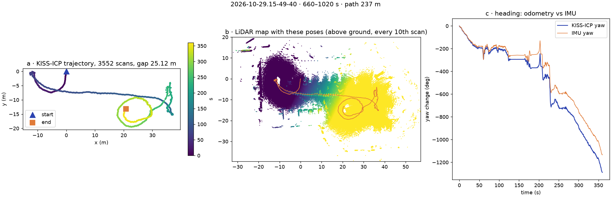
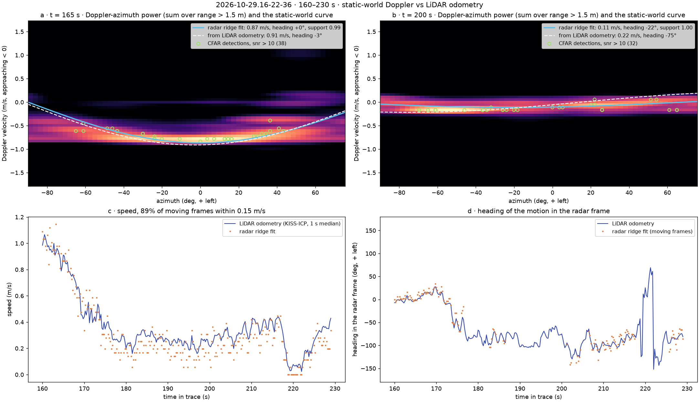
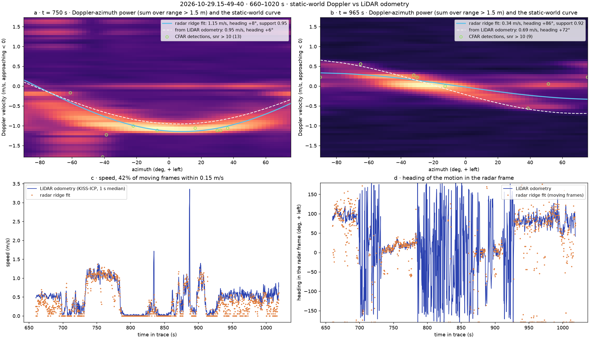
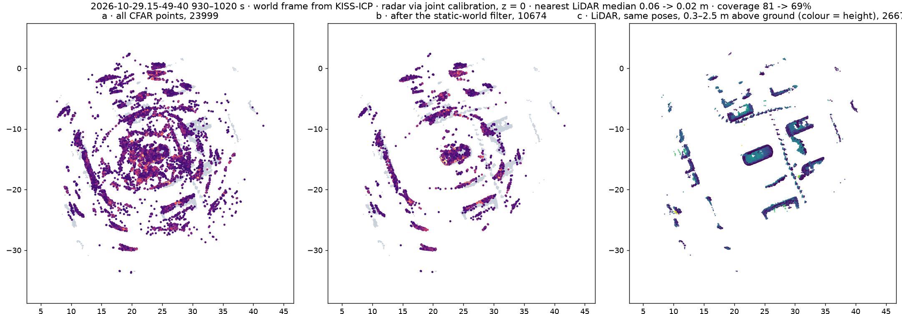
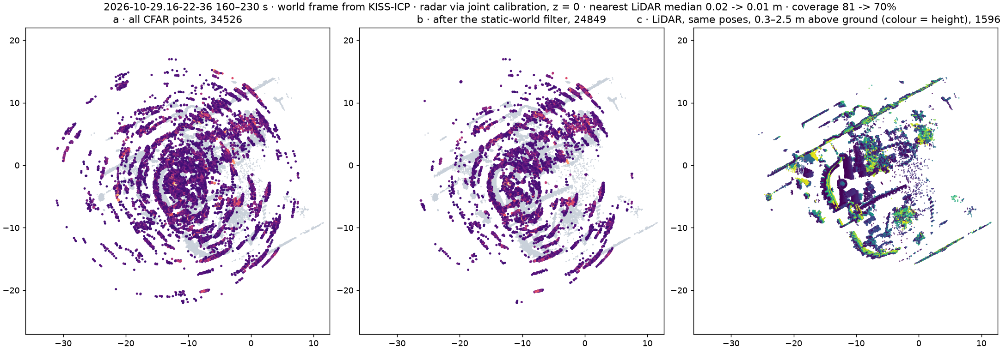
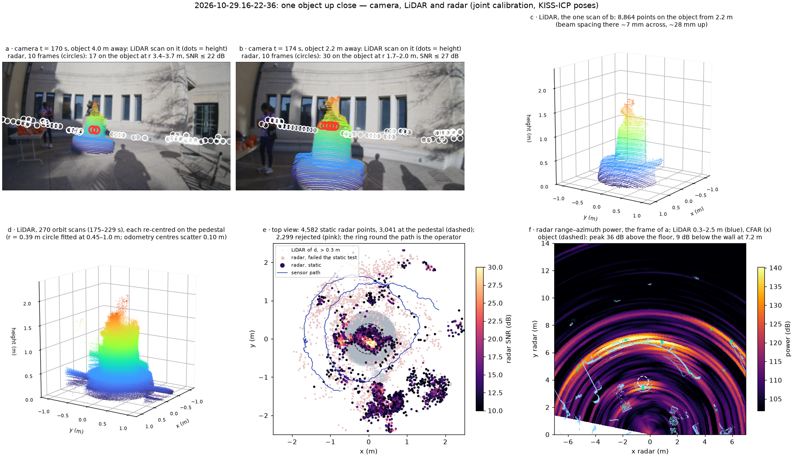

# 360° orbits: how object size and material change what the radar sees

**Status:** Data partly recorded (2026-10-29); poses, static-world filter and accumulation working (2026-11-01); per-object numbers pending (Yining)

## Question
For a car, a small metal object, a tree or sculpture and a building wall: how much of each object does the radar capture, compared with the 128-beam LiDAR?

## Method
Orbit each object once (radius 2 to 5 m, 0.5 to 1 m/s, start and stop at a marked spot), camera pointed at the object. Poses from LiDAR SLAM; radar points accumulated in the object frame.

## Data
Recorded 2026-10-29 (see [session log](../../notes/sessions/2026-10-29.md)): car = `2026-10-29.15-49-40` 11-17 min; sculpture (thin metal pole) = `2026-10-29.16-12-38` 5:30-9:40; small metal (Scotty) = `2026-10-29.16-22-36` 2:59-3:45. Still to record: tree, GHC wall, spin in place.

## Poses (2026-11-01)
KISS-ICP (LiDAR-only odometry, no loop closure, `src/recon/poses.py`) on the OS-0-128 scans, 25 scans/s on CPU. Three things had to be right before the trajectory held together. The LiDAR geometry: with the beam-azimuth sign flipped (the bug fixed on 11/1) the odometry diverged within a minute. The deskew: KISS-ICP's own constant-velocity deskew feeds its per-scan jitter back into the next scan on this handheld rig and doubled the apparent path (685–705 s: 28 m with it, 14 m without); each scan is now un-skewed with the IMU's z gyro instead (column j was measured at ts + j/2048 × 0.1 s, rotated back to mid-scan), which on the 98°/s swing at 720 s leaves 4° against the gyro where the built-in deskew leaves +98° and no deskew −208°. The map: with KISS-ICP's defaults (50 m, 0.5 m voxels) the sparse far returns of the open parking lot steer the registration during that same swing (−267° even with gyro deskew); 30 m / 0.3 m brings it to 15°.

| Window | Scans | Path | Heading, odometry vs IMU | Note |
|---|---|---|---|---|
| `15-49-40` 660–1020 s (loop at the start, walk 35 m, two orbit laps) | 3,552 | 237 m | −1288° vs −1133° | the two laps overlap; the 155° difference accumulates in two slips while standing still and spinning (785–890 s), not on the orbit |
| `16-22-36` 160–230 s (Scotty) | 700 | 32 m | +598° vs +608° | not a closed loop (gap 14 m) |

Poses are written to `data/poses/<trace>/lidar.npz` (per scan) and `radar.npz` (interpolated to radar frames: linear position, slerp rotation), world frame = first scan of the window. Per-scan position jitter is still ~0.1 m (95th percentile 0.12 m), so anything differentiated from the poses needs smoothing. Drift on the orbit itself is to be measured by closing a lap next time (start and end at a marked spot).



*KISS-ICP on `15-49-40` 660–1020 s: trajectory, LiDAR map built with these poses, heading against the IMU. The ring around the path in the map is the operator. `python -m src.recon.poses data/raw/2026-10-29.15-49-40 --start 660 --seconds 360`.*

## Static-world filter: does the radar's Doppler agree with the odometry? (2026-11-01)
A static target at azimuth az seen from a sensor moving with velocity v shows Doppler v_r = −v · u(az), u = (−sin az, cos az), negative = approaching on our Doppler axis (the sign was settled on the straight walk to the Jeep, 735–780 s: the static-world ridge sits at −1.1 m/s straight ahead). `src/radar/ego.py` fits that cosine to the strongest return of every azimuth bin (one vote each, power-weighted) and `src/recon/ego_check.py` compares the fit with the velocity from the LiDAR poses (1 s median, rotated into the radar frame with the joint calibration). The two never see each other, so their agreement checks the Doppler axis, the pose velocity, the calibration yaw and the time alignment at once.

They agree. On Scotty the ridge speed is within 0.15 m/s of the odometry on 89 % of moving frames (median difference 0.08 m/s) and the heading within 6°, through the approach at 1 m/s and the sideways orbit at 0.3 m/s. On the Jeep window every moving segment lines up (the 0.5 m/s loop at the start, the 1.1 m/s walk, the 0.5–0.6 m/s orbit with the motion 85° to the left of the radar axis); the overall 42 % within 0.15 m/s is pulled down by the slow orbit, where the whole scene sits inside ±0.5 m/s and the ridge amplitude is uncertain by about that much. The heading agrees to 13° there.



*`16-22-36` 160–230 s: Doppler-azimuth power of two frames with the static-world curve from the radar alone (blue) and from the LiDAR poses (dashed), and the CFAR detections of those frames; speed and heading over the window from both. `python -m src.recon.ego_check data/raw/2026-10-29.16-22-36 --start 160 --seconds 70 --frames 165 200`.*



*Same for `15-49-40` 660–1020 s (`--frames 750 965`). The 720 s spike in the odometry speed is the look-around swing that the deskew and map settings above were tuned on.*

## Accumulation in the world frame (2026-11-01)
`src/recon/accumulate.py`: CFAR points of every radar frame (snr > 10), the static-world test with the odometry velocity (|v − (−v_sensor · u(az))| < 1.5 Doppler bins), the slant range placed in the plane (z = 0; the elevation estimate is unusable, see the close-up below), joint calibration into the LiDAR frame, the interpolated pose into the world. Next to it the LiDAR built with the same poses, the operator and rig dropped (within 1.5 m), and only the layer 0.3–2.5 m above the ground kept, within 15 m of the sensor; that layer is roughly what the radar sees. The ground is estimated per scan in the sensor frame, in two steps: a plane fitted to the low points within 10 m (the handheld rig is tilted, so in the sensor frame the ground is a slope of up to ±1 m at 5 m), then per 2 m cell the 5th percentile of the residual to that plane, so a terrace or the raised lawn next to Scotty's plaza counts as ground too. Per scan because the odometry's z and pitch jitter smears the ground into a 0.5 m slab in the world frame, where a height cut no longer separates it (the first try, a world-frame cut, left a lattice of ground wedges); the plane alone kept Scotty's lawn as a 0.3–0.5 m "layer", the cells alone let the tilted asphalt through. Two numbers, both within 15 m of the path: the xy distance from each radar point to the nearest LiDAR point of the layer, and coverage, the share of 0.5 m LiDAR cells that have a radar point within 0.5 m.

On the Jeep orbit (930–1020 s, two laps, 1,777 frames, 23,999 CFAR points) the static filter keeps 44 %. What it removes is the cloud inside the orbit (panel a): points with the wrong Doppler for their azimuth, the ghosts of the Jeep's two-bounce returns, sidelobes of the strong near echo, and the companion walking alongside. What stays (panel b) is the Jeep as a ring of returns around its LiDAR outline, the row of parked cars at 10–15 m, and the wall segments at the left, each where the LiDAR has them: the median distance to the LiDAR layer drops from 0.06 to 0.02 m and the share within 0.5 m rises from 77 to 88 %. Coverage drops from 81 to 69 %, so the filter also costs real points, mostly where the odometry velocity is least certain (the 1 s median lags turns) and at the edge of the field of view, where the static curve is steepest. On Scotty (160–230 s, 1,384 frames, 34,526 points) 72 % pass, the median distance goes from 0.02 to 0.01 m (90 to 92 % within 0.5 m) and coverage from 81 to 70 %. The pass rate tracks the odometry speed: at Scotty's 0.3 m/s the whole scene sits within a few Doppler bins of zero and little can fail the test; at 0.55 m/s around the Jeep more does. Both runs also write the dense range–azimuth power of every frame (`--dense`, `data/recon/<trace>/dense_power.npz`, float16 dB, with the frame index that keys the poses) for a reconstruction that does not start from CFAR points.



*`15-49-40` 930–1020 s, top view, world frame from KISS-ICP: all CFAR points (a), after the static-world filter (b), the LiDAR layer built with the same poses, coloured by height above ground (c); grey in a, b is the LiDAR. `python -m src.recon.accumulate data/raw/2026-10-29.15-49-40 --start 930 --seconds 90 --dense`.*



*Same for `16-22-36` 160–230 s. Scotty is the small cluster near the orbit centre; the arcs are the wall and planters behind it.*

What this is good for and what it is not: the accumulated static points sit on the LiDAR surfaces to a few centimetres in the plane, which is the calibration and odometry working; the object itself is still a ring the width of the 14° beam, with no height. Per-object numbers (points on the object per frame, extent against the LiDAR, echo strength versus viewing angle) are the next step, on these files.

## Up close: Scotty (2026-11-01)
`src/recon/closeup.py`: one object at the resolution each sensor has for it. Two camera frames of the approach, at 4.0 m and 2.2 m, carry the LiDAR scan of that instant and the radar detections of ten frames, both projected through the joint calibration; the LiDAR points are cut out within 1.2 m of the statue and coloured by height above the local ground, the radar points are drawn at the radar's height, red when they fall within half a metre of the pedestal. The statue's position starts as a guess (the orbit's centre) and is refined on every scan: a circle of fixed radius (0.39 m, fitted once on the 4 m scan, where most of the arc is visible) is fitted to the LiDAR points 0.45–1.0 m above ground, two parameters, Gauss–Newton with a shrinking inlier band. The guess was 0.45 m off; the per-scan centres then scatter 0.10 m about their mean, which is the odometry's jitter, and the cut-out from all 270 scans of the orbit (175–229 s) is drawn with that correction.

What each sensor has of a 1.9 m statue. The camera has all of it, fisheye, 1920 × 1080. The LiDAR at 2.2 m has 8,864 points on it, 7 mm apart across and 28 mm up, enough that the head, back and tail of the dog read from one scan (panel c); from the whole orbit, re-centred, the plinth, the cylinder and the dog are all there, the dog smeared by the odometry's yaw error, which the re-centring does not touch (d). The radar at 4 m sees the statue as two CFAR detections at 3.4–3.5 m (SNR 12–17 dB); its peak in the range–azimuth map is 36 dB above the noise floor and 9 dB below the wall behind it at 7.2 m (f). At 2.2 m it is 30 points of ten frames at 1.7–2.0 m, SNR up to 27 dB. Over the orbit the static points pile onto the pedestal: 3,041 of the 4,582 within 2.5 m lie within 0.35 m of its surface (e), a blob the size of the pedestal rather than a ring, because at 1–1.3 m from the axis the 14° beam and the 9 cm range bin each cover the whole object. The 2,299 rejected points form a ring around the path: the operator, who moves with the sensor and so carries the wrong Doppler for a static target. Below about 1.5 m the LiDAR–camera projection drifts off the photo (the solved translation is good to 0.1 m and parallax grows as 1/range), so the close frame is taken at 2.2 m.

One fix came out of this. The radar's elevation estimate was being used: `to_xyz` scales the range by cos(el) before z was zeroed, and with 13 % of detections at |el| > 20° and 8 % beyond 45°, those points landed short. `to_xy` now puts the slant range in the plane, and the accumulation numbers above are with it (Jeep, filtered: median 0.04 → 0.02 m, 86 → 88 % within 0.5 m).



*`16-22-36`: a, b camera at 4.0 and 2.2 m with the LiDAR scan (colour = height) and the radar detections (circles, red on the object); c the one scan at 2.2 m; d the orbit's 270 scans re-centred on the pedestal; e top view with the orbit's radar points; f range–azimuth power of the 4 m frame with the LiDAR of that instant. `python -m src.recon.closeup data/raw/2026-10-29.16-22-36 --centre -12.45 -2.60 --far 170 --near 174 --orbit 175 229 --split --out figures/closeup_scotty.png`.*

## Results
| Object | Size | Material | Radar points per frame on object | Extent error vs LiDAR | Mean echo (dB) | Visible from all sides? |
|---|---|---|---|---|---|---|
| Parked car | ~4.5 m | metal | TBD | TBD | TBD | TBD |
| Trash can / hydrant / bike rack | ~1 m | metal | TBD | TBD | TBD | TBD |
| Tree or sculpture | ~1 to 3 m | non-metal | TBD | TBD | TBD | TBD |
| GHC wall or corner | > 10 m | concrete / glass | TBD | TBD | TBD | TBD |


*Pending: one panel per object: accumulated radar points (orange) over the LiDAR cloud (grey), top view. Source: TBD.*


*Pending: radar echo strength vs viewing angle around each object (polar plot); flat walls should show narrow specular spikes. Source: TBD.*


*Pending: 3D viewer screenshot of the car orbit. Source: TBD.*


*Pending: map of the orbit paths with LiDAR-SLAM poses. Source: TBD.*


## Conclusion
Pending. Expected: the car is bright from every side, the small metal object is smeared by the ~14° beam, the tree is weak, the wall only lights up when faced squarely.

## Open items
- Odometry yaw still slips ~150° over the Jeep window while standing still and spinning (785–890 s); a loop closure or the IMU as a yaw prior would fix it. The orbit itself is unaffected.
- Decide how to segment each object in the LiDAR layer (the Jeep is the cluster at the orbit centre)
- The LiDAR cut-out of an object is only as sharp as the odometry's yaw; the pedestal fit fixes the position, not the rotation. Registering the scans on the object itself (ICP on the cut-out) is the next step for a crisp model.
- The static filter's cost in coverage (81 → 69 % on the Jeep): a Doppler-only ego estimate per frame, or a shorter velocity smoothing, might keep more of the edge-of-view points

## B-roll to capture (for the 5-minute video)
- [ ] Phone video of each orbit from a second person
- [ ] Photo of each object
- [ ] Viewer orbit video of the accumulated car point cloud

## Reproduce
```bash
python -m src.recon.poses data/raw/2026-10-29.15-49-40 --start 660 --seconds 360 --out figures/poses_jeep.png
python -m src.recon.ego_check data/raw/2026-10-29.15-49-40 --start 660 --seconds 360 --frames 750 965 --out figures/ego_check_jeep.png
python -m src.recon.accumulate data/raw/2026-10-29.15-49-40 --start 930 --seconds 90 --dense --out figures/accum_jeep.png
python -m src.recon.closeup data/raw/2026-10-29.16-22-36 --centre -12.45 -2.60 --far 170 --near 174 --orbit 175 229 --split --out figures/closeup_scotty.png
```
Same for `16-22-36` with `--start 160 --seconds 70` (and `--frames 165 200`). Outputs: `data/poses/<trace>/`, `data/recon/<trace>/` (not in git). Per-object analysis: `src/ext/360/` (Yining).

[Back to all experiments](../../EXPERIMENTS.md)
