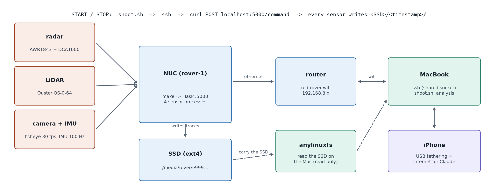
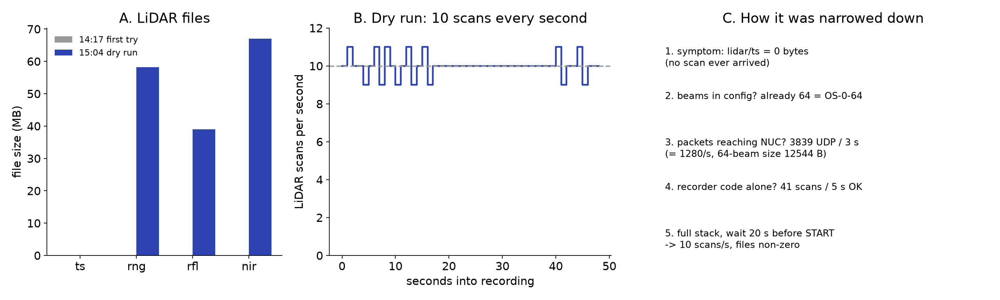
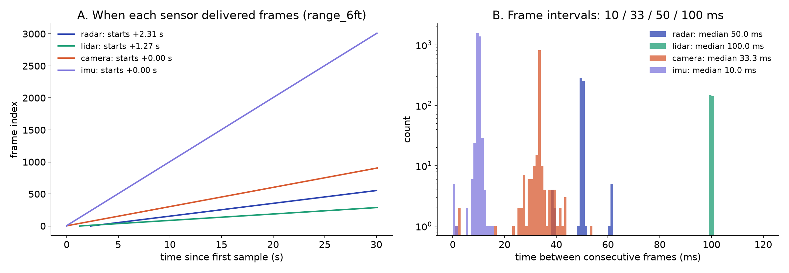
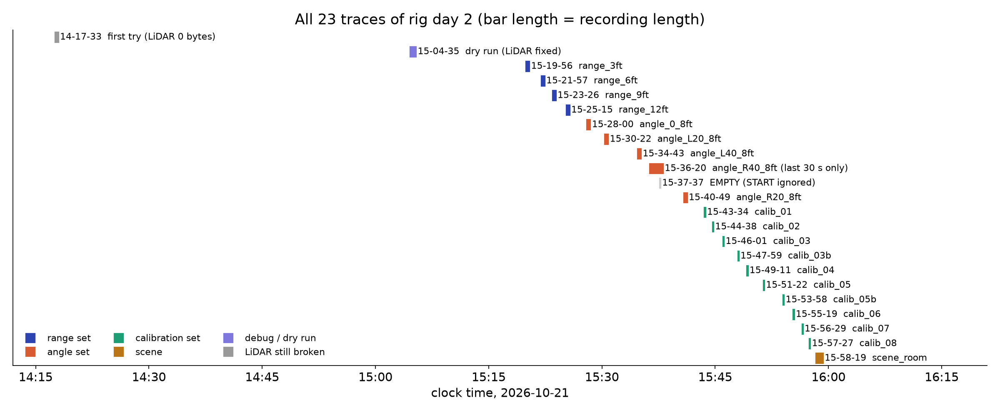

# Rig health: LiDAR, timing and the 128-beam swap

**Status:** Done (2026-10-21, 2026-10-29)

## Question
Are all four sensors recording, on time, and does the LiDAR deliver data?

## Method
LiDAR debugging step by step (file sizes, UDP packets, the recorder code on its own, the full stack). Frame intervals from every sensor's `ts`. Dry run after swapping to the OS-0-128.

## Data
`2026-10-21.14-17-33` (LiDAR broken), `2026-10-21.15-04-35` (fixed), `2026-10-21.15-21-57` (timing), `2026-10-29.15-18-16` (128-beam dry run).

## Results
| Check | Result |
|---|---|
| LiDAR 0 bytes | not the beam count; packets arrived (1,280 UDP/s, 12,544 B each); recorder code alone got 41 scans in 5 s; likely START pressed before the LiDAR finished reconfiguring. Wait 20 to 30 s after `Initialized`. |
| Frame intervals (range 6 ft) | radar 50.0 ms (p99 55.9), LiDAR 100.0 ms (p99 100.7), camera 33.3 ms (p99 39.8), IMU 10.0 ms (p99 11.0) |
| Start offsets | LiDAR +1.3 s, radar +2.3 s after the camera |
| OS-0-128 dry run (10/29) | LiDAR [128, 2048], 288 scans in 30 s, interval 0.100 s (max 0.107); radar 552 frames all valid |
| 128-beam config | `beams: 128`, `addr: 169.254.149.190` (a blank address made the recorder pick the IPv6 link-local and crash) |

*How the rig is driven: sensors, NUC, SSD, router, Mac, iPhone*

*LiDAR debugging: file sizes, scans per second, the steps that narrowed it down*

*When each sensor delivers frames, and the interval histograms*

*All traces of rig day 2*

## Conclusion
The recording chain is reliable once the start-up order is followed: `make config` after every reboot, wait for the LiDAR, then START. Fusion must align by timestamps, not frame numbers.

## Open items
- Note the 128-beam config change for Tianshu

## B-roll to capture (for the 5-minute video)
- [ ] Phone clip of the start-up: NUC, recorder web page, LiDAR spinning

## Reproduce
`./shoot.sh`, `./validate.sh`, `check_valid.py`.

[Back to all experiments](../../EXPERIMENTS.md)
