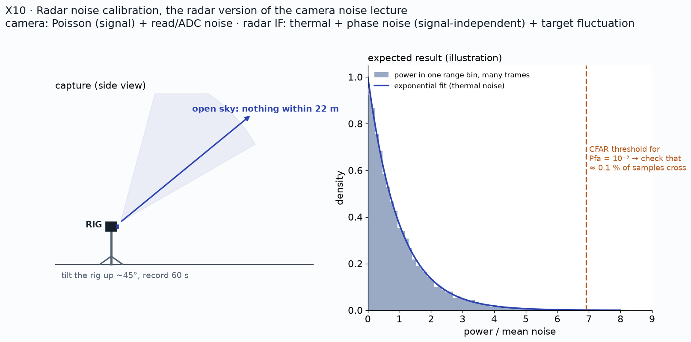

# X10: radar noise calibration (the radar version of the camera noise lecture)

**Status:** Preliminary result (2026-10-21); sky capture pending

## Question
What is the distribution of radar noise, does it match theory, and is the CFAR false-alarm rate what the formula promises?

## Method
Range bins 14 to 19 m of a static room scene. Static echo = mean over the 64 chirps; noise = each sample minus that mean. Compare the power with an exponential (complex Gaussian). Next: a 60 s open-sky capture, noise floor vs range, measured vs designed Pfa.

## Data
`scene_room` (`2026-10-21.15-58-19`); planned: `sky_60s` in Session 2.

## Results
| Check | Result | Expected |
|---|---|---|
| 99th percentile of power / mean, static removed | 4.60 | 4.61 (exponential) |
| Static-to-noise power ratio in that bin (Rician K) | 6.0 | — |
| Channel phase residual (0° shot) | RMS ≈ 3° | small |
| Noise floor vs range (sky) | TBD | flat beyond the leakage zone |
| Measured Pfa at designed 1e-3 | TBD | within 2× |
| Noise floor in watts vs kTB·NF | TBD | — |

*Plan: point the rig at empty sky (the radar's dark frame) and fit the power distribution*

*Raw samples are pushed off the origin by a static echo; after removing it, a circular noise cloud*

*Power histogram and Q-Q plot: exponential after removing the static part*

*Pending: sky capture: power histogram and Q-Q plot without removing anything. Source: TBD.*

*Pending: noise floor (dB) vs range bin, sky vs room. Source: TBD.*

*Pending: measured false-alarm rate vs designed Pfa for several CFAR window sizes. Source: TBD.*

### Camera vs radar noise
| | Camera | Radar |
|---|---|---|
| Measures | photon count (intensity, no phase) | complex field amplitude |
| Dominant noise | shot noise (Poisson, signal-dependent) + read noise | receiver thermal noise (additive, signal-independent) |
| Distribution | variance grows with brightness | complex Gaussian → power exponential |
| Averaging | intensities, SNR ∝ √N | coherent sum first, up to 18 dB over 64 chirps |
| Dark frame | lens cap | open sky |
| Flat field | uniform light | per-channel phase/gain calibration |

## Conclusion
Once the static echo is removed, radar noise is complex Gaussian as textbook theory assumes (Richards; Finn and Johnson 1968), so the CA-CFAR threshold formula applies, but only after subtracting the static part.

## Open items
- Record `sky_60s`
- Test independence across range bins and chirps
- Convert ADC counts to power and compare with kTB·NF

## B-roll to capture (for the 5-minute video)
- [ ] Phone clip of the rig tilted at the sky
- [ ] Animation: the I/Q cloud before and after removing the static echo

## Reproduce
TBD in `src/ext/x10/`.

[Back to all experiments](../../EXPERIMENTS.md)
