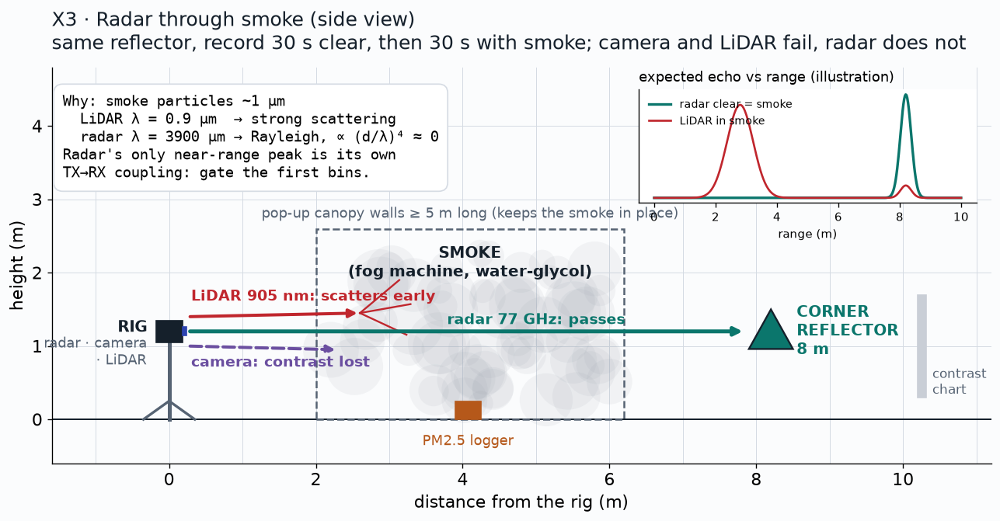

# X3: radar through smoke

**Status:** Candidate extension (not in the plan to achieve)

## Question
Does the radar keep the same range peak in smoke while LiDAR and camera fail?

## Method
Same target, 30 s clear then 30 s with a water-glycol fog machine inside a canopy; PM2.5 logger for density. Needs a venue and approval.

## Data
TBD

## Results
| Sensor | Clear | Smoke | Change |
|---|---|---|---|
| Radar peak range / level | TBD | TBD | TBD |
| LiDAR false returns in the smoke | TBD | TBD | TBD |
| Camera contrast on the chart | TBD | TBD | TBD |

*Plan / expected shape (illustration, not data)*

*Pending: three panels: LiDAR range profile, camera contrast, radar range profile, clear vs smoke. Source: TBD.*

## Conclusion
Pending. Pass: radar peak moves < 1 bin and changes < 1 dB; LiDAR shows false returns in the smoke.

## Open items
- Decide after M3 whether to run it

## B-roll to capture (for the 5-minute video)
- [ ] Wide shot of the smoke setup
- [ ] Camera view going grey while the radar view stays

## Reproduce
TBD in `src/ext/x3/`.

[Back to all experiments](../../EXPERIMENTS.md)
