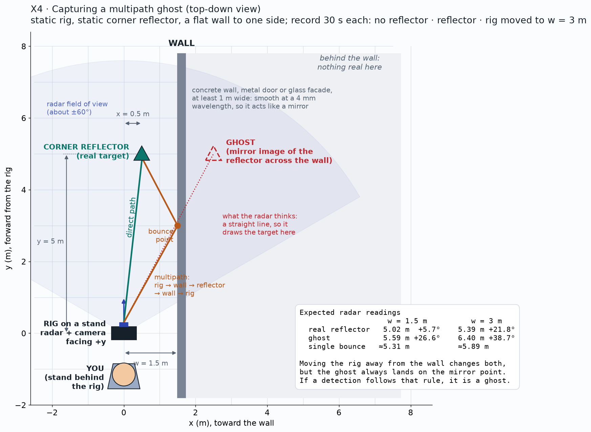

# X4: multipath ghosts (the radar version of a late bounce)

**Status:** Side result (2026-10-21); side-wall test pending

## Question
Can multipath ghosts be predicted from geometry and removed?

## Method
Planned: rig parallel to a side wall 1.5 m away, corner reflector at (0.5, 5) m; three runs: no reflector, reflector, rig moved to 3 m from the wall. Side result already seen: an echo at twice the target distance (radar → target → rig → target → radar).

## Data
Range shots of 2026-10-21; planned `x4_wall_empty`, `x4_wall_refl`, `x4_wall_3m`.

## Results
### Seen on 2026-10-21: the 2× echo
| Target | Peak | 2× echo | Level |
|---|---|---|---|
| 3 ft | 1.10 m | 2.18 m | −12.5 dB |
| 6 ft | 1.99 m | 3.93 m | −22.6 dB |
| 9 ft | 2.90 m | 5.94 m | −21.5 dB |
| 12 ft | 3.82 m | 7.86 m | −24.3 dB |

*Profiles rescaled by the target distance: the 2× echo*
### Planned side-wall test

*Geometry: the wall acts as a mirror; the ghost sits at the mirror image of the reflector*
| Run | Ghost predicted | Ghost measured | Removed by filter |
|---|---|---|---|
| wall 1.5 m | 5.59 m, +26.6° | TBD | TBD |
| wall 3 m | 6.40 m, +38.7° | TBD | TBD |

*Pending: top view before and after the ghost filter, with LiDAR walls overlaid. Source: TBD.*

## Conclusion
Pending. Pass: > 90 % of ghosts removed, > 95 % of real points kept.

## Open items
- Find a flat concrete wall or metal door with 6 m of open space next to it

## B-roll to capture (for the 5-minute video)
- [ ] Phone photo of the wall setup from above or behind
- [ ] Top-view animation: the ghost jumps when the rig moves away from the wall

## Reproduce
TBD in `src/ext/x4/`.

[Back to all experiments](../../EXPERIMENTS.md)
