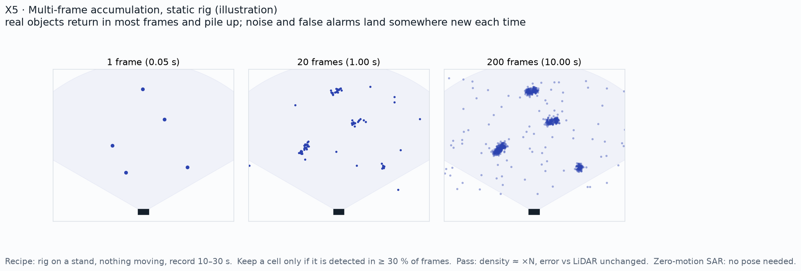

# X5: multi-frame accumulation

**Status:** Candidate extension (not in the plan to achieve)

## Question
How much denser does the radar cloud get when frames of a static scene are stacked?

## Method
Static rig, 10 to 30 s; keep a cell if it is detected in at least 30 % of frames. With poses for moving segments (360 orbits).

## Data
TBD

## Results
| Frames stacked | Points | Error vs LiDAR (m) | False alarms |
|---|---|---|---|
| 1 | TBD | TBD | TBD |
| 20 | TBD | TBD | TBD |
| 200 | TBD | TBD | TBD |

*Plan / expected shape (illustration, not data)*

*Pending: point density vs number of frames. Source: TBD.*

## Conclusion
Pending. Pass: density grows about ×N with unchanged error against LiDAR.

## Open items
- Decide after M3 whether to run it

## B-roll to capture (for the 5-minute video)
- [ ] Time-lapse of points piling up in the viewer

## Reproduce
TBD in `src/ext/x5/`.

[Back to all experiments](../../EXPERIMENTS.md)
