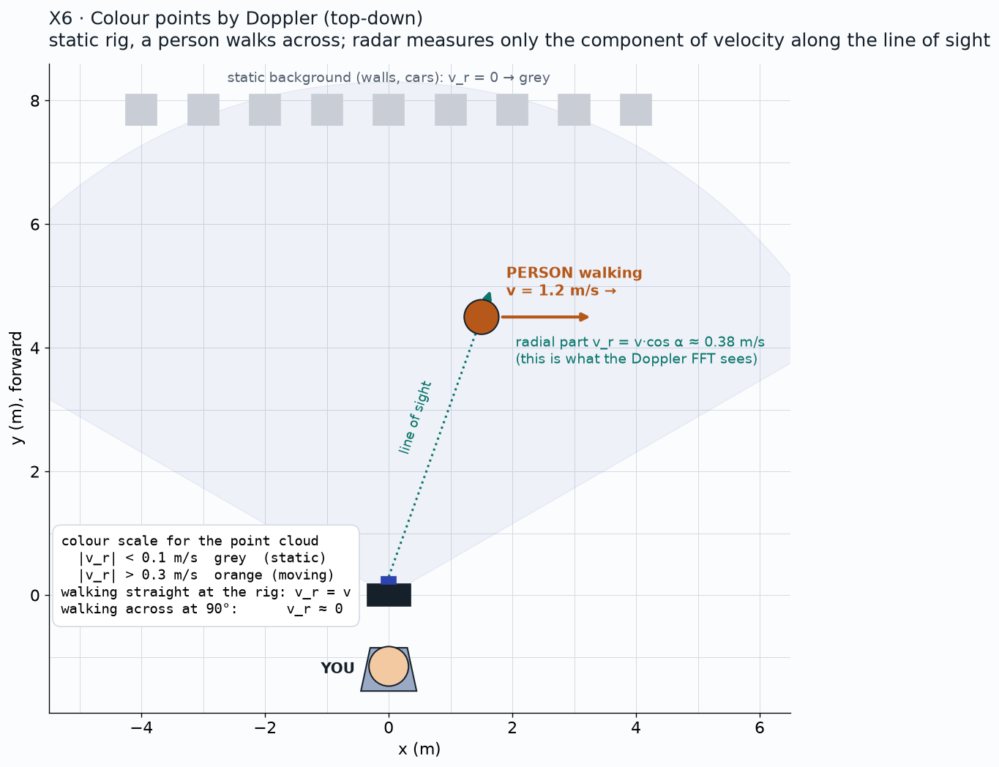

# X6: colour points by Doppler

**Status:** Candidate extension (not in the plan to achieve)

## Question
Can moving people and cars be separated from the static scene by radial velocity alone?

## Method
Rig static; people walking across and toward the rig; campus scenes from Session 2.

## Data
TBD

## Results
| Target | |v_r| measured | Expected | Separated? |
|---|---|---|---|
| Static background | TBD | < 0.1 m/s | TBD |
| Person walking toward | TBD | ~1.2 m/s | TBD |
| Person walking across | TBD | ~0 | TBD |
| Car | TBD | may wrap above 1.79 m/s | TBD |

*Plan / expected shape (illustration, not data)*

*Pending: dense depth with points coloured by radial velocity. Source: TBD.*

## Conclusion
Pending. Pass: moving points |v_r| > 0.3 m/s, background < 0.1 m/s.

## Open items
- Decide after M3 whether to run it

## B-roll to capture (for the 5-minute video)
- [ ] Clip of a person walking toward the rig with the coloured points

## Reproduce
TBD in `src/ext/x6/`.

[Back to all experiments](../../EXPERIMENTS.md)
