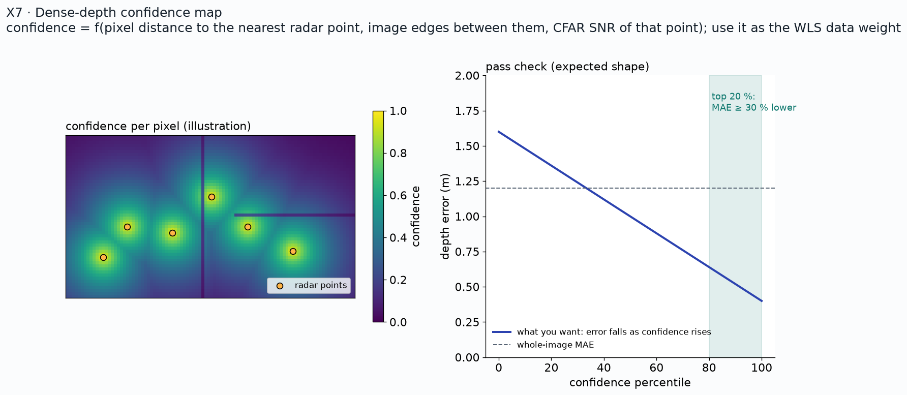

# X7: confidence map for dense depth

**Status:** Candidate extension (not in the plan to achieve)

## Question
Can a per-pixel confidence tell where the dense depth is trustworthy?

## Method
Confidence = f(distance to the nearest radar point, image edges in between, CFAR SNR); used as the WLS data weight; calibrated against LiDAR.

## Data
TBD

## Results
| Confidence percentile | MAE (m) |
|---|---|
| top 20 % | TBD |
| all pixels | TBD |
| bottom 20 % | TBD |

*Plan / expected shape (illustration, not data)*

*Pending: error vs confidence percentile curve. Source: TBD.*

## Conclusion
Pending. Pass: the top 20 % have at least 30 % lower MAE than the whole image.

## Open items
- Decide after M3 whether to run it

## B-roll to capture (for the 5-minute video)
- [ ] Overlay of the confidence map on the camera frame

## Reproduce
TBD in `src/ext/x7/`.

[Back to all experiments](../../EXPERIMENTS.md)
