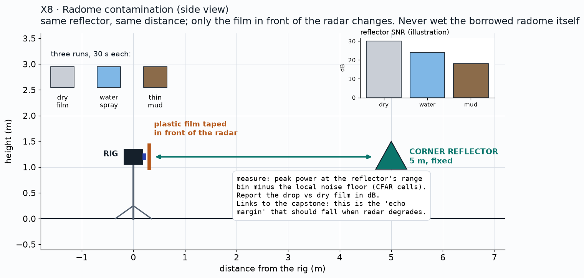

# X8: radome contamination

**Status:** Candidate extension (not in the plan to achieve)

## Question
How much echo is lost with water or mud in front of the radar?

## Method
Plastic film in front of the radome (never wet the borrowed radome); same target at 5 m; dry, water spray, thin mud, 30 s each.

## Data
TBD

## Results
| Film | Peak (dB) | Drop vs dry (dB) |
|---|---|---|
| dry | TBD | 0 |
| water | TBD | TBD |
| mud | TBD | TBD |

*Plan / expected shape (illustration, not data)*

*Pending: bar chart of the echo drop per condition. Source: TBD.*

## Conclusion
Pending. Pass: a number in dB for each condition.

## Open items
- Decide after M3 whether to run it

## B-roll to capture (for the 5-minute video)
- [ ] Close-up of spraying the film

## Reproduce
TBD in `src/ext/x8/`.

[Back to all experiments](../../EXPERIMENTS.md)
