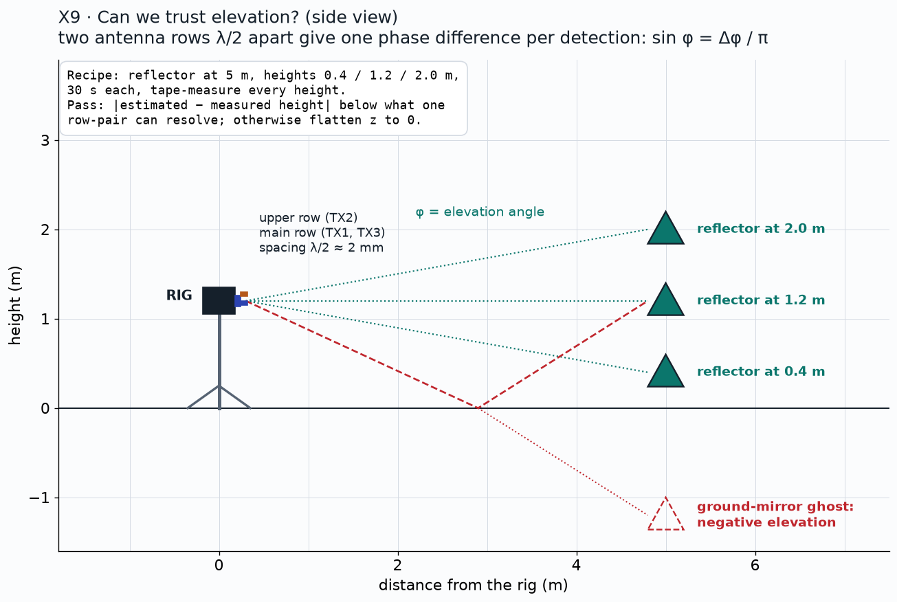

# X9: can we trust the radar elevation?

**Status:** Candidate extension (not in the plan to achieve)

## Question
Is the elevation from the two antenna rows accurate enough to keep z in the 3D output?

## Method
Target at 5 m at three heights (0.4, 1.2, 2.0 m), 30 s each; compare with LiDAR. Look for ground-mirror ghosts at negative elevation.

## Data
TBD

## Results
| Height | Expected elevation | Measured | Error |
|---|---|---|---|
| 0.4 m | TBD | TBD | TBD |
| 1.2 m | TBD | TBD | TBD |
| 2.0 m | TBD | TBD | TBD |

*Plan / expected shape (illustration, not data)*

*Pending: elevation error histogram against LiDAR. Source: TBD.*

## Conclusion
Pending. Pass: error below what one row pair can resolve; otherwise flatten z to 0.

## Open items
- Decide after M3 whether to run it

## B-roll to capture (for the 5-minute video)
- [ ] Photo of the target on a height-adjustable stand

## Reproduce
TBD in `src/ext/x9/`.

[Back to all experiments](../../EXPERIMENTS.md)
