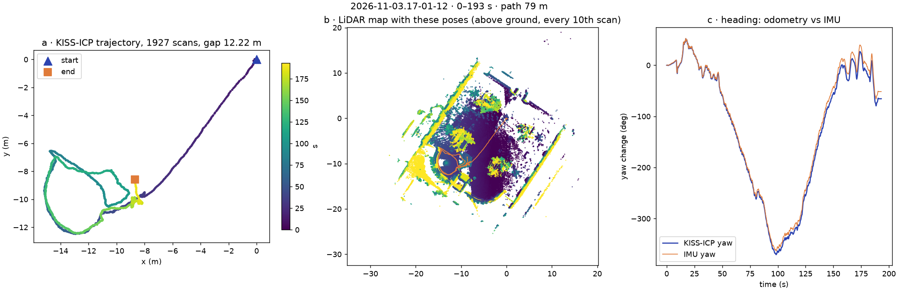
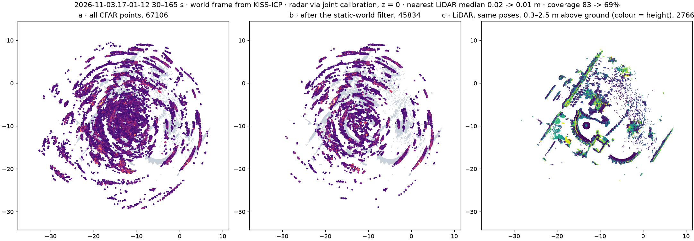

# Session 3 · 2026-11-03 · lab calibration, campus at sunset

Rig: unchanged since 10/29. OS-0-128 (serial 992112000195), `config.yaml` identical to 10/29 field by field, `lidar.json` differs only in the initialization id. 13 traces, 24 GB, on nunga under `/data/christineh/DATASET/radarhd/transfer_2026-11-03/` (the folder name is the uploader's, not the usual `<date>/`; `data/raw/<trace>` links there, so a rename means relinking).

Trace content below is read from the camera frames and the odometry, not from anyone's notes. No tape distances, photos or labels came with the upload, so place names and board distances are inferred and should be corrected by whoever was there.

Local only (faces visible, gitignored): contact sheets and overlays in `data/sessions/2026-11-03/`. The numbers come from `notes/sessions/2026-11-03_checks.py`.

## Segments
| Trace | Length | Content |
|---|---|---|
| `16-03-39` to `16-27-20` (8 traces) | 10 s each | lab, rig static with the LiDAR 0.80 m above the floor, flat board at about 3, 2 and 1.5 m across ±41°; people around it, one holding the board in the closest shots |
| `16-55-34` | 7 s | dry run outdoors |
| `17-01-12` | 195 s | walk to the Scotty plaza → **two passes around the statue, 30-165 s** → a table with people sitting |
| `17-07-11` | 211 s | same table → **192 m loop around a large lawn (looks like the Cut)**: tent, painted banners, benches, lamp posts, a few people; ends on a path |
| `17-11-37` | 410 s | path → past a building with a "Drama" banner → bike rack under an overhang → lit ramp to a glass-walled building → **indoors from about 205 s**: glass doors, corridors, a bridge → balcony over an atrium with a dining floor |
| `17-18-46` | 84 s | **spin in place on that balcony, about six turns**, rig often tilted up at the skylight; people below |

## Data quality
| Trace | Radar frames (invalid) | LiDAR scans (missing, longest gap) | Camera frames (max gap) | IMU |
|---|---|---|---|---|
| 16-03-39 | 152 (0) | 87 (0) | 301 (40 ms) | 994 |
| 16-07-14 | 152 (0) | 86 (0) | 301 (43 ms) | 995 |
| 16-10-01 | 152 (0) | 86 (0) | 301 (43 ms) | 994 |
| 16-12-15 | 152 (0) | 85 (1 scan) | 301 (43 ms) | 994 |
| 16-14-17 | 152 (3) | 86 (1 scan) | 298 (108 ms) | 995 |
| 16-16-48 | 155 (0) | 88 (0) | 306 (40 ms) | 1,011 |
| 16-23-01 | 155 (1) | 89 (0) | 306 (43 ms) | 1,010 |
| 16-27-20 | 155 (0) | 89 (0) | 306 (48 ms) | 1,011 |
| 16-55-34 | 102 (0) | 62 (0) | 226 (43 ms) | 744 |
| 17-01-12 | 3,848 (1) | 1,927 (0.3 %, 0.4 s) | 5,845 (50 ms) | 19,476 |
| 17-07-11 | 4,178 (1) | 2,076 (1.1 %, 0.8 s) | 6,340 (51 ms) | 21,126 |
| 17-11-37 | 8,144 (4) | 3,905 (4.4 %, 0.5 s) | 12,289 (67 ms) | 40,955 |
| 17-18-46 | 1,629 (0) | 826 (0) | 2,517 (48 ms) | 8,381 |

- `roverd validate` passes on all 13.
- The radar starts 2.31 s after the camera in every trace, so a 10 s shot holds 7.5 s of radar.
- The 4.4 % of missing scans in `17-11-37` is the worst so far (10/29: 1.5-1.8 %). The gaps cluster indoors, from about 244 s.
- Camera sharpness (variance of the Laplacian) is as good as 10/29 on static frames: about 88 in the lab shots against 34 on 10/21. It falls to about 20-35 walking indoors.

## How dark it was
Sunset was about 17:15 EST by calculation (civil dusk 17:43). The walk went indoors at about 17:15 and recording ended at 17:20, so **there is no outdoor frame after sunset**. In the lower part of the frame (no sky):

| Stretch | Ground luma | Edge strength |
|---|---|---|
| 10/29 Jeep lot, day | 132 | 13.9 |
| 10/29 Scotty, day | 79 | 13.1 |
| 10/29 paths, day | 65 | 11.5 |
| 11/3 17:01 Scotty | 73 | 11.7 |
| 11/3 17:07 lawn | 24 | 8.0 |
| 11/3 17:11 paths | 37 | 9.0 |
| 11/3 17:15 indoors | 54 | 8.9 |
| 11/3 17:19 atrium | 38 | 11.5 |

The image still has most of its edges, so this is low light and not the "camera fails" case. The trace does not record whether the camera's exposure was automatic. The LiDAR's NIR channel is no use as a light meter: on the static lab shots it climbs from 278 to 394 in 24 minutes with no change in the room, which looks like the sensor warming up.

## Calibration shots
| Trace | Radar: range, azimuth, SNR | LiDAR: board xy range | Board height z in LiDAR frame |
|---|---|---|---|
| 16-03-39 | 2.96 m, −1.8°, 35 dB | 2.95 m | −0.52 m |
| 16-07-14 | 2.96 m, +24.0°, 27 dB | 2.79 m | −0.45 m |
| 16-10-01 | 2.88 m, −41.0°, 30 dB | 2.98 m | −0.42 m |
| 16-12-15 | 2.00 m, −3.6°, 38 dB | 2.01 m | −0.38 m |
| 16-14-17 | 2.00 m, −32.1°, 39 dB | 1.87 m | −0.58 m |
| 16-16-48 | 2.09 m, +18.2°, 37 dB | 2.05 m | −0.38 m |
| 16-23-01 | 1.48 m, −18.2°, 42 dB | 1.35 m | −0.61 m |
| 16-27-20 | 1.56 m, +7.2°, 35 dB | 1.46 m | −0.45 m |

Same flat board as 10/21, no corner reflector visible in any frame, indoors, 1.5-3 m. The board is found in the radar, the LiDAR and the image in all eight.

| Radar → LiDAR, radar part of the joint solve (quick look, not in `calib/`) | Yaw | t (m) | Range residual | Azimuth residual |
|---|---|---|---|---|
| 10/21 joint solve applied to these shots | +94.4° | (−0.15, +0.02, −0.27) | **+18.5 cm, all eight the same sign** | 1.7° |
| Fresh solve, z held at −0.27 m | +98.3° ± 2.5° | (+0.05 ± 0.055, +0.12 ± 0.023, −0.27) | 6.3 cm | 2.1° |
| Fresh solve, z free | +99.2° | (−0.08, +0.14, +0.24) | 4.0 cm | 2.1° |

- The free solve puts the radar above the LiDAR, which it is not. All boards are at nearly one height, so these shots cannot see z.
- The LiDAR board projected through the 10/21 LiDAR → camera solve lands off the board in the image, by eye about 50 px at 3 m and 100 px at 1.5 m. An offset that grows as the board comes closer is a translation error.
- Both point the same way: **the LiDAR may have moved by about 20 cm against the radar and camera in the 10/29 swap.** It would also explain why the 10/21 transform only held to 20-30 cm on 10/29.
- This is not proven. An independent check on the Scotty orbit could not separate the two offsets: the radar reads 0.28 m in front of the pedestal axis under the 10/21 offset and 0.48 m under the fresh one, on either side of the 0.39 m pedestal radius. The radar's ranges (2.96, 2.00, 1.48 m) look like tape marks at 3, 2 and 1.5 m, which would mean the range calibration is still right, but the tape numbers are not in the upload. A tape measure on the rig settles it.

## Odometry
KISS-ICP with the repo defaults over each whole trace; poses in `data/poses/<trace>/` (not in git).

| Trace | Scans | Path | Heading, odometry vs IMU | Note |
|---|---|---|---|---|
| `17-01-12` | 1,927 | 79 m | −66° vs −52° | see below |
| `17-07-11` | 2,076 | 192 m | −386° vs −461° | the difference appears in the first seconds (fast swing, 0.8 s LiDAR gap at 1 s); the two curves are parallel after that |
| `17-11-37` | 3,905 | 477 m | +328° vs +378° | through glass doors and corridors; not closed |
| `17-18-46` | 826 | 20 m | −2,148° vs −2,174° | six turns, 26° apart, start-to-end 0.56 m. On 10/29 a spin in the open lot slipped about 150° |

## The Scotty orbit, 17-01-12, 30-165 s
- Two passes in opposite directions: −360° in 75 s, then +355° in 60 s, at 0.35 m/s. Tilt is 6° median, 12° at the 90th percentile.
- Range to the pedestal: median 2.6 m, 5-95 % 1.9-5.0 m. On 10/29 it was 1-1.3 m and less than a loop.
- The pedestal found from each pass alone lands in the same place to 2 cm. Over this orbit the odometry drifts by less than the object's detail.
- Radar: 67,106 CFAR points, 45,834 kept by the static-world filter, 1 cm median to the nearest LiDAR point, coverage 69 %. Within 2.5 m of the pedestal 7,367 points, of which 4,378 are within 0.35 m of its axis.
- In range the radar does see the near side (the reading sits in front of the axis with an interquartile range of 17 cm). Across the beam it is still one blob: 14° at 2.6 m is 63 cm, against a pedestal 78 cm wide.
- The scene has changed since 10/29: pumpkins on the statue, balloons on metal stands beside it, people at tables on one side. The curved wall is still behind it, so the ghost remains.

*`python -m src.recon.poses data/raw/2026-11-03.17-01-12 --out figures/poses_scotty_1103.png`, commit 9a2e47a.*

*`python -m src.recon.accumulate data/raw/2026-11-03.17-01-12 --start 30 --seconds 135 --out figures/accum_scotty_1103.png`, commit 9a2e47a, with the 10/21 joint calibration.*

## What each trace is good for
| Use | Where |
|---|---|
| M4 on the current rig | the 8 board shots (a solve is still to be run) |
| obj-orbit-360, small metal | `17-01-12` 30-165 s; replaces the 10/29 Scotty as the main one |
| Mapping, large open scene | `17-07-11`, 192 m around the lawn |
| Odometry yaw on a spin | `17-18-46` |
| M5-M6, low light, handheld | `17-01-12`, `17-07-11`, `17-11-37` up to 205 s |
| M6 and capstone, indoors with people | `17-11-37` from 205 s, `17-18-46` |
| Capstone, people at close range | `17-01-12` start, `17-07-11` end, `17-11-37` start |

## Not recorded
- Anything after dark
- Any static outdoor scene: no outdoor stretch has the gyro quiet for 5 s
- A corner reflector, tape numbers, rig geometry by tape
- A small object in the open, X4 side wall, X10 open sky

## Next
The shot list is in `SESSIONS.md`.
