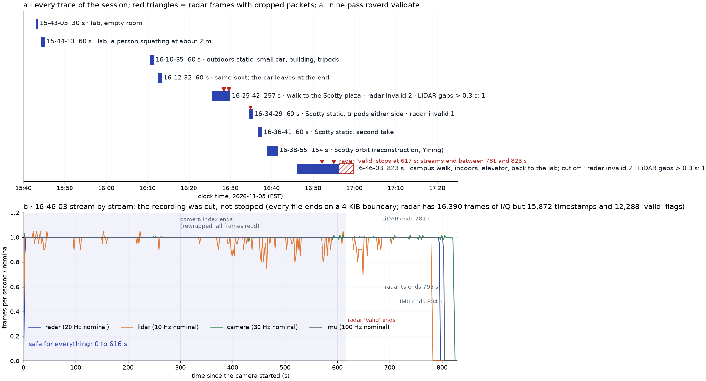
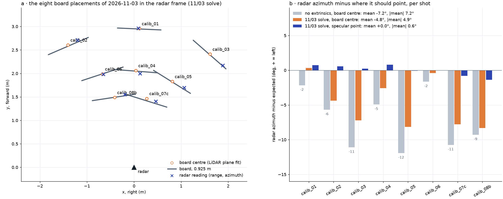
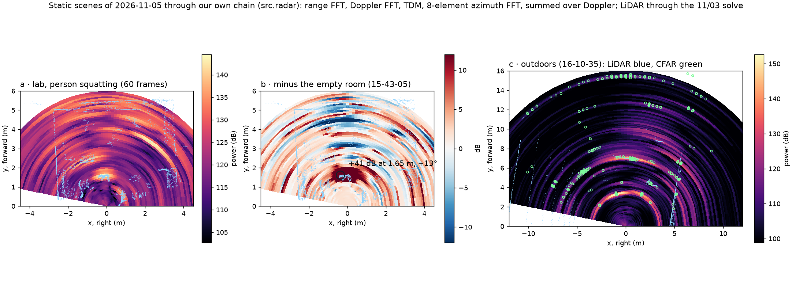
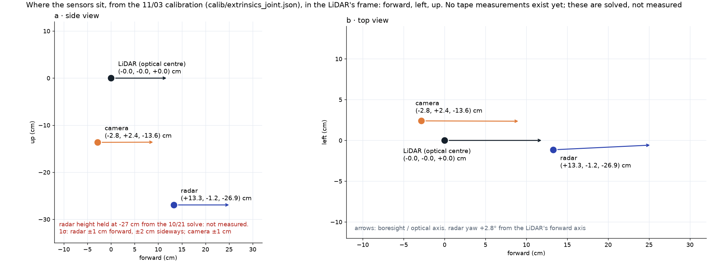
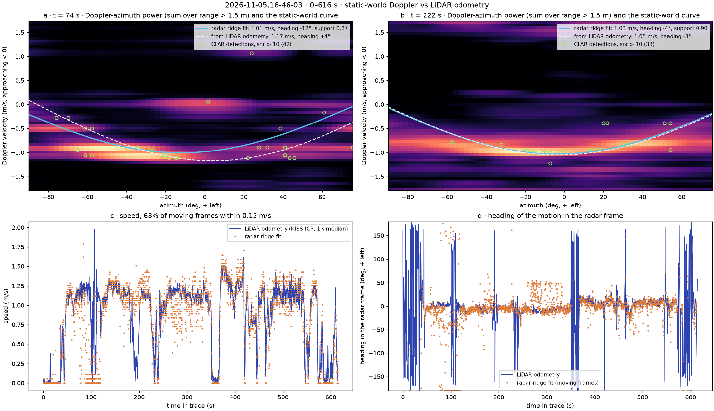
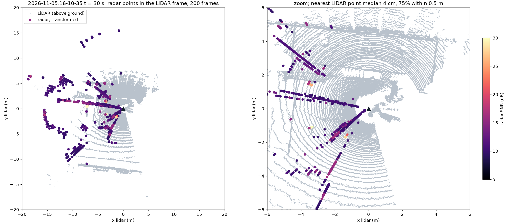
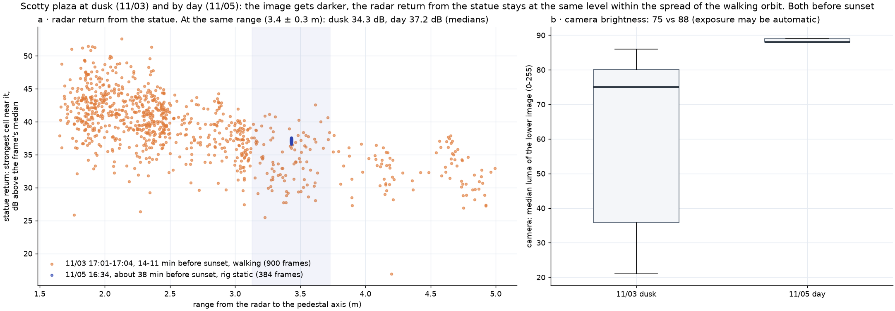

# Session 4 · 2026-11-05 · static scenes, Scotty plaza, a campus walk — and seven figures

Rig: unchanged since 10/29 (OS-0-128, `config.yaml` identical to 11/03). Ten traces, 66 GB, on nunga under `/data/christineh/DATASET/radarhd/2026-11-05/`; `data/raw/<trace>` links there. All ten pass `roverd validate`. No notes, tape numbers or shot labels came with the upload, so the content below is read from the camera frames, and the names used in planning (`static_day_a`, `static_day_b`, ...) are mapped to trace ids here.

| Trace | Length | Content | Planning name |
|---|---|---|---|
| `15-43-05` | 30 s | lab, empty room | dry run / empty reference |
| `15-44-13` | 60 s | lab, a person squatting at about 2 m | `static_day_a` |
| `16-10-35` | 60 s | outdoors, rig static: a small car, a building, two tripods | `static_day_b` |
| `16-12-32` | 60 s | same spot; the car leaves at the end | |
| `16-25-42` | 257 s | walk to the Scotty plaza | `scotty_plaza_loop` (reconstruction, Yining) |
| `16-34-29` | 60 s | Scotty, rig static, tripods either side of the statue | |
| `16-36-41` | 60 s | Scotty, second static take | |
| `16-38-55` | 154 s | orbit of Scotty | `scotty_orbit` (reconstruction, Yining) |
| `16-46-03` | 823 s | campus walk, indoors, an elevator, back to the lab, rig set on the desk; **cut off** | campus walk |
| `19-11-08` | 1,292 s | **night**: lab desk, then a walk outdoors along the road (cars, headlights, a few people), rig set down at the end; complete | night walk |

Not touched here, per `CONTRIBUTING.md`: the reconstruction traces (`16-25-42`, `16-38-55`), and point-cloud fusion, accumulation, confidence, elevation and depth evaluation (Yining: obj-orbit-360, X5, X7, X9, M6 evaluation). Figures with camera frames are kept local (`data/sessions/2026-11-05/`, gitignored); every figure below is radar, LiDAR or numbers only.

Script for all seven: `notes/sessions/2026-11-05_figures.py` (the docstring lists the commands).

## 1 · Session health (rig-health)

*`python notes/sessions/2026-11-05_figures.py fig1`.*

Eight traces are clean: radar at most 2 invalid frames, LiDAR at most one gap over 0.3 s, camera gaps under 0.1 s. **`16-46-03` was cut off, not stopped.** Every file ends on a 4 KiB boundary and the streams disagree on their own length:

| Stream | Data | Timestamps | Ends at |
|---|---|---|---|
| radar | 16,390 frames of I/Q | 15,872 | 796 s; `valid` has only 12,288 flags, to 616.7 s |
| LiDAR | 7,680 scans | 7,680 | 781 s |
| IMU | 80,896 samples (`acc`), 82,304 (`avel`) | 80,384 | 804 s |
| camera | 24,482 frames in the file, an AVI index for 8,913 | 24,690 | 823 s |

What to do with it: use **0-616 s** for anything that needs the radar's `valid` flags (the walk ends in the lab at about 700 s anyway; after that the rig sits on the desk). The camera index stops at 297 s, so OpenCV cannot seek past it; `ffmpeg -i video.avi -c copy video_full.mkv` rewraps it and every frame reads (done locally in `data/sessions/2026-11-05/16-46-03_video_full.mkv`). `src.recon.poses` now trims the IMU arrays to their timestamps; before, the mismatch crashed it. Likely cause: the rig lost power or the recorder was killed; ask whoever was there.

## 2 · Board placements against the radar (M1 / M4)

*`python notes/sessions/2026-11-05_figures.py fig2`. The eight 11/03 shots in trace order, named as in planning: `16-03-39` … `16-16-48` = calib_01 … 06, `16-23-01` = calib_07c, `16-27-20` = calib_08b.*

There are no tape coordinates for these shots (none in the upload or the repo), so the board positions are the LiDAR's plane fits (5-9 mm rms), which are better than a tape anyway. Radar azimuth minus where it should point:

| Assumption | Mean | Mean of the magnitude |
|---|---|---|
| no extrinsics (radar at the LiDAR, axes aligned), board centre | −7.2° | 7.2° |
| 11/03 solve, board centre | −4.8° | 4.9° |
| 11/03 solve, specular point | +0.0° | 0.6° |

The "+6° bias" from planning does not show up: the offset has the other sign (to the right) and it is not one number. About 2.4° of it is the extrinsics (the 2.8° yaw and the radar sitting 13 cm ahead of the LiDAR, a large parallax at 1.5-3 m); the rest is the board, whose return comes from its specular point and not its centre, so the error grows with how far the board is turned (calib_03, 05, 07c, 08b). Aimed at the specular point the residual is 0.6° (`experiments/m4-extrinsics`).

## 3 · Static scenes through our own chain (M2 / M3)

*`python notes/sessions/2026-11-05_figures.py fig3`. Our chain only: range FFT, Doppler FFT, TDM compensation, 8-element azimuth FFT, power summed over Doppler, 60 frames over each 60 s trace; LiDAR (blue) placed through the 11/03 solve. Camera frames for the two scenes: local only.*

- **a, b · the person (`15-44-13`).** Against the empty room (`15-43-05`, same rig position) the person stands out by **+41 dB at the peak cell, 1.65 m, +13° (left)**, and by +31 dB over the 5 × 5 cells around it, on the LiDAR outline of the person; with them in the room that spot is the brightest of the scene (143 dB against 102-113 dB empty). The camera puts them at about 2 m, slightly left; 1.65 m is the radar's near-side return of a squatting body.
- **c · the outdoor scene (`16-10-35`).** The building at 15 m, the car and the tripods are the bright arcs; CFAR detections (green) sit on them. The faint arcs across the whole azimuth at fixed ranges are probably angle sidelobes of the strongest reflectors.
- For M3 (due 11/08): this is the angle FFT and CFAR on real static scenes, with the LiDAR as the reference. The ±7° acceptance is already met by the calibration shots (0.6°, figure 2).

## 4 · Rig geometry (M4)

*`python notes/sessions/2026-11-05_figures.py fig4`, from `calib/extrinsics_joint.json`.*

There are no tape numbers in the 11/03 log (the upload had none), so this is the solved geometry, in the LiDAR's frame (forward, left, up): **radar (+13.3, −1.2, −26.9) cm, camera (−2.8, +2.4, −13.6) cm**, radar boresight 2.8° left of the LiDAR's forward axis, camera optical axis along it. The radar's height is held from 10/21 and not measured; 1σ is about 1 cm forward, 2 cm sideways for the radar and about 1 cm for the camera. One tape measure of the rig checks all of it.

## 5 · Ego-motion Doppler on the walk (X6)

*`python -m src.recon.poses data/raw/2026-11-05.16-46-03 --seconds 616 --out figures/poses_walk_1105.png`, then `python -m src.recon.ego_check data/raw/2026-11-05.16-46-03 --seconds 616 --frames 74 222 --out figures/s4_fig5_ego_walk.png`.*

Walking at about 1.1 m/s, the static world lies on v = −s·cos(az − φ) (a, b): the radar fits that curve from its own Doppler and the LiDAR odometry gives it independently. Over 0-616 s the radar's speed is within 0.15 m/s of the odometry on **63 %** of moving frames, heading **6°** (10/29 Scotty: 89 %, 6°; this walk has stops and an elevator ride, where the comparison is weakest). At t = 74 s, on a path with people, CFAR points sit off the curve, at +1.1 m/s and around −0.5 m/s: most likely the people walking, and that separation is what X6 colours. The odometry over the 616 m holds the IMU's heading throughout (`figures/poses_walk_1105.png`).

## 6 · Radar on LiDAR, static_day_b (M4 check)

*`python -m src.calib.overlay data/raw/2026-11-05.16-10-35 --time 30 --accumulate 200 --rmax 20 --joint --out figures/s4_fig6_overlay_static_b.png`. Plane only, z set to 0; no elevation.*

Rig static, 200 frames (10 s), 7,925 CFAR points: **median 4 cm** to the nearest LiDAR point, **75 %** within 0.5 m, on a scene the solve never saw. The straight streaks at fixed azimuths run across range: probably range sidelobes of the strong reflectors on the tripods, not checked.

## 7 · Scotty at dusk and by day (M5)

*`python notes/sessions/2026-11-05_figures.py fig7`. 11/03 `17-01-12` (30-165 s, walking, odometry poses) against 11/05 `16-34-29` (rig static, pedestal found in the LiDAR at 3.6 m).*

Radar return from the statue, as the strongest range-azimuth cell near its near side, in dB above the frame's median: at the same range (3.4 ± 0.3 m) **34.3 dB at dusk and 37.2 dB by day** (medians). The dusk values are a walking orbit and spread from about 25 to 42 dB with the viewing angle, so the 3 dB is within that spread. The camera's ground brightness falls from **88 to 75** (median luma). Both takes are before sunset (11/03 about 12 min before, 11/05 about 38 min before), and the camera may be on automatic exposure, so this is only the first step toward "works in the dark": the light changed little, the radar did not change. A night trace now exists (`19-11-08`, a walk along the road), but no static Scotty take after dark, so this comparison still waits for one.

## Open
- Who stopped `16-46-03`, and how (power, the recorder)? A clean stop next time.
- Tape the rig; it checks figure 4 and replaces the held radar height.
- The night take at the same Scotty station as `16-34-29`, same camera settings, for figure 7's real comparison.
