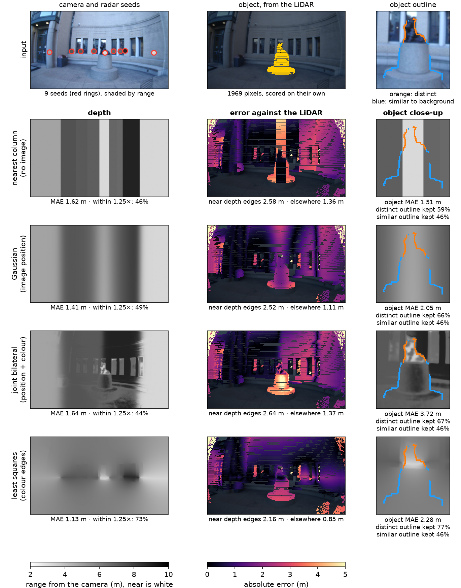
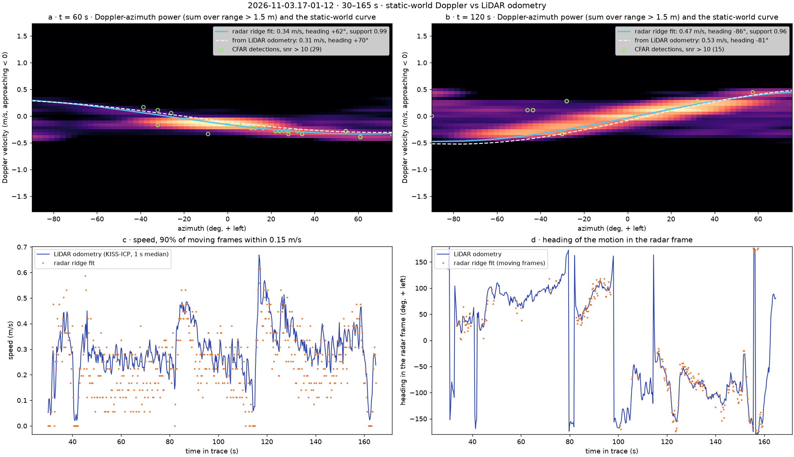

# Time-of-Flight at 4 mm: A 3D Camera from a Single-Chip Radar and a Fisheye Camera

*Report draft, rewritten 2026-11-11 in the style of the example papers (Ng et al. 2005, RadarHD, GRT). Markdown first; it moves into `report.tex` (Overleaf "CP Final") once the text settles. Target about ten pages plus references.*

Conventions for this draft:

- Every number and figure comes from code in `src/radar/`, `src/calib/`, `src/recon/`, `src/grt/`, `src/fusion/` and `src/eval/`. Nothing comes from `src/ext/` or from Yining's reconstruction work.
- `[TODO: ...]` marks text still to write. Figures still to make are grey placeholders. Figures that exist are embedded from `figures/` and `notes/fig/`; most still need re-exporting for the PDF (larger text, no trace names in titles).
- Citations marked *(add to note.bib)* are not in the bibliography yet. Each was taken from the reference list of RadarHD or GRT and still has to be checked against the original before it goes in.
- Single author, so the text says "I", not "we".

---

## Abstract

A single-chip 77 GHz FMCW radar measures metric range in any light, but its eight-element array resolves angle only to about 14° and gives no usable elevation. This report asks how much of a 3D camera such a radar can be once a fisheye camera is placed next to it. I treat the radar as a continuous-wave time-of-flight sensor at a 4 mm wavelength and build its imaging chain from raw ADC samples to 3D points. I then calibrate it to the camera by modelling a flat target as the mirror it is at this wavelength, accumulate its points over a handheld walk with a Doppler test that keeps only the static world, and fill the sparse radar depth into a dense depth map with image-guided filters. Against a 128-beam LiDAR, ranges are linear to ±1.2 cm, the calibration holds azimuth to 0.58°, and 91–92 % of accumulated radar points lie within 0.5 m of a LiDAR surface. Dense depth shows the limits of the pairing. The radar puts the right depth on a statue, but no image-guided fill also recovers the statue's outline. Where the statue's outline differs from the background in colour, an edge-aware fill keeps 77 % of it. Where the statue and the background are the same stone, every fill fails, and joint bilateral upsampling moves the statue to the wall behind it.

---

## 1. Introduction

A camera records shape and texture but not metric depth, and in the dark it records little at all. Time-of-flight sensors measure depth directly, but optical ones fail in strong sunlight, smoke and fog, and LiDARs are bulky and expensive. A single-chip millimetre-wave radar is a third option. Transmitters, receivers and signal processing fit on one chip, it measures range to centimetres regardless of light, and it also measures radial velocity. These properties have made it common in cars and robots \citep{Prabhakara:RadarHD:2023, Huang:GRT:2025}.

The radar's weakness is angle. Its aperture is a few wavelengths wide, so a point target spreads over a beam about 14° across, two orders of magnitude coarser than a LiDAR \citep{Prabhakara:RadarHD:2023}. Its array has almost no vertical extent, so elevation is essentially unknown. Figure 3 shows the result: the radar sees a parked car 5.6 m away as an arc 1.4 m wide, where the LiDAR sees a line. A radar alone gives a 3D output that is sparse, blurred in angle and flat.

The camera has the opposite profile. It resolves angle to a fraction of a degree but has no metric depth. This suggests a division of labour that this course has seen before: let the sensor with good range supply depth at a few points, and let the image decide where that depth should spread. Joint bilateral upsampling \citep{Kopf:JBU:2007} does exactly this for a low-resolution depth map and a high-resolution photograph. The question is whether the same idea survives a depth sensor whose samples are not a low-resolution image but a handful of points on a single row, each smeared over 14°, some of them ghosts.

To answer it, I built a radar–camera 3D camera from first principles on a handheld rig borrowed from the CMU WiSE Lab, with a LiDAR as ground truth. In building it, I ran into three problems that a camera pipeline does not have. First, *the radar's raw output is not an image*: it is a stream of complex samples that must become range, velocity and angle, and each step has its own artifacts (mirrored range axes, a velocity-dependent phase error between transmitters, sidelobes that CFAR detection picks up as targets). Second, *at 4 mm most surfaces are mirrors*, so the obvious calibration target, a flat board, does not return from where the camera and LiDAR see it. Third, *radar returns come from the strongest reflectors, not from the visible surface*, so a radar point can be correct in range and still belong to an object that the camera cannot see at that pixel.

**Contributions.** This report makes four contributions:

- A radar imaging chain from raw ADC samples to 3D points, checked stage by stage against the rig's own signal-processing library to better than 10⁻⁷ relative error, and against a tape measure to ±1.2 cm in range (Sections 4.1, 6.1).
- A radar–LiDAR–camera calibration that treats a flat board as a mirror. Aiming at the board's specular point instead of its centre reduces the azimuth residual from 2.89° to 0.58°, and explains why earlier angle shots read 6–9° too wide (Sections 4.2, 6.1).
- Accumulation of radar points over a handheld walk, with a Doppler test that keeps only the static world. The radar's own Doppler agrees with the LiDAR odometry to 0.15 m/s, and 91–92 % of the kept points lie within 0.5 m of a LiDAR surface (Sections 4.3, 6.2).
- A study of camera-guided dense depth from radar seeds, scored on the object, around it and on its outline. It separates outlines that are visible in colour from outlines that are not, following a suggestion by the course staff (Sections 4.4, 6.3, 6.4).

**Key findings.**

- **The radar has the depth; the camera does not have the shape.** On a statue 3.3 m away, the radar seed on the statue is 0.26 m from the LiDAR, but every image-guided fill moves part of the statue towards the wall behind it.
- **A sharp-looking depth map is not a correct one.** Joint bilateral upsampling gives the depth map that looks most like the scene and the largest error on the statue (3.72 m). Its sharpness is texture copied from the photograph.
- **Edges help only where they exist.** An edge-aware least-squares fill keeps 77–78 % of the statue's outline where it differs from the background in colour, and no fill does better than a constant depth where it does not.

*Figure 1. **Nine radar points and one photograph do not give a statue its shape.** Input and LiDAR reference, then four fills. Rows: 3D view, depth (near is white), statue close-up; outline orange where it stands out in colour, blue where it does not. MAE against the LiDAR under each panel. [TODO: teaser version, top row only.]*

---

## 2. Related work

**Radar as an imaging sensor.** The range and angle limits of FMCW radar follow from its bandwidth and aperture \citep{Rao:MIMO:2018}. The classical way to sharpen angle is synthetic aperture: move the radar along a known path and combine the frames, which needs millimetre-accurate motion \citep{Guan:HawkEye:2020} *(add to note.bib)*. In contrast, the rig in this report is handheld and its poses come from LiDAR odometry with about 0.1 m jitter, far coarser than the wavelength, so I accumulate detected points rather than coherent samples.

**Learned radar super-resolution.** RadarHD \citep{Prabhakara:RadarHD:2023} *(add to note.bib)* trains a U-Net to turn a single-chip radar's range–azimuth heatmap into a LiDAR-like 2D point cloud and improves on CFAR detection by 3.5×. GRT \citep{Huang:GRT:2025} scales this to a transformer trained on 29 hours of raw radar data from the same kind of rig as mine and predicts 3D occupancy. Both learn from LiDAR what the radar alone cannot resolve. This report takes the opposite route and asks what classical processing and a camera can recover without training. Section 6.5 runs a released GRT checkpoint on my traces as a reference point.

**Radar–camera depth.** Learned methods associate radar points with image pixels to densify depth for driving scenes \citep{Long:RCPDA:2021}, and radar–camera fusion has been used for long-range depth imaging on the same radar family \citep{Prabhakara:RadarCamera:2022} *(add to note.bib)*. These methods learn the association from data. Here the association is a fixed, hand-designed filter, which makes its failure modes visible.

**Image-guided upsampling.** Joint bilateral upsampling \citep{Kopf:JBU:2007} filters a low-resolution signal with weights from a high-resolution guide image. Edge-aware weighted least squares spreads sparse values over an image while respecting its edges \citep{Levin:Colorization:2004} *(add to note.bib; check this is the right reference for the formulation)*. Both assume that pixels similar in colour are similar in depth. Section 6.4 measures where that assumption fails.

**Ego-motion from Doppler.** A radar moving through a static scene sees each target's radial velocity determined by its own velocity and the target's azimuth, which has been used to estimate ego-motion from a single frame \citep{Kellner:EgoMotion:2013} *(add to note.bib)*. I use the same relation in the other direction: given the motion from LiDAR odometry, it decides which radar points belong to the static world.

[TODO: one more line on multipath in mmWave if space allows; N7 in the report plan.]

---

## 3. Background: FMCW radar as a time-of-flight camera

This section derives the three limits that shape everything after it: range resolution, angular resolution, and the absence of elevation. Each limit is a prediction that Section 6 tests.

### 3.1 Range from a beat frequency

An FMCW radar transmits a chirp whose frequency rises linearly with slope *S* over a bandwidth *B*. The echo from a target at range *r* returns after a delay τ = 2*r*/*c*. Mixing the echo with the chirp still being transmitted gives a beat tone at

> *f*b = *S* τ = 2*S r* / *c*,

so range is a frequency, and a Fourier transform over the samples of one chirp is a range profile. This is the radar counterpart of continuous-wave time-of-flight in optics: depth is encoded in a modulation of the signal and read out as a frequency or a phase. Two targets are separable when their beat tones differ by more than one bin, which gives the range resolution

> Δ*r* = *c* / 2*B*.

My radar's chirp sweeps *B* = 1.716 GHz, so Δ*r* = 8.74 cm, with 256 samples covering 22.4 m. [TODO: one sentence linking to the course's ToF lecture: phase vs frequency, and where the analogy breaks (a single chirp has no ambiguity in range up to the sampling limit).]

The phase of the beat tone also changes from chirp to chirp as the target moves, by 4π*v T*c/λ per chirp interval *T*c. A second Fourier transform over 64 chirps gives radial velocity in bins of 5.6 cm/s, up to ±1.79 m/s.

### 3.2 Angle from a virtual array

Angle comes from the phase difference of the same echo at different antennas. With three transmitters fired in turn and four receivers, the radar forms twelve virtual elements: a row of eight at half-wavelength spacing for azimuth, and a row of four offset by half a wavelength in height \citep{Rao:MIMO:2018}. An array of *N* elements at spacing λ/2 has a main lobe of width about

> Δθ ≈ 2 / *N* radians,

so eight elements give about 0.25 rad, or 14°. At range *d* the beam is *d* tan 14° ≈ *d*/4 wide: 0.9 m at a statue 3.6 m away, 1.4 m at a car 5.6 m away (Figure 3). An object narrower than this is one point to the radar. The vertical baseline is a single half-wavelength step between two rows, which gives one phase difference and no resolution, so elevation is effectively unknown (Figure 4).

### 3.3 Surfaces as mirrors

At a 4 mm wavelength, painted walls, glass, metal and smooth stone are optically smooth. A flat surface returns energy to the radar only from the point where its normal points back at the radar, its *specular point*, and reflects the rest away. Walls also act as mirrors for other objects, so a strong target can appear a second time at a longer range (Section 7). This is the property that most separates radar imaging from camera imaging, and it determines how the calibration of Section 4.2 must be done.

*Figure 3. **The radar sees a car as an arc.** One radar frame of a parking lot: (a) the radar's range–azimuth top view, where the car 5.6 m away spreads into an arc about 1.4 m wide; (b) the LiDAR scan, where the same car is a line; (c) the camera.*

*Figure 4. **Radar elevation is not usable.** One second of radar points (a) in 3D, (b) from above, coloured by SNR, (c) from the side. On a flat lot the points spread over ±3 m in height.*

---

## 4. Method

Figure 2 shows the pipeline. Raw radar samples become 3D points (4.1). A calibration places those points in the LiDAR's and the camera's frames (4.2). Over a handheld walk, LiDAR odometry and the radar's own Doppler keep the points that belong to the static world and accumulate them (4.3). For a single camera frame, the radar points become seeds that an image-guided filter spreads into a dense depth map (4.4).

*Figure 2. To make: pipeline overview. Raw ADC → range and Doppler FFT → TDM correction and angle FFT → CFAR → 3D points → (calibration) → static-world test and accumulation / seeds and image-guided fill → evaluation against the LiDAR.*

### 4.1 From raw samples to 3D points

**Unpacking.** Each radar frame is 786,432 bytes of 16-bit integers, which reshape to 64 chirps × 3 transmitters × 4 receivers × 512 values. The last axis interleaves in-phase and quadrature samples, and unpacking it gives 256 complex samples per chirp. Getting the order wrong mirrors the range axis, which is how I checked it.

**Range and Doppler.** A Hann-windowed FFT over each chirp gives the range profile (Figure 5). Averaging its magnitude over 64 chirps and 12 channels lowers the noise floor by about 15 dB. Below 0.35 m the profile is dominated by leakage from transmitter to receiver, and above 20.5 m by the I/Q mirror of near echoes, so both are masked. A second FFT over the chirps gives Doppler. On a walking rig the static world spreads over velocity, so the detection stage sums power over Doppler.

**TDM correction and angle.** The three transmitters fire 179 µs apart, so a target that moves between them adds a phase that grows with its Doppler. Uncorrected, this appears as a jump of −1.59 rad in the middle of the virtual array during a walk. Correcting each Doppler bin by its expected phase brings the jump to +0.04 rad (Figure 6). An FFT over the eight azimuth elements, zero-padded to 64 bins, gives the angle spectrum.

**Detection.** At first glance, one might threshold the range–azimuth map directly. But a strong target's angular sidelobes spread across the whole map, and a fixed threshold either keeps the sidelobes or loses weak targets. I use cell-averaging CFAR along range instead, with 8 training and 2 guard cells on each side and a false-alarm probability of 10⁻³, which sets the threshold about 9.4 dB above the local noise. This assumes that noise power is exponentially distributed, and I checked it: in target-free bins, after removing the static echo, the 99th percentile of power over its mean is 4.60, against 4.61 for an exponential. Range-only CFAR still keeps every cell of a target's angular lobe, 227 detections per frame on the parking lot. Requiring each detection to be a local maximum in azimuth leaves 12 (Figure 7).

*Figure 5. **Averaging over chirps and channels lifts targets out of the noise.** (a) Camera. (b) Range profile: one chirp in grey, the mean over 64 chirps and 12 channels in black, with the car at 5.6 m and a row of cars at 13–19 m. Masked zones are shaded.*

*Figure 6. **A moving rig breaks the virtual array until each transmitter's delay is corrected.** (a) 3 TX × 4 RX form a 2 × 8 virtual array. (b) Phase across the azimuth row; the kink is the TDM error before correction. (c) The azimuth spectrum after correction.*

*Figure 7. **CFAR alone detects every sidelobe.** (a) One azimuth's range profile and its CFAR threshold. (b) Range-only detections form arcs; keeping only azimuth peaks leaves 12. (c) Detections per frame drop from 227 to 12.*

### 4.2 Calibration: a flat board is a mirror

The radar, LiDAR and camera are rigidly mounted, so three fixed transforms relate them. I estimate radar to LiDAR and LiDAR to camera, and compose the two.

**Radar to LiDAR.** I place a 0.925 m square board at eight positions between 1.5 and 3 m and ±41° from the rig. The LiDAR fits the board's plane. The natural assumption is that the radar's strongest return comes from the board's centre, which is where the LiDAR and camera see it. At 4 mm this is wrong: the board is a mirror, and the radar sees it only at its specular point, the foot of the perpendicular from the radar onto the board's plane (Section 3.3). When the board is turned, the specular point moves away from the centre, and a solve that assumes the centre absorbs the difference as an angle error. I therefore fit the radar's measured range and azimuth to the specular point of each LiDAR plane, solving for yaw and the two in-plane translations. Pitch and roll are fixed at zero, since without elevation they cannot be observed. Figure 8 shows the geometry.

**LiDAR to camera.** I mark the board's four corners in the camera image and match them to the corners of the LiDAR's board plane, then solve the camera pose by PnP with the rig's fisheye intrinsics. Radar to camera is the composition of the two transforms.

*Figure 8. **A flat board returns from its specular point, not its centre.** (a) Board planes from the LiDAR, with their centres, specular points and the radar's readings. (b) Azimuth residual per placement, aimed at the centre or at the specular point. (c) Mean error falls from 2.9° to 0.6° on the calibration placements and from 4.0° to 0.8° on held-out shots.*

### 4.3 Accumulating the static world over a walk

A single radar frame has about a dozen points. To build a 3D model of a scene, I accumulate frames over a handheld walk, which needs a pose for every frame and a way to reject points that do not belong to the static scene.

**Poses.** I run KISS-ICP \citep{Vizzo:KISSICP:2023} on the 128-beam LiDAR scans and interpolate the poses to radar timestamps. Three settings had to change before odometry held on a handheld rig. The LiDAR's beam geometry had a sign error that made odometry diverge within a minute. The built-in constant-velocity deskew doubled the path, because a hand-held rig does not move at constant velocity, so I deskew each scan with the IMU gyro instead. And the map range of 50 m let sparse far returns steer the registration, so I use 30 m and 0.3 m voxels.

**The static-world test.** A static target at azimuth *az*, seen from a sensor moving with velocity **v**, has radial velocity −**v** · **u**(*az*), where **u** is the unit vector towards the target. Every static point therefore lies on one curve in the Doppler–azimuth plane that is fixed by the rig's motion. A point off that curve is a moving object, a multipath ghost or a sidelobe. I keep a detection only when its Doppler lies within a tolerance of the curve predicted from the odometry, transform it to the world frame with its pose, and place it at the radar's height, since its elevation is unknown.

This test also checks the whole system at once. If the Doppler axis, the poses, the calibration yaw and the time alignment between radar and LiDAR are all correct, then the radar's own Doppler ridge should give the same speed and heading as the odometry. Section 6.2 uses this as a consistency check.

### 4.4 Camera-guided dense depth

The last stage turns radar points into a depth for every pixel of one camera frame. It uses a static scene, with the rig on a stand, so that the radar can be averaged over time.

**Seeds.** With the rig still, a real surface is detected in the same range–azimuth cell frame after frame, while noise and flicker are not. Over 500 frames (50 s) I keep cells detected in at least 30 % of frames with an SNR above 10 dB. A cell is dropped as a sidelobe when another cell in the same range bin is more than 12 dB stronger. For each azimuth, only the nearest cell is kept, because the radar sees past objects that the camera cannot see past. The remaining cells are projected into the image with the calibration. Each becomes a *seed*: a pixel with a known depth. A seed has no elevation, so all seeds lie on the image row at the radar's height.

**Fills.** I compare five ways to spread the seeds over the image, ordered by how much they use the image:

| Fill | Uses the image | Rule |
|---|---|---|
| Constant | no | the median seed depth everywhere |
| Nearest column | no | each pixel takes the depth of the seed nearest to its column |
| Gaussian | position only | weighted mean of the seeds by image distance |
| Joint bilateral | position and colour | weighted mean by image distance and colour similarity |
| Edge-aware least squares | colour edges | depth spreads along the image and slows at colour edges |

The joint bilateral fill \citep{Kopf:JBU:2007} gives each pixel *p* a weighted mean of the seed depths *d*q:

> *D*(*p*) = Σq *w*s(*p*, *q*) *w*c(*p*, *q*) *d*q / Σq *w*s(*p*, *q*) *w*c(*p*, *q*),

where *w*s is a Gaussian in image distance and *w*c a Gaussian in the Lab colour difference between *p* and the seed's pixel. Because all seeds lie on one row, *w*s is anisotropic, with σx = 100 px and σy = 320 px; σc = 0.08 in Lab/100. Dropping *w*c gives the Gaussian fill.

The edge-aware least-squares fill solves for the depth map *D* that minimises

> Σseeds (*D*i − *d*i)² + λ Σ*p*~*q* *w*pq (*D*p − *D*q)²,  *w*pq = exp(−‖*I*p − *I*q‖² / 2σ²),

over 4-neighbour pixel pairs, with σ = 0.05 and λ = 1. The two image-guided fills ask different questions. Joint bilateral asks whether a pixel *looks like* a seed. Least squares asks whether a pixel is *connected* to a seed without crossing an edge. With point seeds alone, a 2D smoothness term is degenerate: the solution is flat with a dip at each seed. I therefore anchor the least-squares fill on the whole seed row, filled column by column from the nearest seed. All filter parameters were set by eye on this scene and **not tuned against the LiDAR**.

---

## 5. Implementation

**Hardware.** The rig is the WiSE Lab's handheld data-collection platform, of the kind used to collect the GRT dataset \citep{Huang:GRT:2025}. It carries a TI AWR1843Boost radar with a DCA1000 capture board for raw ADC, a fisheye camera (1920 × 1080, 30 fps), an Ouster OS0-128 LiDAR (10 Hz), and an IMU (100 Hz). The LiDAR serves only as ground truth and for poses. All four streams share one clock. The radar starts about 2.3 s after the camera, so streams are matched by timestamp, never by frame index. Frame intervals are 50.0 ms for the radar (99th percentile 55.9 ms), 100.0 ms for the LiDAR, 33.3 ms for the camera and 10.0 ms for the IMU.

**Data.** I recorded on four days between 10/21 and 11/05 (Table 1). The indoor session gives range and angle shots at taped distances. The outdoor sessions give a handheld orbit of a parked car, a handheld orbit of a statue (the Scotty sculpture on campus), and static scenes with the rig on a stand.

*Table 1. Captures used in this report.*

| Date | Traces | Content | Used in |
|---|---|---|---|
| 10/21 | 23 | indoor: board at taped distances and angles, calibration placements, a room | §6.1 |
| 10/29 | 5 | campus, handheld: parking lot with an orbit of a parked car, a statue | §3, §4.1, §6.2, §6.5 |
| 11/03 | 13 | eight calibration placements; statue orbit, lawn, corridors, a spin | §4.2, §6.1, §6.2, §6.5 |
| 11/05 | 10 | static scenes on a stand (lab, outdoors, the statue), a campus walk, a night walk | §6.3, §6.4 |
| [TODO] | | night session: the statue static scene at night | §6.4 |

[TODO: check trace counts against `SESSIONS.md`; 10/19 (two traces, no LiDAR) is left out.]

**Software.** Everything from the raw ADC to the dense depth is my own Python. The rig's signal-processing library served only as a test oracle: each stage of my chain is compared with it on the same frame. Poses use the KISS-ICP library.

*Figure 9. **The rig.** Sensor positions relative to each other, from the calibration of Section 4.2. [TODO: add a photo of the rig as (a); Berlin supplies, N5.]*

---

## 6. Results

### 6.1 Accuracy of range, angle and calibration

**Implementation.** Each stage of the chain agrees with the rig's own library on the same frame to a relative error of 6–8 × 10⁻⁸, that is, to floating-point precision.

**Range.** I placed a board at 3, 6, 9 and 12 ft from the radar. The measured range is linear in the tape distance, radar = 0.993 × tape + 0.183 m, with residuals within ±1.2 cm (Figure 10). This is well under the 8.74 cm bin of Section 3.1, because the peak of a single strong target is refined between bins with a three-point parabola. The constant 0.18 m offset is subtracted everywhere after this.

**Calibration.** Treating the board as a mirror changes the calibration substantially. Aimed at the board's centre, the radar-to-LiDAR solve leaves an azimuth residual of 2.89°, and 3.37° in leave-one-out. Aimed at the specular point, the same eight placements give 0.58° and 0.66°, with a range residual of 1.6 cm (Figure 8). The solve is yaw +92.75° ± 0.71° and a translation of (−0.133, +0.012) m in the plane.

The same model resolved an earlier puzzle. Indoor angle shots from 10/21 had read 6–9° too wide at ±20°, and channel phase errors were too small to explain it. Aimed at each shot's specular point, those shots, which were not used in the calibration, are within 1.5° and 0.75° on average, against 4.05° aimed at the centre.

LiDAR to camera reprojects the board corners to 6.4 px, and 7.9 px when each placement is left out in turn. The solve from before the LiDAR was swapped gave 52 px on the same shots (Figure 11).

*Figure 10. **Range is linear to ±1.2 cm.** A board at four taped distances, one peak per shot; radar = 0.993 × tape + 0.183 m.*

*Figure 11. **The LiDAR-to-camera solve puts the board where the camera sees it.** LiDAR points on the board projected into the camera with the old solve (top) and this one (bottom). White crosses are the board's corners in the image.*

### 6.2 Accumulation over a handheld walk

**Doppler against odometry.** On the statue orbit of 11/03, the speed from the radar's Doppler ridge is within 0.15 m/s of the LiDAR odometry on 90 % of moving frames, and the heading agrees to 8° (Figure 12). Because the radar's Doppler and the LiDAR's poses are independent, this one agreement confirms the Doppler axis, the poses, the calibration yaw and the time alignment together.

**Accumulated points.** Table 2 scores the accumulated radar points against the LiDAR, accumulated with the same poses. On the parked-car orbit, the static-world test keeps 44 % of 23,999 detections, and 91 % of those lie within 0.5 m of a LiDAR surface. What it removes is the cloud inside the orbit: two-bounce ghosts of the car, sidelobes of its strong near echo, and the person walking alongside (Figure 13). The cost is coverage: the share of LiDAR cells near the path that have a radar point falls from 81 % to 69 %. The statue orbit gives the same picture, with 68 % kept and 92 % within 0.5 m. The pass rate follows walking speed. At 0.3 m/s around the statue the whole scene lies within a few Doppler bins of zero and little can fail the test; at 0.55 m/s around the car more does.

*Table 2. Radar points accumulated over two handheld orbits, against the LiDAR built with the same poses.*

| Orbit | Detections kept by the static test | Within 0.5 m of a LiDAR surface | LiDAR covered |
|---|---|---|---|
| Parked car, 10/29, 90 s | 44 % of 23,999 | 91 % | 69 % |
| Statue, 11/03, 135 s | 68 % of 67,106 | 92 % | 71 % |

The accumulated cloud is accurate but has the radar's limits: the car is still a ring of returns 14° wide around its LiDAR outline, and every point lies in one plane.

[TODO: the night walk (`2026-11-05.19-11-08`) through the same chain. N4, not run yet.]

*Figure 12. **The radar's own Doppler agrees with the LiDAR odometry.** Statue orbit, 11/03. Doppler–azimuth power of two frames, with the static-world curve predicted from the radar alone and from the poses; speed and heading over the orbit from both.*

*Figure 13. **The Doppler test removes the ghosts inside the orbit.** A 90 s orbit of a parked car, top view in the world frame: (a) all CFAR points; (b) the points kept by the static-world test; (c) the LiDAR with the same poses, 0.3–2.5 m above the ground.*

### 6.3 Dense depth

**Scene and protocol.** I evaluate dense depth on one static scene: the statue with the rig on a stand, 3.3 m from the statue and about 7 m from a curved stone wall behind it (11/05, two takes). The reference is the LiDAR projected into the camera, five scans merged, with range measured from the camera centre. Only pixels more than 0.3 m above the ground are scored, because the radar has no returns from the ground and no fill is asked to solve it.

**Why one number is not enough.** The wall covers most of the image. A fill that paints one depth everywhere already scores well on all pixels, while getting the statue completely wrong. Conversely, a fill that paints the statue's depth over a wide band scores well on the statue and badly around it. I therefore report the error on all pixels, near depth edges (a 7 × 7 LiDAR window spanning more than 1 m), on the statue, and *around* the statue (the other pixels of its close-up box, mostly the wall), and read the last two together.

**Seeds.** 21 radar cells pass the persistence test and 9 remain as seeds after sidelobe and occlusion removal. Seven are within 0.35 m of the LiDAR at their pixel; the seed on the statue's bronze figure reads 3.22 m, 0.26 m short. Of the other two, one is 1.8 m short and one 2.7 m long.

*Table 3. Mean absolute error (m) of each fill against the LiDAR, 0–20 m, take 1. Best in each column in bold.*

| Fill | All above ground | Near depth edges | Statue | Around the statue | Stone pedestal | Bronze figure |
|---|---|---|---|---|---|---|
| Constant | 1.29 | 2.38 | 3.44 | **0.55** | 3.47 | 3.36 |
| Nearest column | 1.62 | 2.58 | **1.51** | 1.18 | **1.80** | **0.59** |
| Gaussian | 1.41 | 2.52 | 2.05 | 0.99 | 2.17 | 1.69 |
| Joint bilateral | 1.64 | 2.64 | 3.72 | 1.44 | 4.10 | 2.52 |
| Edge-aware least squares | **1.13** | **2.16** | 2.28 | 0.79 | 2.62 | 1.24 |

Figure 1 and Table 3 show four behaviours, one per fill.

**Nearest column** has no image. Each column takes the depth of the nearest seed, so the depth map is a set of vertical bands and the 3D view a set of flat slabs. The band of the statue's seed happens to land on the statue's middle, which gives the lowest statue error (1.51 m): statue pixels inside the band are off by 0.14 m, those outside it by 3.5 m. The same band pulls the wall above the statue 3.9 m forward. The statue is about one radar beam wide, so the band fits it by luck.

**Gaussian** blurs the bands into one smooth surface. Nothing follows the statue's outline, and the statue sits between its own depth and the wall's (2.05 m). The overall error is lower (1.41 m) only because nothing is far off.

**Joint bilateral** gives the depth map that looks most like the scene: windows, statue and pedestal are all visible. That sharpness is texture copied from the photograph, not depth. The statue comes out about as far as the wall (median 7.15 m against 3.34 m in the LiDAR), so this fill has the largest statue error (3.72 m), and in 3D the statue is torn into pieces pasted onto the wall. The cause is the colour term. The bronze figure (lightness 0.21) is as dark as the windows at the wall's seeds (0.17–0.23), and the stone pedestal (0.44) as light as the stone wall (0.43–0.60). The statue's own seed sits on a darker patch (0.10), so the colour term trusts it least of all.

**Edge-aware least squares** spreads depth from the seed row and slows at colour edges. It gives the flattest wall, the lowest overall error (1.13 m) and the lowest error around the statue among the image-guided fills (0.79 m). In the close-up, the bronze figure is cut off at its outline where it stands out against the pale window frames. The pedestal, made of the same stone as the wall, takes the wall's depth, so the statue error stays at 2.28 m.

**The seeds are not the limit.** Keeping only the 6 of 9 seeds within 0.3 m of the LiDAR, which uses the LiDAR and is therefore an upper bound rather than a method, barely changes the statue's numbers: joint bilateral goes from 3.72 to 3.24 m and is still the worst. A second take of the same scene ranks the fills the same way (statue: 1.50, 1.91, 2.78 and 2.05 m for nearest, Gaussian, joint bilateral and least squares).

### 6.4 Distinct and similar outlines

The statue offers a natural experiment. Its upper half is dark bronze against pale window frames, so its outline is visible in colour. Its lower half is a stone pedestal against a stone wall, so its outline is a depth edge with almost no colour edge. Does a fill keep an outline better when the outline is visible?

**Method.** The outline is the boundary of the statue's LiDAR pixels. For each outline pixel I measure a colour contrast, the Lab distance between the mean colour 4 px inside and 4 px outside, and a depth step, the mean LiDAR range outside minus inside. I keep only pixels with a step of more than 1 m, which excludes the base where the pedestal meets the ground. The contrast is clearly bimodal (median 6.8, upper quartile 23.8 Lab units). Outline pixels with contrast of at least 15 are *distinct* (89 px, the bronze against the window frames); those below 7 are *similar* (134 px, the pedestal against the wall). The thresholds come from the gap in the histogram, not from tuning.

The score is the share of the outline kept: of the pixels within 4 px of an outline class, the share that a fill puts on the correct side, nearer the statue's range (3.7 m) inside and nearer the wall's (6.6 m) outside. A constant depth gets only the outside right, about 46 %. The LiDAR itself, spread to every pixel from its nearest point, gets 88 % and 91 %.

*Table 4. Share of the statue's outline kept, for outlines distinct from the background in colour and similar to it. Two takes of the same scene.*

| Fill | Distinct, take 1 | Distinct, take 2 | Similar, take 1 | Similar, take 2 |
|---|---|---|---|---|
| Constant | 47 % | 47 % | 46 % | 46 % |
| Nearest column | 59 % | 58 % | 46 % | 47 % |
| Gaussian | 66 % | 68 % | 46 % | 46 % |
| Joint bilateral | 67 % | 57 % | 46 % | 44 % |
| Edge-aware least squares | **77 %** | **78 %** | 46 % | 46 % |

**Where the outline is not visible in colour, no fill keeps it.** On the similar outline every fill scores like a constant depth: all of them give the pedestal's edge the wall's depth.

**Where it is visible, the fill that follows edges keeps the most.** Least squares keeps 77–78 % in both takes. Joint bilateral is no better than the Gaussian fill, which ignores colour altogether (67 against 66 %, and 57 against 68 %). A distinct outline helps a fill that asks whether a pixel is connected to a seed, not one that asks whether it looks like one. With seeds chosen by the LiDAR, the numbers barely move (least squares 76 % and 46 %), so the seeds are not the limit here either.

This test is small: one object, two takes of the same scene, 89 and 134 outline pixels. It nevertheless separates the two image-guided fills cleanly, in the same direction on both takes.

**Day and night.** [TODO: the same scene at night, same mark (N2). Prediction from this section: the radar seeds do not change, while the guide image loses most of its colour edges, so the distinct outline should behave like the similar one and the least-squares fill should fall towards the Gaussian. Not recorded yet.]

*Figure 14. To make: the statue scene at night, same mark, through the same fills (N2).*

### 6.5 Comparison with a learned radar model

To place these results, I ran a released checkpoint of GRT \citep{Huang:GRT:2025} unchanged on my traces, without training. It takes raw radar frames and outputs a 3D occupancy grid (64 elevation × 128 azimuth × 64 range) in the LiDAR's frame, so it needs no calibration. I score it like the classical chain, against the LiDAR as first-return depth (Table 5).

*Table 5. GRT against the LiDAR as first-return depth.*

| Window | Threshold | Chamfer, model to LiDAR / LiDAR to model | Depth error, median |
|---|---|---|---|
| Statue, 10/29 (280 frames) | p > 0.5 | 0.60 / 0.70 m | 2.10 m |
| Statue, 10/29 | p > 0.9 | 0.34 / 0.64 m | 0.70 m |
| Parked car, 10/29 (240 frames) | p > 0.5 | 0.73 / 0.52 m | 1.40 m |
| Statue orbit, 11/03 | p > 0.5 | 0.49 / 0.64 m | 1.40 m |

The two approaches fail in opposite directions (Figure 15). The classical chain gives 10 to 20 sharp points per frame on the strongest reflectors, accurate but sparse. The learned model gives a full occupancy that follows walls and the car's outline coarsely and covers the whole field of view, but it smears along range and elevation, and at p > 0.5 its first return is biased near by 1–3 m. Raising the threshold to 0.9 trades coverage for accuracy: from 94 % to 57 % of LiDAR columns, and from 0.60 to 0.34 m. A sweep of a residual yaw finds no consistent offset in the model's output, to a sensitivity of about 3°.

*Figure 15. **Classical detection is sparse and sharp; the learned model is dense and smeared.** One instant of the statue orbit: the camera; the CFAR points on the LiDAR scan; the learned model's first-return cells on the same scan, with no calibration; the LiDAR label.*

---

## 7. Discussion and limitations

**Elevation is the binding limit.** Every radar point in this report is placed at the radar's height. This flattens the accumulated cloud into a plane and puts every dense-depth seed on one image row, which is why the vertical extent of the statue has to come entirely from the image. A radar with a vertical aperture, or a rig that tilts the radar between passes, would change this more than any filter.

**Multipath.** Every range shot shows a second peak at twice the target's range, 12.5 dB below it for the nearest target and 22–24 dB for the rest (Figure 16). In a first dense-depth trial on an outdoor scene with a car, one seed was such an echo, at twice the wall's range. Indoors, CFAR points scatter outside the walls: the median distance to the LiDAR is 65 cm in a corridor, against 7 cm on the statue.

**Open scenes.** With few reflectors the radar covers little: 23 % of the LiDAR on an open lawn (Figure 17). The radar sees what reflects towards it, not what is there.

**Calibration** is tested only up to 3 m, and the radar's height is the rig's nominal value of about 0.17 m below the LiDAR, not a measurement. An earlier joint solve gave 0.27 ± 0.15 m, consistent within its error.

**Dense depth** was evaluated on one scene, with filter parameters set by eye. The ground is excluded, not solved. The image-guided fills assume that colour predicts depth, and Section 6.4 shows how directly their success depends on that assumption holding at the object's outline.

[TODO: night, once N2 and N4 are in.]

*Figure 16. **Walls make a second copy of every target.** Range profiles rescaled by the target's distance; the second-bounce echo lines up at twice the range.*

*Figure 17. **An open lawn gives the radar little to see.** Few reflectors, and the radar covers 23 % of the LiDAR.*

---

## 8. Conclusion

I built a 3D camera from a single-chip radar and a fisheye camera, starting from the radar's raw samples. On its own, the radar is a metric, light-independent depth sensor, accurate in range to centimetres and, once its mirror-like targets are modelled, in azimuth to a fraction of a degree, but with a 14° beam and no elevation. The camera can lend it shape only where the scene's colour edges and depth edges coincide: there, an edge-aware fill keeps three quarters of an object's outline, and where they do not, image guidance can move correct radar depth onto the wrong surface. [TODO: one sentence on day and night once N2 is in.]

---

## References

In `note.bib` today, each checked: Kopf et al. 2007 (joint bilateral upsampling), Rao 2018 (TI MIMO radar application report), Long et al. 2021 (radar–camera depth completion), Huang et al. 2025 (GRT), Vizzo et al. 2023 (KISS-ICP).

To add, each taken from the reference lists of RadarHD or GRT and still to be checked against the original:

- Prabhakara et al., "High resolution point clouds from mmWave radar," ICRA 2023 (RadarHD).
- Prabhakara et al., "Exploring mmWave radar and camera fusion for high-resolution and long-range depth imaging," IROS 2022.
- Guan et al., "Through fog high-resolution imaging using millimeter wave radar," CVPR 2020 (HawkEye).
- Kellner et al., "Instantaneous ego-motion estimation using Doppler radar," ITSC 2013.
- Richards, *Fundamentals of Radar Signal Processing*, 2005 (CFAR), if Section 4.1 needs a citation.
- Levin et al., "Colorization using optimization," SIGGRAPH 2004, for the edge-aware least-squares formulation. Not from those lists; check that it is the right reference.

---

## Not in this draft

- Results from `src/ext/` and Yining's object reconstruction: out of the graded report.
- The other static scenes tried for dense depth on 11/11 (an outdoor scene with a car, lab scenes, board placements): the report uses the statue only.
- Figures dropped from the earlier draft to keep about ten pages: the frame-timing plot (`notes/fig/rd2/f02_sync.png`) and the GRT residual-yaw sweep (`figures/grt_align_scotty.png`). Both are summarised in one sentence of text.
