# Time-of-Flight at 4 mm: A 3D Camera from a Single-Chip Radar and a Fisheye Camera

*Report draft, 2026-11-11. Markdown first; it moves into `report.tex` (Overleaf "CP Final") once the text settles. Target about ten pages plus references.*

Conventions for this draft:

- Every number and figure comes from code in `src/radar/`, `src/calib/`, `src/recon/`, `src/grt/`, `src/fusion/` and `src/eval/`, with its source in the notes column or caption. Nothing comes from `src/ext/` or `experiments/obj-orbit-360/`.
- `[TODO: ...]` marks text still to write. Figures that exist today are embedded from `figures/` and `notes/fig/`; most still need re-exporting for the PDF (larger text, no trace names in the titles: N6). Figures still to make are grey placeholders.
- The dense-depth section uses the Scotty static scene only.

---

## Abstract

[TODO: write last, about 120 words. Draft:] A single-chip 77 GHz FMCW radar measures metric range in any light, but its eight-element array resolves angle only to about 14° and gives no usable elevation. I built a 3D camera from such a radar and a fisheye camera on a handheld rig. I implemented the radar chain from raw ADC samples to 3D points, calibrated radar, camera and a reference LiDAR to each other, accumulated radar points over a handheld walk with LiDAR odometry and a Doppler test for the static world, and filled the sparse radar depth into a dense depth map with image-guided filters. Against the LiDAR, the accumulated radar points lie within 0.5 m of a LiDAR surface for 91 % of points on an orbit of a parked car. For dense depth, the radar gives the right depth for a statue, but image guidance can move it to the wrong surface when the statue and the background share a colour.

---

## 1. Introduction

*About 0.75 page.*

- **Problem.** A camera sees shape and texture but not metric depth, and little at night. A radar measures range directly and is unaffected by light, but a single-chip radar has a beam about 14° wide and no usable elevation, so a radar-only 3D output is sparse, blurred in angle and flat.
- **Idea.** Treat the FMCW radar as a continuous-wave time-of-flight camera at a 4 mm wavelength, build its imaging chain from raw samples, and lend it the camera's structure with classical tools from this course: geometric calibration, detection under noise, and edge-aware filtering.
- **What I built.** (1) The radar chain from raw ADC to 3D points, checked stage by stage. (2) A radar–LiDAR–camera calibration that models a flat board as the mirror it is at 4 mm. (3) Accumulation over a handheld walk, with poses from LiDAR odometry and a Doppler test that keeps only the static world. (4) Camera-guided dense depth from the radar points, scored against the LiDAR. (5) A comparison with a released learned radar model.
- **Main results.** [TODO: one sentence each, pick from sections 4–8.]

*Figure 1. Teaser, for now the full dense-depth figure of section 7 (Figure 15). To make: a two-row cut of it, the input row and the joint bilateral row.*

---

## 2. Background

*About 1 page.*

### 2.1 FMCW radar as a time-of-flight sensor

- A chirp sweeps frequency linearly; the echo from range r returns delayed by 2r/c, and mixing it with the transmitted chirp gives a beat frequency proportional to r. One FFT over the samples of a chirp is a range profile.
- Range resolution is c / 2B. Our chirp sweeps 1.716 GHz, so 8.74 cm bins out to 22.4 m. The phase change across 64 chirps gives radial velocity: 5.6 cm/s bins, ±1.79 m/s.
- Analogy to optical ToF: [TODO: two sentences linking to the course's time-of-flight lecture: continuous-wave ToF, phase vs frequency, ambiguity.]

### 2.2 What a single-chip radar cannot resolve

- **Angle.** 3 TX × 4 RX give twelve virtual elements: one row of eight for azimuth, a row of four half a wavelength higher. Eight elements give a main lobe of about 14° \citep{Rao:MIMO:2018}; at 5.6 m a point smears into a 1.4 m arc.
- **Elevation.** The four elevated elements are too few: on the Scotty orbit 13 % of detections have |el| > 20°. All radar points are therefore placed at the radar's height in this report.
- **Surfaces are mirrors.** At 4 mm most surfaces are smooth, so a flat object returns only when it faces the radar, and walls produce ghost echoes.

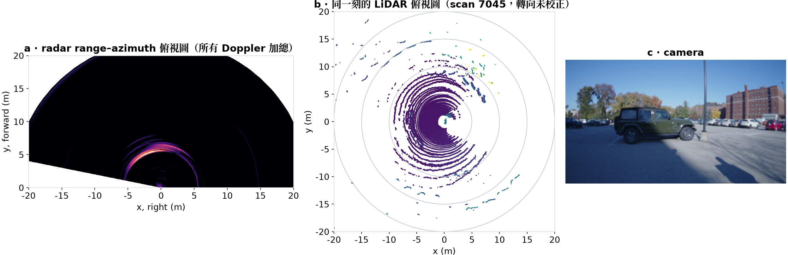

*Figure 2. One radar frame of a parking lot: (a) the radar's range-azimuth top view, the car 5.6 m away is an arc; (b) the LiDAR scan, the same car is a line; (c) the camera.*

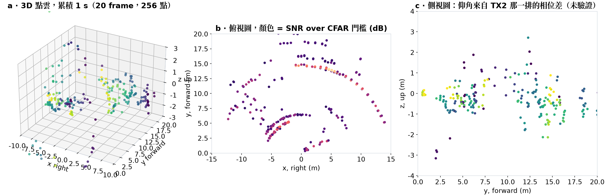

*Figure 3. One second of radar points: (a) in 3D, (b) from above, coloured by SNR, (c) from the side. On a flat lot z spreads over ±3 m: elevation is not usable.*

### 2.3 Related work

- Image-guided upsampling of a low-resolution signal: joint bilateral upsampling \citep{Kopf:JBU:2007}.
- Learned radar–camera depth completion \citep{Long:RCPDA:2021}.
- Learned single-chip radar models trained on this kind of rig \citep{Huang:GRT:2025}.
- LiDAR odometry used for poses \citep{Vizzo:KISSICP:2023}.
- [TODO: 2 to 4 more, each checked before it goes in: edge-aware or weighted-least-squares depth completion; radar imaging with MIMO arrays; multipath in mmWave. N7 in the report plan.]

---

## 3. Hardware and data

*About 0.75 page.*

### 3.1 The rig

- Handheld rig borrowed from the CMU WiSE Lab: TI AWR1843Boost radar with a DCA1000 board for raw ADC, a fisheye camera (1920 × 1080, 30 fps), an Ouster OS0-128 LiDAR (10 Hz, ground truth only), an IMU (100 Hz). The recording software and the fisheye intrinsics come with the rig.
- All four streams share one clock. The radar starts about 2.3 s after the camera, so streams are matched by timestamp, never by frame index.
- Frame intervals: radar 50.0 ms (p99 55.9 ms), LiDAR 100.0 ms, camera 33.3 ms, IMU 10.0 ms.

*Figure 4. To make: photo of the rig (Berlin supplies, N5).*

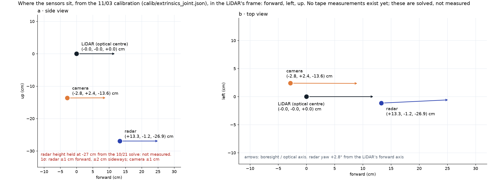

*Figure 5. Where the sensors are relative to each other, from the calibration of section 5.*

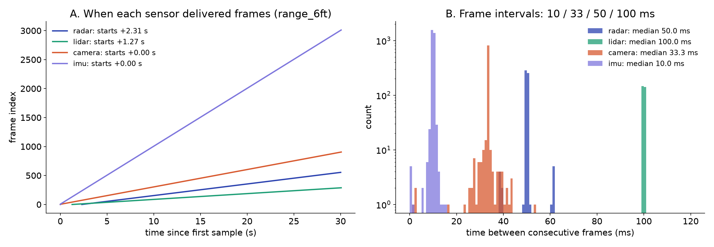

*Figure 6. Frame timing of the four streams: radar 50.0 ms, LiDAR 100.0 ms, camera 33.3 ms, IMU 10.0 ms; the radar starts 2.3 s after the camera.*

### 3.2 Captures

| Date | Traces | Content | Used in |
|---|---|---|---|
| 10/21 | 23 | indoor room: board at taped distances and angles, calibration placements, a room scene | §4.4 |
| 10/29 | 5 | campus, handheld: parking lot with an orbit of a parked car, a statue | §4, §6, §8 |
| 11/03 | 13 | eight calibration board placements; statue orbit, lawn, corridors, a spin | §5, §6, §8 |
| 11/05 | 10 | static scenes with the rig on a stand (lab, outdoors, the statue), a campus walk, a night walk | §7 |
| [TODO] | | night session: the statue static scene at night | §7.4 |

[TODO: check the trace counts and sizes against `SESSIONS.md` before final; 10/19 (two traces, no LiDAR) is left out.]

---

## 4. From raw samples to 3D points

*About 1.5 pages. Three figures at most.*

### 4.1 Range and Doppler

- `radar/iq` is int16, 786,432 bytes per frame, reshaped to [64 chirps, 3 TX, 4 RX, 512]; the last axis interleaves the samples, and unpacking gives 256 complex samples per chirp. The wrong order mirrors the range axis, which is the check.
- Range FFT with a Hann window. Averaging magnitude over 64 chirps and 12 channels lowers the floor about 15 dB. Below 0.35 m (TX–RX leakage) and above 20.5 m (the I/Q mirror of near echoes) are masked.
- Doppler FFT over the 64 chirps. A walking rig spreads the static world over velocity, so later stages sum power over Doppler.

### 4.2 Virtual array and angle

- TDM-MIMO: the three transmitters fire 179 µs apart, so a moving target adds a Doppler-dependent phase to the later transmitters. On a walk it showed as a −1.59 rad jump in the middle of the array; a per-Doppler-bin correction brings it to +0.04 rad.
- Angle: FFT over the eight azimuth elements, zero-padded to 64 bins.

### 4.3 Detection

- Cell-averaging CFAR along range: 8 training and 2 guard cells each side, Pfa = 10⁻³, threshold about 9.4 dB.
- Range-only CFAR keeps every cell of a target's angular lobe (227 detections per frame on the parking lot). Requiring a local maximum in azimuth leaves 12.
- The CFAR threshold assumes exponential noise power. In target-free bins, after removing the static echo, the 99th percentile of power over mean is 4.60 against 4.61 for an exponential.

### 4.4 Accuracy

- **Implementation check.** Each stage agrees with the rig's own signal-processing library, used only as a test oracle, to 6–8 × 10⁻⁸ relative error.
- **Range.** A board at 3, 6, 9 and 12 ft: radar = 0.993 × tape + 0.183 m, residuals within ±1.2 cm.
- **Azimuth.** Aimed at the board's specular point (§5), angle shots held out from the calibration are within 1.5° (mean 0.75°).

Four candidates; the report keeps three.

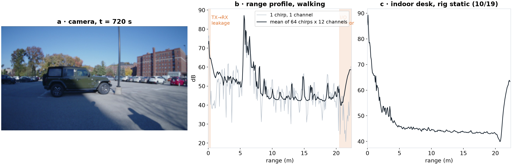

*Figure 7. Range: (a) camera; (b) range profile, one chirp in grey, the mean over 64 chirps and 12 channels in black, the car at 5.6 m and a row of cars at 13–19 m; masked zones shaded.*

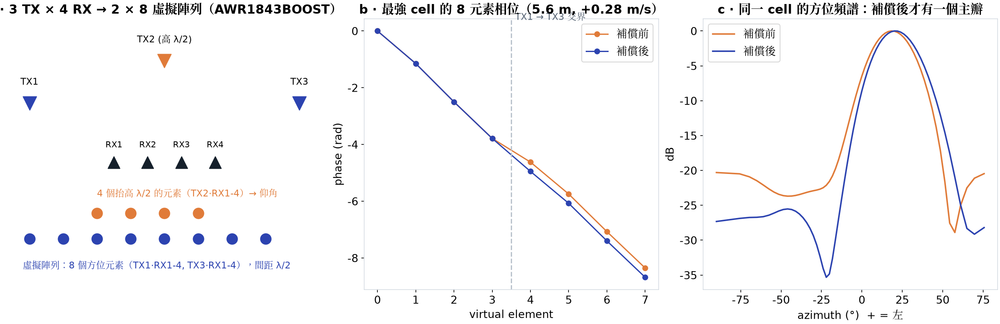

*Figure 8. Virtual array and TDM: (a) 3 TX × 4 RX give a 2 × 8 array; (b) phase across the azimuth row, the kink is the TDM error before correction; (c) the azimuth spectrum after correction.*

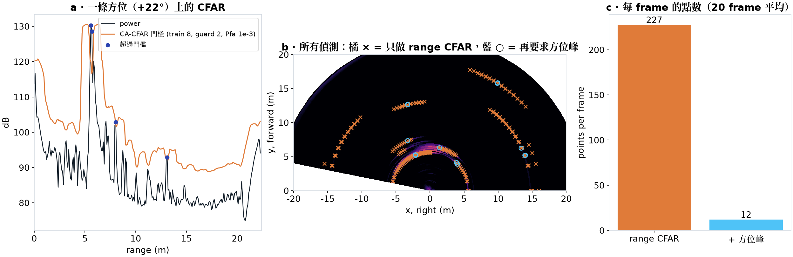

*Figure 9. Detection: (a) one azimuth's range profile and its CFAR threshold; (b) range-only detections form arcs, the azimuth-peak rule keeps 12; (c) 227 to 12 per frame.*

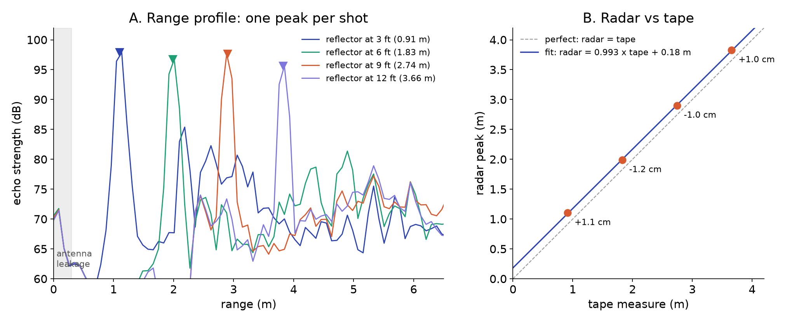

*Figure 10. Range against a tape: one peak per shot, radar = 0.993 × tape + 0.183 m, residuals within ±1.2 cm.*

---

## 5. Calibration

*About 1 page.*

### 5.1 Radar to LiDAR: a flat board is a mirror

- Eight placements of a 0.925 m board, 1.5–3 m, ±41°. The LiDAR fits the board's plane; the radar's return comes from the board's **specular point**, the foot of the perpendicular from the radar onto that plane, not from its centre.
- Modelling this drops the azimuth residual from 2.89° to 0.58° (leave-one-out 3.37° to 0.66°), with range residual 1.6 cm. Result: yaw +92.75° ± 0.71°, t = (−0.133, +0.012) m in the plane.
- The same model explains an earlier ±20° bias on the 10/21 angle shots: aimed at the specular point they are within 0.75° on average, against 4.05° aimed at the board's centre.
- Pitch and roll are fixed at 0 (not observable without radar elevation). The radar's height below the LiDAR is not observable from these shots: the rig's nominal value is about 0.17 m, and an earlier joint solve gave 0.27 ± 0.15 m, which is what the calibration file holds.

### 5.2 LiDAR to camera

- PnP on the board's four corners in the image against the LiDAR's corners: 6.4 px (leave-one-shot-out 7.9 px), against 52 px for the solve before the LiDAR swap. Radar to camera is composed from the two.

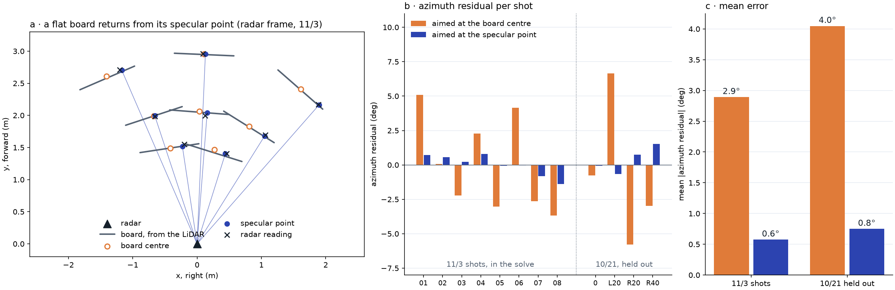

*Figure 11. A flat board returns from its specular point: (a) board planes from the LiDAR, their centres, specular points and the radar's readings; (b) azimuth residual per shot, aimed at the centre or at the specular point; (c) mean error, 2.9° to 0.6° on the calibration shots, 4.0° to 0.8° on held-out shots.*

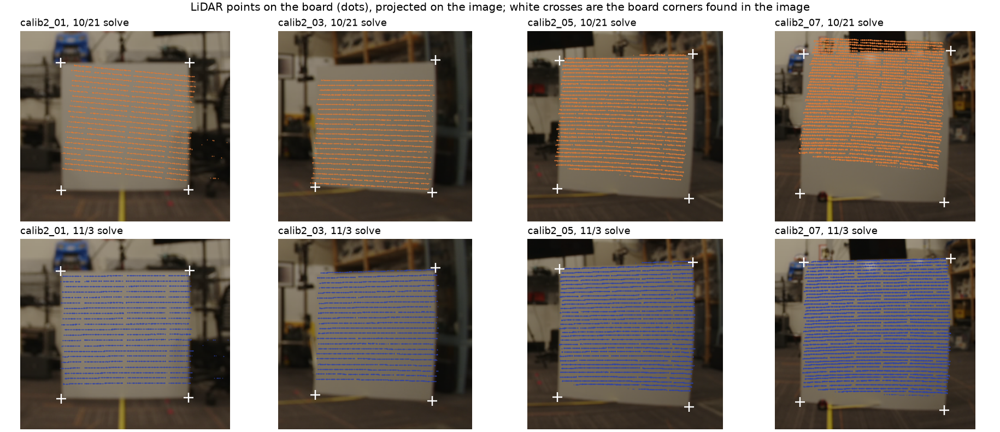

*Figure 12. LiDAR points on the board projected into the camera, under the old solve (top) and this one (bottom); white crosses are the board's corners in the image.*

---

## 6. Accumulation over a handheld walk

*About 1.25 pages.*

### 6.1 Poses

- KISS-ICP \citep{Vizzo:KISSICP:2023} on the 128-beam scans. Three things had to be right: the LiDAR beam geometry (a sign error made odometry diverge within a minute), the deskew (the built-in constant-velocity deskew doubled the path on a handheld rig, so each scan is de-skewed with the IMU gyro instead), and the map range (30 m and 0.3 m voxels instead of the 50 m and 0.5 m defaults).
- Poses are interpolated to radar timestamps. Per-scan jitter is about 0.1 m.

### 6.2 Separating the static world with Doppler

- A static target at azimuth az, seen from a sensor moving with velocity v, has Doppler −v · u(az). Points off that curve are ghosts, sidelobes or moving people.
- Check: the radar's own Doppler ridge against the LiDAR odometry. On the statue orbit the speed agrees within 0.15 m/s on 89 % of moving frames (median difference 0.08 m/s) and the heading within 6°. This one test checks the Doppler axis, the poses, the calibration yaw and the time alignment together.

### 6.3 The accumulated point cloud

| Window | Radar points kept by the static test | Within 0.5 m of a LiDAR surface | LiDAR covered |
|---|---|---|---|
| Parked car orbit, 10/29 (`15-49-40`, 930–1020 s) | 44 % of 23,999 | 91 % | 69 % |
| Statue orbit, 11/03 (`17-01-12`, 30–165 s) | 68 % of 67,106 | 92 % | 71 % |

- The filter removes the cloud inside the orbit: two-bounce ghosts of the car, sidelobes and the person walking alongside. The cost is coverage (81 % to 69 % on the car orbit).
- [TODO: night. The night walk (`2026-11-05.19-11-08`) through the same chain. N4, not run yet.]

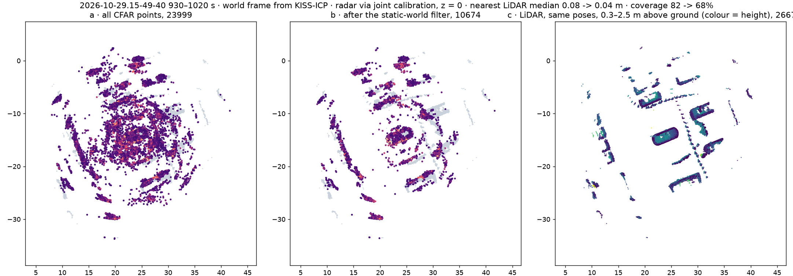

*Figure 13. Orbit of a parked car, 90 s, top view in the world frame: (a) all CFAR points; (b) after the static-world test; (c) the LiDAR with the same poses, 0.3–2.5 m above the ground.*

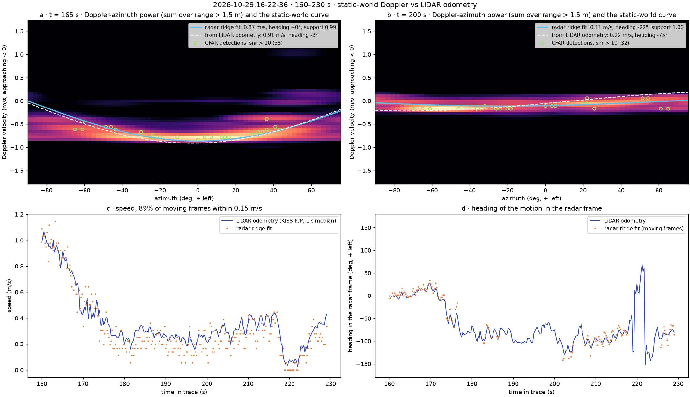

*Figure 14. The radar's Doppler against the LiDAR odometry on a statue orbit: Doppler-azimuth power of two frames with the static-world curve from the radar alone and from the poses; speed and heading over the window from both.*

---

## 7. Camera-guided dense depth

*About 2 pages. One scene: the Scotty statue with the rig on a stand, 11/05 (`2026-11-05.16-34-29`, a second take `16-36-41` for repeatability).*

### 7.1 Seeds: which radar cells to trust

- With the rig still, a surface is detected in the same range–azimuth cell frame after frame. Over 50 s (500 frames), cells hit in at least 30 % of frames with SNR above 10 dB are kept: 21.
- A cell is dropped as an azimuth sidelobe when another cell in the same range bin is more than 12 dB stronger. Per azimuth only the nearest is kept, because the radar sees past an object the camera cannot. 9 seeds remain in the image.
- A seed has no height, so it is drawn at the radar's height: all seeds lie on one image row.
- Checked against the LiDAR at their own pixel: 7 of 9 within 0.35 m, the statue's seed at −0.26 m. The two others are off by −1.8 m and +2.7 m. Second take: 5 of 8 within 0.35 m.

### 7.2 Fills

Five ways to turn one row of seeds into a depth map, from no image at all to fully image-guided:

| Fill | Uses the image? | Rule |
|---|---|---|
| Constant | no | the median seed depth everywhere |
| Nearest column | no | each pixel takes the seed nearest to its column |
| Gaussian | position only | weighted mean of seeds by image distance |
| Joint bilateral \citep{Kopf:JBU:2007} | position and colour | weighted mean by image distance and by colour similarity to the seed's pixel |
| Edge-aware least squares | edges | the seed row is filled by nearest seed, then depth spreads over the image with a smoothness term that is weak across colour edges |

The joint bilateral weight is exp(−Δx²/2σx² − Δy²/2σy²) · exp(−‖ΔLab‖²/2σc²) with σx = 100 px, σy = 320 px (long, because the seeds lie on one row) and σc = 0.08 in Lab/100. The least-squares fill uses edge weights exp(−‖ΔLab‖²/2σ²), σ = 0.05, and λ = 1. These were set by eye on this scene and **not tuned against the LiDAR**.

Point seeds alone are degenerate for a 2D smoothness term (the solution is flat with a dip at each seed), which is why the least-squares fill is anchored on the whole seed row.

### 7.3 Evaluation

- Reference: the LiDAR projected into the image, five merged scans, range from the camera centre. Only pixels more than 0.3 m above the ground are scored; the ground has no seeds and is left out, not solved.
- Regions: all pixels; pixels near a depth edge (a 7 × 7 window of LiDAR depths spanning more than 1 m, grown by 3 px); and the statue, cut out of the LiDAR (points within 0.9 m of its axis), split at 1.05 m into the stone pedestal and the bronze figure on top.

Mean absolute error (m), 0–20 m, take 1 with radar seeds:

| Fill | All above ground | Near depth edges | Statue | Stone pedestal | Bronze figure |
|---|---|---|---|---|---|
| Constant | 1.29 | 2.38 | 3.44 | 3.47 | 3.36 |
| Nearest column | 1.62 | 2.58 | **1.51** | **1.80** | **0.59** |
| Gaussian | 1.41 | 2.52 | 2.05 | 2.17 | 1.69 |
| Joint bilateral | 1.64 | 2.64 | 3.72 | 4.10 | 2.52 |
| Edge-aware least squares | **1.13** | **2.16** | 2.28 | 2.62 | 1.24 |

Take 2 gives the same ranking: statue 1.50 (nearest), 1.91 (Gaussian), 2.78 (joint bilateral), 2.05 (least squares); all pixels 1.74, 1.66, 1.78, 1.35, constant 1.31.

*Figure 15. Scotty, rig on a stand. Top row: the camera with the 9 radar seeds, the statue's pixels from the LiDAR, and the statue's outline, orange where it is distinct from the background in colour and blue where it is similar. Each further row is one fill: its depth (grey, near is white), its error against the LiDAR above the ground, and a close-up of the statue with the same outline. Under each panel: mean absolute error (MAE), the share of pixels within a factor 1.25 of the LiDAR, the error near depth edges and elsewhere, and the share of each outline kept (section 7.5). The constant fill is in the table only.*

Numbers: `experiments/m6-dense-depth/dense_scotty_1105.json`, `dense_scotty_1105_take2.json` and `dense_scotty_1105_upper_bound.json`.

### 7.4 What the numbers say

- **The radar has the statue's depth.** Its seed on the statue is 0.26 m off. Without the image (nearest column) the bronze figure is at 0.59 m error.
- **Colour guidance moved that depth to the wrong surface.** The joint bilateral fill is the worst fill on the statue (3.72 m). In the guide image the bronze figure (median lightness 0.21) is as dark as the windows of the wall 7 m away (0.17 to 0.23 at the wall's seeds beside it) and lighter than the patch at the statue's own seed (0.10); and the stone pedestal (0.44) matches the stone wall (0.43 to 0.60). The colour test therefore picks the wall's seeds for both parts of the statue.
- **The overall average hides this.** The wall covers most pixels, so a constant depth already scores 1.29 m overall and the statue barely moves the overall number.
- **Connectivity instead of colour helps overall but not on the statue.** The least-squares fill is the best overall (1.13 m) and near depth edges (2.16 m), but on the statue it is between nearest column and joint bilateral.
- **Upper bound.** Keeping only the seeds within 0.3 m of the LiDAR (6 of 9; this uses the LiDAR, so it is not a method) barely changes the statue's numbers (joint bilateral 3.72 to 3.24 m, still the worst): the wrong seeds are not what moves the statue's depth.
- **Reading.** Image guidance assumes that similar colour means similar depth. The joint bilateral fill compares each pixel with the seeds' pixels anywhere in its reach, so what matters is whether the object looks like *another seed's* surface, not only like what is right behind it. The bronze figure stands out against the window frames behind it (section 7.5), yet still takes the wall's depth, because it is as dark as the windows at the wall's seeds.

### 7.5 Distinct and similar outlines

Does a fill keep an object's outline better when the outline is visible in colour? The statue has both kinds. Its outline is the closed set of the statue's LiDAR pixels. Each outline pixel gets a colour contrast, the Lab distance between the mean colour within 4 px inside and outside it, and a depth step, the mean LiDAR range outside minus inside. Only outline pixels with a step over 1 m count, which leaves out the base, where the pedestal meets the ground at the same range. The contrast is clearly bimodal (median 6.8, upper quartile 23.8 Lab units). Outline pixels with contrast ≥ 15 are **distinct** (89 px, the bronze figure against the pale window frames). Those below 7 are **similar** (134 px, the stone pedestal against the stone wall).

The score is the **share of the outline kept**: of the pixels within 4 px of an outline class, the share the fill puts on the right side, nearer the statue's range (3.7 m) inside and nearer the wall's (6.6 m) outside. A constant depth gets only the outside right, about 46 %; the LiDAR itself, spread to every pixel from its nearest point, gets 88 % and 91 %.

| Fill | Distinct, take 1 | Distinct, take 2 | Similar, take 1 | Similar, take 2 |
|---|---|---|---|---|
| Constant | 47 % | 47 % | 46 % | 46 % |
| Nearest column | 59 % | 58 % | 46 % | 47 % |
| Gaussian | 66 % | 68 % | 46 % | 46 % |
| Joint bilateral | 67 % | 57 % | 46 % | 44 % |
| Edge-aware least squares | **77 %** | **78 %** | 46 % | 46 % |

- **Where the outline does not show in colour, no fill keeps it.** On the similar outline every fill scores like a constant: all of them give the pedestal's edge the wall's depth.
- **Where it does, the fill that follows colour edges keeps the most.** Least squares keeps 77–78 % in both takes. Joint bilateral is no better than the Gaussian fill, which ignores colour (67 vs 66 %, 57 vs 68 %): a distinct outline helps a fill that asks whether a pixel is *connected* to a seed, not one that asks whether it *looks like* one.
- With seeds picked by the LiDAR (upper bound) the numbers barely move (least squares 76 % / 46 %), so the seeds are not the limit here.
- Limits: one object, two takes of the same scene, 89 and 134 outline pixels. The thresholds come from the gap in the contrast histogram, not from tuning against the LiDAR.

*Figure 16. To make: the same scene at night, same mark (N2).*

[TODO: 7.6 Day and night. The night pair of this scene (N2), same mark. Expected: the radar seeds do not change; the guide image loses its edges, so the joint bilateral fill tends to the Gaussian one. Not recorded yet.]

---

## 8. A learned radar front-end, for comparison

*About 0.75 page.*

- A released checkpoint of a learned single-chip radar model \citep{Huang:GRT:2025}, run unchanged on our traces: raw radar frames in, a 3D occupancy grid (64 elevation × 128 azimuth × 64 range) in the LiDAR's frame out. No training.
- Scored like the classical chain, against the LiDAR as first-return depth:

| Window | Threshold | Chamfer, model to LiDAR / LiDAR to model | Depth error, median |
|---|---|---|---|
| Statue, 10/29 (280 frames) | p > 0.5 | 0.60 / 0.70 m | 2.10 m |
| Statue, 10/29 | p > 0.9 | 0.34 / 0.64 m | 0.70 m |
| Parked car, 10/29 (240 frames) | p > 0.5 | 0.73 / 0.52 m | 1.40 m |
| Statue orbit, 11/03 | p > 0.5 | 0.49 / 0.64 m | 1.40 m |

- **Classical against learned.** The CFAR chain gives 10 to 20 sharp points per frame on the strongest reflectors. The learned model gives a full occupancy that follows walls and the car's outline coarsely and covers the whole field of view, but smeared along range and elevation; at p > 0.5 its first return is biased near by 1–3 m. Raising the threshold trades coverage for accuracy (94 % to 57 % of LiDAR columns, 0.60 to 0.34 m).
- **No calibration was needed** for the model's output, which is already in the LiDAR's frame; a sweep of a residual yaw finds no consistent offset (sensitivity about 3°).

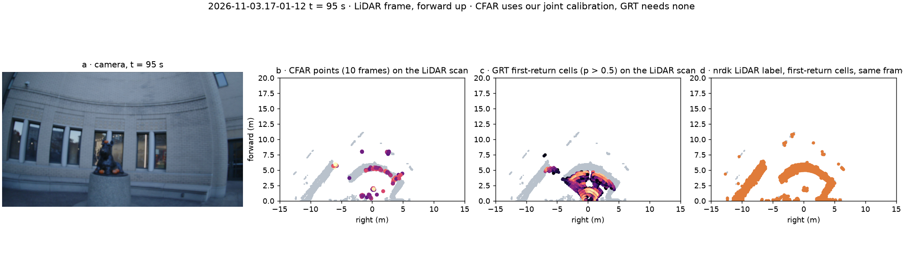

*Figure 17. One instant of the statue orbit: camera; the CFAR points on the LiDAR scan; the learned model's first-return cells on the same scan, with no calibration; the LiDAR label.*

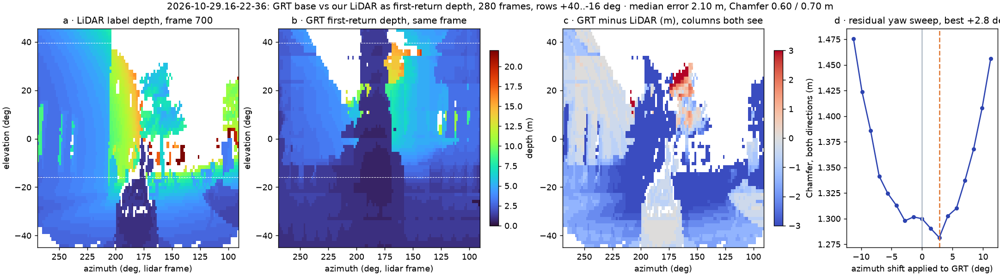

*Figure 18. The learned model against the LiDAR as first-return depth: LiDAR depth, the model's depth, their difference, and the residual-yaw sweep.*

Numbers: `GRT.md` §10.

---

## 9. Discussion and limitations

*About 0.5 page.*

- **Elevation.** Every radar point is placed at the radar's height. This limits the accumulated cloud to a plane and the dense-depth seeds to one image row.
- **Multipath.** A second peak at twice the target's range appears on every range shot (−12.5 dB for the nearest, −22 to −24 dB for the rest); a seed at twice the wall's range was one of the dense-depth failures. Indoors, CFAR points scatter outside the walls (65 cm median to the LiDAR in a corridor, against 7 cm on the statue).
- **Open scenes.** With few reflectors the radar covers little: 23 % of the LiDAR on an open lawn.
- **Calibration** is tested only up to 3 m, and the radar's height is the rig's nominal value, not measured.
- **Dense depth** was evaluated on one scene, with filter parameters set by eye. The ground is excluded, not solved.
- [TODO: night, once N2 and N4 are in.]

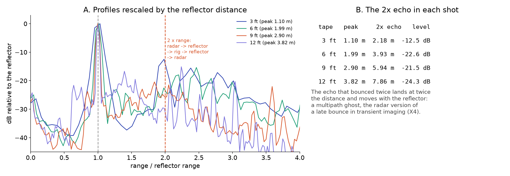

*Figure 19. Range profiles rescaled by the target's distance: the second-bounce echo lines up at twice the range.*

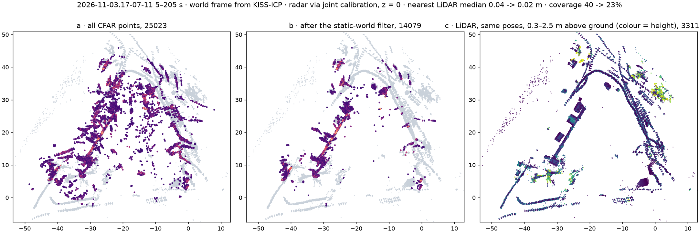

*Figure 20. An open lawn: few reflectors, and the radar covers 23 % of the LiDAR.*

---

## 10. Conclusion

[TODO: about 0.25 page. Three sentences: what was built; what the radar alone gives (metric, light-independent, accurate in range, 14° in angle, flat); what the camera adds and where it misleads (image guidance helps where colour edges and depth edges coincide, and moves correct radar depth to the wrong surface where an object resembles its background).]

---

## References

In `note.bib` today, each checked: Kopf et al. 2007 (joint bilateral upsampling), Rao 2018 (TI MIMO radar application report), Long et al. 2021 (radar–camera depth completion), Huang et al. 2025 (learned single-chip radar model), Vizzo et al. 2023 (KISS-ICP). Template entries not cited are not printed. [TODO: N7.]

---

## Not in this draft

- Results from `src/ext/` and `experiments/obj-orbit-360` (object reconstruction from three sensors): out of the graded report.
- The other static scenes tried for dense depth on 11/11 (an outdoor scene with a car, lab scenes, board placements): the report uses Scotty only.
